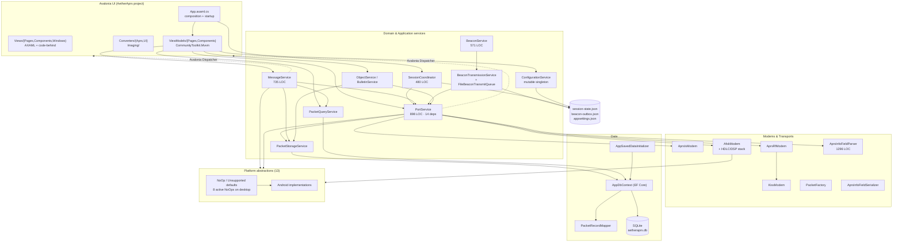
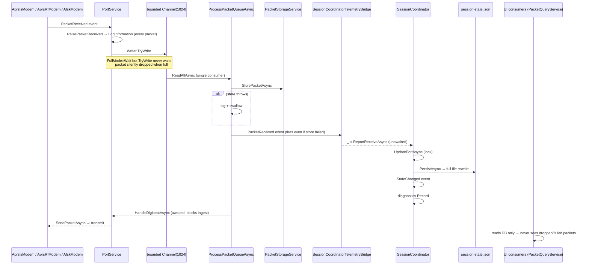
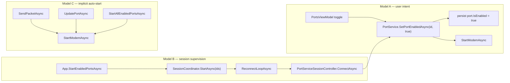
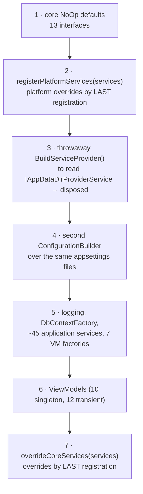
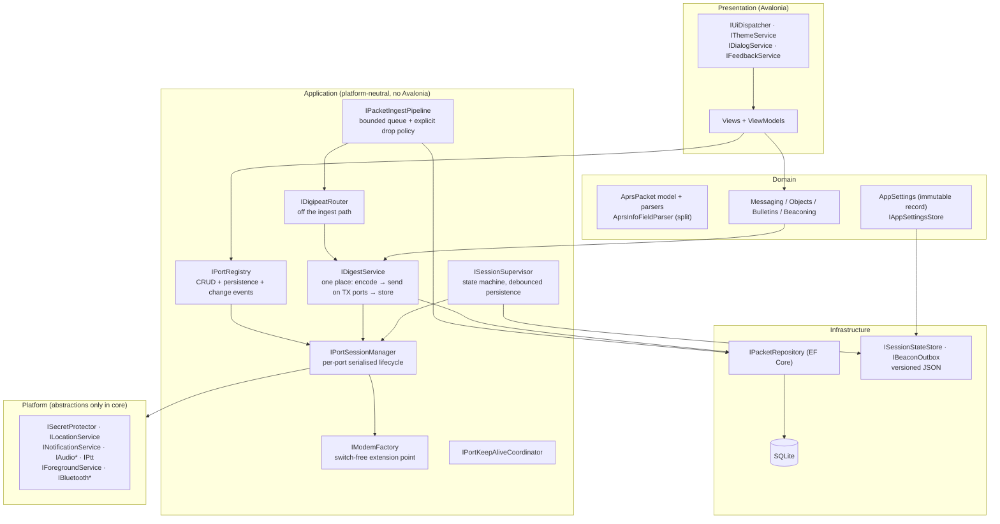
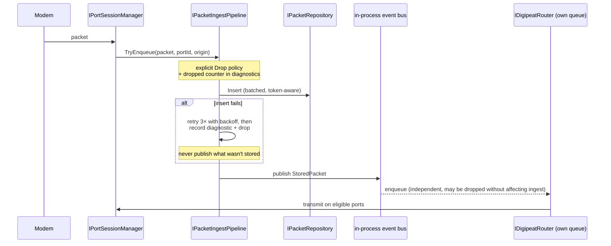
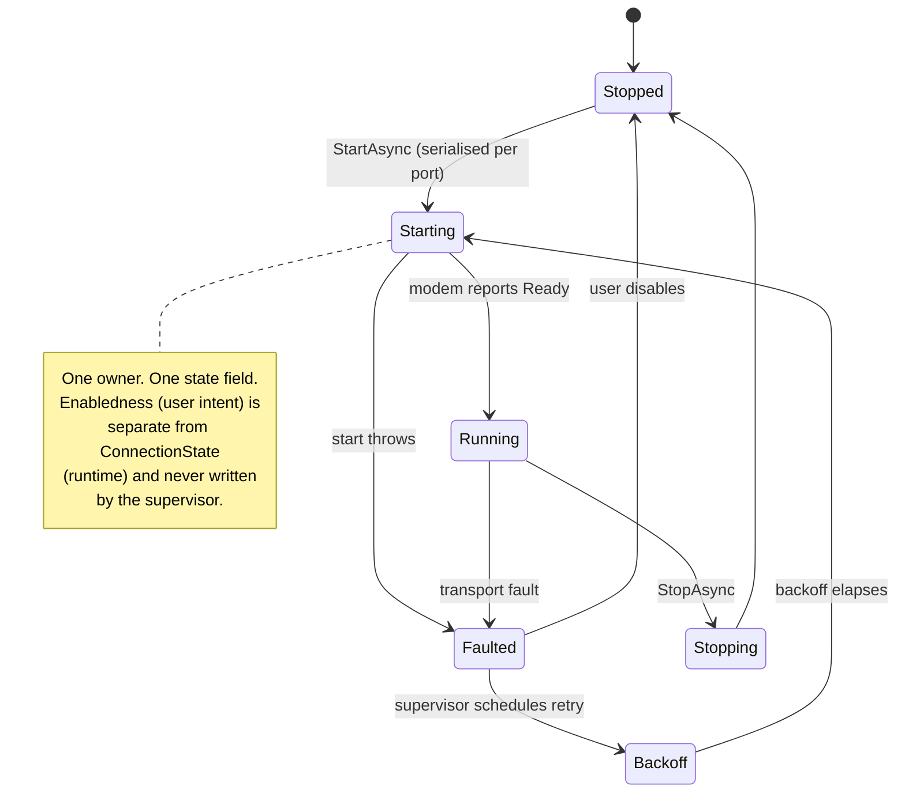
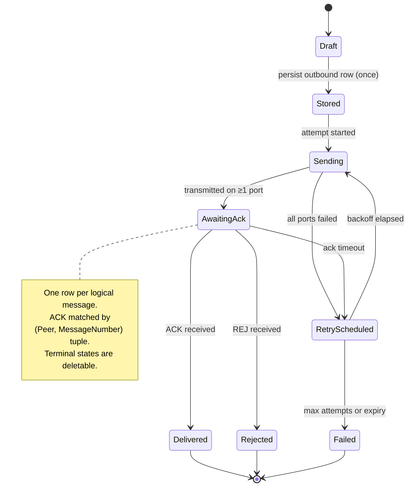

<!--
This file is part of AetherAprs
SPDX-FileCopyrightText: 2026 Rui Oliveira <ruimail24@gmail.com>
SPDX-License-Identifier: CC-BY-SA-4.0
-->

# AetherAprs — Full Architecture & Code Audit

**Audit date:** 2026-11-23
**Commit audited:** `5b6b64f` — "Enhance CI and release automation with dependency scanning, SBOM generation, and security checks; document BLE profile contract for LilyGO T-Echo Plus target."
**Branch:** `main` (working tree clean)
**Scope:** entire repository — `AetherAprs/` (core), `AetherAprs.Android/`, `AetherAprs.Tests/`, `AetherAprs.Android.Tests/`, build/CI, documentation, localization.
**Build state at audit:** `dotnet build AetherAprs.Tests/AetherAprs.Tests.csproj` → **succeeded, 0 warnings, 0 errors** under `TreatWarningsAsErrors=true`, `AnalysisLevel=latest-recommended`, `EnforceCodeStyleInBuild=true`.
**Nature of this document:** an audit log and remediation guide. **No project source, build, or configuration file was modified.** The only file added to the repository is this document.
**Findings:** 195 discrete, each with a location, a required behaviour, and a fix — 15 Critical, 22 Major, 90 Minor, 15 test-suite, 34 platform/Android, 19 view-layer. Every finding ID is defined and referenced; see Appendix E.

---

## Table of contents

1. [Executive summary](#1-executive-summary)
2. [How to read this document](#2-how-to-read-this-document)
3. [Architecture as-is](#3-architecture-as-is)
4. [Architecture to-be (target)](#4-architecture-to-be-target)
5. [Architecture Decision Records](#5-architecture-decision-records)
6. [Findings register — CRITICAL](#6-findings-register--critical)
7. [Findings register — MAJOR](#7-findings-register--major)
8. [Findings register — MINOR](#8-findings-register--minor)
   - [8.1 Duplication and dead code](#81-duplication-and-dead-code) · [8.2 Type design and domain modelling](#82-type-design-and-domain-modelling) · [8.3 Async, cancellation, and lifecycle](#83-async-cancellation-and-lifecycle) · [8.4 Data layer](#84-data-layer) · [8.5 Configuration](#85-configuration) · [8.6 UI / MVVM](#86-ui--mvvm) · [8.7 Diagnostics and logging](#87-diagnostics-and-logging) · [8.8 Build and tooling](#88-build-and-tooling)
   - [8.9 Test-suite quality (T-01..T-15)](#89-test-suite-quality-from-the-test-sub-audit-appendix-a2) · [8.10 Android/platform layer (P-01..P-34)](#810-android--platform-layer-from-the-platform-sub-audit-appendix-a3) · [8.11 Views/AXAML layer (V-01..V-19)](#811-views--axaml-layer-from-the-views-sub-audit-appendix-a1)
9. [Domain deep dives & fix guides](#9-domain-deep-dives--fix-guides)
10. [Positive findings](#10-positive-findings)
11. [Open questions for the maintainer](#11-open-questions-for-the-maintainer)
12. [Phased remediation roadmap](#12-phased-remediation-roadmap)
13. [Appendices](#13-appendices)

   - [A.1 Views / AXAML layer](#appendix-a--specialist-sub-reports) · [A.1.1 Scope](#a11-scope-and-method) · [A.1.2 Bindings](#a12-binding-errors-none-found) · [A.1.3 Localization](#a13-localization-of-the-view-layer-one-string) · [A.1.4 Where it hurts](#a14-where-the-view-layer-actually-hurts) · [A.1.5 What is good](#a15-what-is-genuinely-well-done-in-this-layer)
   - A.2 Test suite: [A.2.1 Infrastructure](#a21-test-infrastructure-quality) · [A.2.2 Coverage](#a22-coverage-map) · [A.2.3 Anti-patterns](#a23-test-quality-anti-patterns) · [A.2.4 Mocking](#a24-mocking-strategy) · [A.2.5 Negative paths](#a25-missing-negative-path-coverage) · [A.2.6 Instrumentation](#a26-aetheraprsandroidtestsinstrumentationtestscs) · [A.2.7 Naming](#a27-naming-and-structure-conformance) · [A.2.8 Flakiness](#a28-top-10-flakiness-risks-ranked-by-probability--impact) · [A.2.9 Scoring](#a29-test-suite-scoring-summary) — register in §8.9
   - A.3 Android/platform: [A.3.1 Scope](#a31-scope-and-baseline) · [A.3.2 Lifecycle](#a32-lifecycle-correctness) · [A.3.3 Permissions](#a33-permission-handling) · [A.3.4 Adapters](#a34-service-adapters) · [A.3.5 Bluetooth](#a35-bluetooth-is-the-ble-path-dead-code) · [A.3.6 FG durability](#a36-foreground-service-durability) · [A.3.7 Security](#a37-security) · [A.3.8 Scoring](#a38-platform-layer-scoring-summary) — register in §8.10
   - [B Localization script](#appendix-b--localization-verification-script) · [C Reproduction commands](#appendix-c--reproduction-commands) · [D Verification log](#appendix-d--verification-log) · [E Finding index](#appendix-e--finding-index)

---

## 1. Executive summary

### 1.1 What this project is

AetherAprs is a .NET 10 / Avalonia 12 APRS client for Android (with a desktop build used for development and testing). It ingests APRS packets from three transport families — APRS-IS over TCP, KISS over TCP/Bluetooth LE/Bluetooth Classic, and an in-process software AFSK modem — parses them into a typed packet model, persists them to SQLite via EF Core, and presents them through an MVVM UI with a Mapsui map, messaging, objects, bulletins and beaconing.

### 1.2 One-sentence verdict

**The codebase is disciplined at the file level and undisciplined at the seam level.** Individual files are readable, documented, null-annotated, warning-clean and license-compliant; the places where those files meet — the composition root, the port/session lifecycle, the persistence ordering contract, and the configuration singleton — are where correctness, durability and testability break down.

### 1.3 Scores

| Dimension | Score | Rationale |
|---|---|---|
| Compiler hygiene | **9/10** | Zero warnings with `TreatWarningsAsErrors`; nullable on; analyzers at `latest-recommended`. |
| License/REUSE compliance | **10/10** | Every file carries SPDX metadata; enforced in CI. Exemplary. |
| Localization completeness | **8/10** | 433 keys × 2 locales, zero missing keys, zero hardcoded strings found in the C# layer. 66 dead keys, 34 untranslated PT values. |
| File-level code quality | **7/10** | Good naming, good XML docs, good use of `record`/`readonly struct`. Heavy comment density occasionally documents workarounds rather than design. |
| Layering / boundaries | **3/10** | Core services reference Avalonia (`Dispatcher.UIThread`, bitmaps). Static service locator. Composition root leaks platform concerns. |
| SOLID / SRP | **3/10** | `PortService` (898 lines, 14 constructor dependencies, 8 responsibilities) is a textbook god class. `PacketFactory` has 7 copy-pasted blocks. |
| Concurrency correctness | **3/10** | Documented check-then-act races, lock-free mutation of shared flags, unobserved fire-and-forget per-packet/per-message tasks, blocking `.Wait()` in production. |
| Durability / data integrity | **3/10** | In-memory-first mutations with no rollback; per-packet JSON rewrite; retries creating unbounded duplicate rows; silent schema-version downgrade; kind-less `DateTime` columns with no UTC convention, so the details pages render UTC as local time (C-15). |
| Performance | **4/10** | Head-of-line-blocked ingest, Information-level logging per packet, single-consumer channel with `TryWrite` drop, hex/string-based position columns with no spatial indexing. |
| Testability | **5/10** | Genuinely substantial: 100 test files with 923 `[Fact]` + 31 `[Theory]` (≈1 014 executed cases), no `Skip`d tests, and real assertions. But `ReceivedBeaconsMapLayerService` (567 LOC) and the entire Android layer (3 087 LOC) have **zero** tests, 44 tests assert only on mock interactions, 8 are tautological, 22 `Task.Delay` sites make the suite timing-dependent (including two **unbounded spin loops**), the shared culture fixture leaks process-global state, and the suite has leaked **408 MB / 14 292 temp directories**. Production APIs were visibly bent to enable tests (`internal` members, dual constructors). See §8.9 and Appendix A.2. |
| Security | **5/10** | Good: passcode encryption hook, diagnostic redaction, signed+attested releases. Bad: fail-open plaintext passcode default, secrets on command lines, `allowBackup` interaction with Keystore, no SBOM despite claiming one. |
| Android/platform fidelity | **3/10** | All 13 platform interfaces have real Android implementations — but the BLE transport cannot carry a real APRS frame (C-11), a Classic BT port cannot be stopped (C-12), the foreground service is capped at 6 h and will be killed (C-13), the Stop action needs a live UI (C-14), the permission service never requests, and background location is unobtainable. See §8.10 and Appendix A.3. |
| Documentation accuracy | **4/10** | Rich prose, but `CODEBASE_STRUCTURE.md` omits 11 source folders, both docs claim 3 projects when there are 4, the csproj references a non-existent `Views/Dialogues/`, the release workflow does not do the SBOM generation the commit message claims, and the BLE profile "contract" checkbox is ticked against a one-sentence document. |
| **Overall** | **4.5/10** | A competent single-developer codebase that needs a deliberate architectural pass before it can absorb more features. |

### 1.4 The six things that actually matter

If only six things are fixed, fix these. Everything else in this document is secondary.

1. **The Android transports must actually work.** This is the only item on the list where the app does not do its job on the only platform it ships. The BLE transport issues one `WriteCharacteristic` per KISS frame with **no MTU negotiation and no chunking** (C-11), so every frame above 20 bytes is silently truncated while reporting success. A Bluetooth Classic port cannot be stopped at all (C-12), because disposal waits on a non-cancellable Java blocking read that only closing the stream would release. The foreground service uses the 6-hour-capped `dataSync` type with no `OnTimeout` override (C-13), so an overnight session is killed. And the Stop notification action cannot reach anything without a live UI (C-14), leaving headless modems behind. All four share one root cause: the transport seam was only ever tested against in-memory and TCP streams.

2. **`PortService` must be split, and modem start must be serialised.** Today two concurrent `StartModemAsync` calls for the same port both pass the "is it already running?" check, both construct a modem, and the second silently overwrites the first in `_activeSessions` — leaking a TCP socket / BLE stream / audio handle and its event subscriptions. This is reachable from five different call sites.

3. **`SessionCoordinator` must stop writing to disk on every packet, and must stop flipping the persisted `IsEnabled` user setting.** Today every received and every transmitted packet calls `PersistAsync`, which rewrites `session-state.json`, raises a UI event, and appends a diagnostic event. On an APRS-IS feed that is thousands of full-file writes per second. Worse, the coordinator's reconnect path reaches `PortService.SetPortEnabledAsync(portId, true)`, which *persists* the change — so a transient network failure permanently rewrites the user's port configuration.

4. **Message retries must not create a database row per attempt.** `MessageService` stores an outbound packet row on every send attempt, each with `DeliveryStatus = Pending`, and the cleanup logic treats `Pending` rows as never-deletable. A message that retries twenty times leaves twenty immortal rows; `UpdateMessageStatusAsync` then updates only the highest-id one, leaving the rest `Pending` forever.

5. **The configuration singleton must be immutable to readers.** `IConfigurationService.Settings` is a publicly mutable object graph shared across every service; `GetSettingsSnapshot()` is a hand-written 90-line deep clone that silently drops any property a future developer forgets to add; and a settings file written by a *newer* version is silently re-stamped as the current version on the next save, destroying the downgrade signal.

6. **Timestamps must survive the round trip.** Packet timestamps are stored as a kind-less `DateTime`, read back from SQLite as `Unspecified`, and then displayed by a converter that only converts `Kind == Utc` — so the raw UTC value renders as local time. The details pages are therefore off by the operator's UTC offset in every non-UTC timezone, with no error (the list page is correct, so the same packet shows two different times in two places). It is a one-file hotfix or a small data-layer convention (C-15), and it is on this list because it is wrong on every install everywhere outside UTC.

*(Not on this list: "core must not depend on Avalonia" (M-16, ADR-002). It remains a real layering violation and is scheduled in Phase 2, but the four Android transport defects outrank it — a layering violation makes future change harder, while those four mean the shipped app does not work.)*

### 1.5 Effort estimate

| Phase | Work | Estimated effort |
|---|---|---|
| 0 | Guardrails: build/CI/test infrastructure so refactors are safe | 2–3 days |
| 1 | Stop the bleeding: the core critical findings, minimally invasive | 5–8 days |
| 2 | Extract `PortService` into 7 collaborators | 5–7 days |
| 3 | Persistence & configuration correctness | 4–6 days |
| 4 | UI/ViewModel layer + test coverage | 6–10 days |
| 5 | Platform/Android hardening (incl. the four Critical transport/service findings) | 8–11 days |
| 6 | Documentation, docs-as-code, ADR backfill | 2–3 days |
| | **Total** | **32–48 developer-days** |

This is not a rewrite. Roughly 70% of the C# is sound; the work is concentrated in about a dozen files plus their call sites, and — on the Android side — in four files with four specific defects.

Ordering note: Phase 5 is the only phase whose findings make the shipped product not work. If the project has a release deadline, **run the transport items of Phase 5 first** (C-11, C-12, C-13, C-14 are roughly 5–7 days of the total) and defer Phase 2/3 until after. The roadmap is presented in dependency order, not importance order — Phase 0 remains mandatory either way because it is what makes the rest verifiable.

---

## 2. How to read this document

### 2.1 Severity definitions

| Level | Meaning | Action |
|---|---|---|
| **Critical** | Produces wrong behaviour, data loss/corruption, resource leaks, security exposure, or crashes under reachable conditions. | Must fix before the next feature branch. |
| **Major** | Blocks change, hides bugs, or degrades performance/durability without currently producing incorrect output. | Fix within the next 2–3 iterations. |
| **Minor** | Friction, duplication, inconsistency, dead code, doc drift. | Batch into a cleanup branch. |
| **Positive** | A pattern worth preserving and propagating. | Do not regress. |
| **Question** | The repository does not make the intent clear; a decision is needed. | Answer before fixing the related finding. |

### 2.2 Finding format

Every finding carries:

- **ID** — stable reference (`C-04`, `M-11`, `m-03`, `T-02`, `P-07`, `V-05`).
- **Location** — `File.cs:line` for the primary site, plus secondary sites.
- **Symptom** — what a user or operator observes.
- **Root cause** — the design or code decision responsible.
- **Impact** — why it matters, and how bad it gets under load.
- **Fix** — ordered, concrete steps, with code sketches where they clarify.
- **Verify** — the test or observation that proves the fix worked.
- **Effort** — S (< 2h), M (half day), L (1–2 days), XL (> 2 days).

The full Critical and Major findings (§6, §7) use that long form. The 90 minor findings (§8.1–§8.8), the 15 test-suite findings (§8.9), the 34 platform findings (§8.10) and the 19 view-layer findings (§8.11) use a condensed table form (`ID | Location | Finding | Fix | Effort`) because their fixes fit in one line. Registered prefixes: `C-` critical, `M-` major, `m-` minor, `T-` test suite, `P-` platform/Android, `V-` views/AXAML. The `P-01..P-04` identifiers are aliases of `C-11..C-14` — the same four findings, numbered for continuity in both registers.

### 2.3 Line numbers

Line numbers refer to commit `5b6b64f`. They will drift; treat them as "closest match" and search by the quoted symbol.

---

## 3. Architecture as-is

### 3.1 Component view



Dotted edges are the boundary violations: core application services reaching back into the UI framework.

### 3.2 Receive data flow (as implemented)



Three problems are visible in this diagram alone: the packet is announced to consumers whether or not it was stored; the digipeat path (which performs network I/O) is on the ingest critical path; and persistence-to-disk happens per packet.

### 3.3 Port lifecycle (two overlapping models)



There are **three** distinct things that start a port, all reaching `StartModemAsync` without mutual exclusion, and Model B reaches Model A — meaning a reconnect retry rewrites the persisted user setting. `PortService.StartAllEnabledPortsAsync()` exists but is not called from the composition root, so it is dead-ish code that would reintroduce the race if wired.

### 3.4 Dependency-injection registration order (the "precedence by position" design)



Two different override mechanisms with opposite precedence (`registerPlatformServices` wins by being second; `overrideCoreServices` wins by being last) and no documentation of which wins when both touch the same interface.

---

## 4. Architecture to-be (target)

### 4.1 Target component view



Key differences from as-is: no Avalonia reference below `Presentation`; no god class; explicit `IDigestService` replacing four copies of "send on all TX ports then store"; `IDigipeatRouter` off the ingest critical path; a platform-feature capability probe.

### 4.2 Target receive flow



### 4.3 Target port lifecycle (single model)



The critical conceptual change: **enabledness is user intent and lives in settings; connection state is runtime and lives in the supervisor.** They must never write to each other.

---

## 5. Architecture Decision Records

The repository contains **no ADRs today** (`DOCS/wiki/Production-Grade-Design-Sheet.md` is a requirements/checklist document, not an architecture record). These ADRs document the decisions this audit recommends, including the ones already implicitly taken. They are written as ready-to-commit files under `docs/adr/`.

---

### ADR-001: Separate user intent from runtime state for ports

**Status:** Proposed (replaces an undocumented implicit decision)

**Context**
AetherAprs has one persisted flag, `PortConfig.IsEnabled`, and three ways to start a port (`PortsViewModel` toggle, `App.StartEnabledPortsAsync` → `SessionCoordinator`, and implicit auto-start from `SendPacketAsync`/`UpdatePortAsync`). `SessionCoordinator.ReconnectLoopAsync` reaches `PortServiceSessionController.ConnectAsync`, which calls `PortService.SetPortEnabledAsync(portId, true)` — persisting `IsEnabled = true`. A transient TCP failure therefore rewrites user configuration, and a port the user disabled can be silently re-enabled by a retry loop.

**Decision**
Introduce two independent concepts:

- `PortConfig.IsEnabled` — **user intent only**. Mutated exclusively from a user action (the ports page toggle, or the add/edit form). Never mutated by any supervisor, health check, or retry path.
- `PortConnectionState` — runtime only (`Stopped`, `Starting`, `Running`, `Faulted`, `Backoff`), owned by `IPortSessionManager`, persisted only as a diagnostic snapshot and never read back as intent.

`ISessionPortController.ConnectAsync` becomes a pure runtime operation that does not touch the registry.

**Alternatives considered**
- *Keep one flag and accept the coupling.* Rejected: a network fault must not be indistinguishable from a user decision, and the current behaviour is a silent data-integrity violation of a persisted setting.
- *Add an `IsDesiredRunning` flag alongside `IsEnabled`.* Rejected: two flags create a third ambiguity (which wins on startup?) and do not fix the write path.

**Consequences**
- Positive: retries can no longer corrupt user configuration; `IsEnabled` becomes an honest setting; the ports UI can show "enabled but failing" which is the information users actually need.
- Negative: one migration to ensure existing `IsEnabled` values are preserved as intent, and the supervisor must be given an explicit "desired ports" set at startup instead of reading `IsEnabled` opportunistically.
- New invariant to enforce in review: **no code path below the ViewModel layer may write `PortConfig.IsEnabled`.**

---

### ADR-002: Application services must not reference the UI framework

**Status:** Proposed (fixes an existing violation)

**Context**
`AetherAprs/AetherAprs.csproj` targets `net10.0` and hosts both application services and the Avalonia UI. As a result:

- `Services/Messaging/MessageService.cs` imports `Avalonia` and `Avalonia.Threading` and marshals with `Dispatcher.UIThread` (guarded by `Application.Current is null`, so tests silently take a different code path).
- `Services/UI/ReceivedBeaconsMapLayerService.cs` and `Services/UI/UserLocationLayerService.cs` construct Mapsui/Avalonia objects.
- `Imaging/AprsSymbolBitmapProvider.cs` and `Imaging/AprsSymbolMapConverter.cs` create and dispose `Bitmap`s.
- `Factories/ServiceProviderFactory.cs` registers `AvaloniaUiDispatcher.Instance` by reaching into a static.

Consequences: services are not unit-testable without an Avalonia application, the desktop and Android builds diverge, and UI thread affinity mistakes are only discoverable at runtime.

**Decision**
Split the core project into two assemblies:

1. `AetherAprs.Core` (`net10.0`, **no** Avalonia/Mapsui package reference) — models, parsers, modems, services, data, platform abstractions.
2. `AetherAprs` (`net10.0`) — Avalonia app, views, view models, converters, imaging, map layers. References `AetherAprs.Core`.

Any service that needs to touch the UI thread takes the existing `IUiDispatcher` abstraction. Any service that produces presentation artefacts (map layers, bitmaps) moves to `AetherAprs`.

Enforce with an architecture test (e.g. `NetArchTest` or a simple reflection/assembly-reference test) asserting `AetherAprs.Core` has no reference to `Avalonia*`, `Mapsui*`, or `Material.*`.

**Alternatives considered**
- *Keep one project and rely on discipline.* Rejected: it has already failed — 4 files and the composition root violate it today, and the compiler cannot help.
- *Interface everything (e.g. `IBitmapFactory`).* Rejected as over-engineering: the services that need bitmaps are genuinely presentation services and belong in the UI assembly.

**Consequences**
- Positive: services become testable on plain `net10.0` without `Avalonia.Headless`; the layering rule becomes machine-enforced; `Dispatcher.UIThread` disappears from application code.
- Negative: a project split touches every `using` and the `.slnx`; a one-time namespace move.
- Migration risk: moderate. Do it after Phase 1 (see roadmap), not first.

---

### ADR-003: Split `PortService` into collaborators

**Status:** Proposed

**Context**
`Services/Ports/PortService.cs` is 898 lines with 14 constructor dependencies and implements `IPortService`, `IPortServiceTelemetry` and `IAsyncDisposable`. It performs: port CRUD, in-memory state and its lock, persistence and passcode encryption, modem construction for three transport families (twice duplicated per family), session bookkeeping, packet queueing, packet storage, digipeating, keep-alive/foreground-service ref counting, telemetry eventing, and disposal ordering. Every bug in this audit's Critical section that is *not* in configuration or messaging is in this file.

**Decision**
Decompose into seven collaborators behind narrow interfaces:

| Collaborator | Responsibility | Owns |
|---|---|---|
| `IPortRegistry` | port CRUD, in-memory list, change events, persistence | `_ports`, the registry lock |
| `IPortSessionManager` | modem lifecycle, per-port serialisation, session map | `_activeSessions`, one `SemaphoreSlim` per port |
| `IModemFactory` | `IAprsModem Create(PortConfig)` | the 3-way `switch` on `TypeSettings` |
| `IPacketIngestPipeline` | bounded queue, consumer, storage, publish, drop policy | the channel and its consumer task |
| `IDigipeatRouter` | decide and perform digipeat relays, own queue | digipeat policy |
| `IPortKeepAliveCoordinator` | ref-counted foreground service acquisition | `_portsKeepAliveActive` |
| `IDigestService` | "encode once, send on every TX port, store" | the 4 duplicated TX loops |

`IPortService` survives as a thin façade for compatibility (adding/updating/removing/reordering ports and raising events) and is deleted once call sites migrate.

**Alternatives considered**
- *Leave it and add tests.* Rejected: the concurrency defects are structural (check-then-act across an `await`) and cannot be tested away.
- *Split only the modem code out.* Rejected as insufficient: the ingest pipeline and the digipeat coupling are equally damaging.

**Consequences**
- Positive: each collaborator is independently testable; the double-start race becomes impossible by construction (one owner of the session map, per-port lock); `IModemFactory` closes the Open/Closed hole for new transports.
- Negative: more interfaces and more DI registrations; a temporary period with both old and new abstractions.
- Sequencing: mechanical, low-risk if done in the order Registry → SessionManager+Factory → Ingest → Digest → Digipeat → KeepAlive, each behind green tests.

---

### ADR-004: One digest path for all outbound packets

**Status:** Proposed

**Context**
Four services implement "iterate every enabled TX port, send, then persist", each slightly differently:

- `MessageService.SendMessagePacketAsync` — stores *before* send, one row per port, no failure aggregation.
- `ObjectService.TransmitAndStoreAsync` — sends *then* stores.
- `BulletinService.TransmitAndStoreAsync` — sends *then* stores.
- `BeaconTransmissionService.TransmitBeaconAsync` — enqueues to a durable outbox *then* sends *then* stores, with a third identical copy in `SendInitialBeaconOnPortActivationAsync` that skips the outbox entirely.

The ordering inconsistency is itself the bug: `MessageService`'s store-before-send plus a retry loop produces a new `Pending` row per attempt, and because `PacketStorageService.IsSafeToDelete` protects `Pending` rows, they accumulate forever.

**Decision**
Introduce `IDigestService` with a single method:

```csharp
Task<DigestResult> SendAsync(
    AprsPacket packet,
    DigestOptions options,           // store-before-send? require-ack? allow-no-tx-port?
    CancellationToken cancellationToken);
```

`DigestResult` reports per-port outcomes (`Guid PortId, DigestOutcome Outcome, Exception? Error`) so callers can distinguish "sent on 1 of 3 ports" from "not sent at all". Exactly one row is written per packet per port, *after* a successful or attempted send, with a terminal `DeliveryStatus` — never a fresh `Pending` row per retry attempt.

**Alternatives considered**
- *Fix each call site independently.* Rejected: it is the duplication that produced the divergence; a fifth call site will diverge again.
- *Always store-before-send (durable outbox).* Preferred for beaconing (which already has an outbox) but wrong for interactive messaging, where a stored-but-never-sent row misleads the UI. Hence `DigestOptions`.

**Consequences**
- Positive: one place to reason about TX ordering, partial failure, and persistence; `Pending` rows become bounded by real in-flight messages.
- Negative: `DigestOptions` risks becoming a god-object; constrain it to three booleans and review any addition.

---

### ADR-005: Configuration is immutable; settings updates are explicit writes

**Status:** Proposed

**Context**
`IConfigurationService.Settings` exposes a **mutable** `AppSettings` graph on a singleton. `SettingsViewModel.SaveSettings` mutates ~20 properties in place and only then takes the internal semaphore to write — so the read-modify-write is not atomic despite the class documentation advising otherwise. `GetSettingsSnapshot()` is a hand-written 90-line deep clone that will silently omit any future property. A settings file from a newer app version is re-stamped with the current `SchemaVersion` on the next save, erasing the only downgrade signal. There are four save paths, one of them dead.

**Decision**

1. Make `AppSettings` and all nested settings types **immutable records** with `init` setters and `with`-based updates.
2. Replace the mutable `Settings` property with:
   - `AppSettings Current { get; }` — an immutable reference, safe to read from any thread, atomically swapped.
   - `Task<SettingsUpdateResult> UpdateAsync(Func<AppSettings, AppSettings> mutate, CancellationToken ct)` — single writer, serialised, validates and persists, then swaps.
3. Delete `GetSettingsSnapshot()`; consumers hold an immutable snapshot by construction.
4. On load, if the on-disk `SchemaVersion` is **greater** than the running version, treat the file as read-only and refuse to save (or save to a side file). Never silently re-stamp.
5. Collapse to exactly one save path.
6. Validate with `IValidateOptions<AppSettings>` / DataAnnotations, replacing throwing property setters (which currently force `Bind` into a swallow-all `try/catch` and abort binding of every property after the first bad one).

**Alternatives considered**
- *Keep mutable settings, add a lock around every read.* Rejected: a lock cannot protect a graph that callers hold a reference to; `with`-based records make the race impossible.
- *Use `IOptionsMonitor<T>`.* Considered, but the app needs file-backed persistence with schema migration, which `IOptionsMonitor` does not provide; it can be layered on top later.

**Consequences**
- Positive: eliminates a whole class of torn-read and lost-update bugs; adds a real downgrade guard; removes 90 lines of fragile clone code.
- Negative: every `_configurationService.Settings.X` read site must be revisited (mechanical, ~40 sites); `with` expressions for nested settings are verbose without helper builders.

---

### ADR-006: Reject silent degradation of platform capabilities

**Status:** Proposed

**Context**
Core registers a NoOp or "Unsupported" default for all 13 platform interfaces and lets the platform override them. On the desktop/test target, eight platform services are NoOps in production: `ILocationService`, `IPermissionService`, `IForegroundService`, `ICompassService`, `INotificationService`, `IAudioStreamService`, `IAudioPlaybackService`, `IPttService`; two are "Unsupported" (`IBluetoothLeScanner`, `IBluetoothClassicDeviceProvider`); and `ISecretProtector` resolves to `PlaintextSecretProtector`, which stores APRS-IS passcodes in plaintext. Nothing at runtime reports any of this — the app silently behaves differently, and `KeepAliveService` logs "Started keep-alive foreground service" when no such service exists.

**Decision**
Add `IPlatformCapabilities`, populated at startup by asking each interface whether it is a real implementation. Expose the result:

- to the UI — disable or annotate the features that cannot work (a beaconing toggle with no location service must say *why*);
- to the support report — so a bug report states "desktop build, no location service, no notification service, keystore absent";
- to the log — one Information line at startup listing degraded features.

Ensure `PlaintextSecretProtector` **fails loudly**: on any target where a real protector is expected, refuse to start (or refuse to store a passcode) rather than silently persisting a secret in the clear.

**Alternatives considered**
- *Remove the desktop target.* Not acceptable: it is the development and test surface.
- *Make NoOps throw `NotSupportedException`.* Rejected: it breaks the desktop build entirely instead of degrading it honestly.

**Consequences**
- Positive: users and maintainers can see what is degraded; the silent-mode-failure class of bug becomes visible; the passcode default becomes fail-closed.
- Negative: one more registration and a startup probe; the UI must handle "capability missing" states, which is real work.

---

### ADR-007: Explicit, observable backpressure and drop policy for ingest

**Status:** Proposed

**Context**
`PortService` creates a bounded `Channel` with `FullMode = BoundedChannelFullMode.Wait` but enqueues with `TryWrite`. `TryWrite` never waits regardless of `FullMode`, so once 1024 packets are queued, every subsequent packet is dropped with only a `LogWarning`. Drops are invisible in diagnostics and in the UI. Separately, `ProcessPacketAsync` publishes `PacketReceived` **even when the storage insert failed**, so consumers act on packets that were never persisted while every UI surface reads from the database — a divergence that shows up as "the map/message list does not contain what the notification said".

**Decision**

1. Make the drop policy explicit and configurable: block for the producer (`WriteAsync` + cancellation) for transports that can afford it (APRS-IS, TCP KISS), drop-oldest for transports that cannot (RF), each documented.
2. Count drops per port and expose them through diagnostics and the support report.
3. **Never publish a packet that was not stored.** On storage failure, retry a bounded number of times, then record a diagnostic and drop — do not raise `PacketReceived`.
4. Move digipeating off the ingest queue.

**Alternatives considered**
- *Unbounded channel.* Rejected: a burst on a busy APRS-IS feed would grow memory without limit on a mobile device.
- *Block the modem's receive loop.* Correct for TCP (natural TCP backpressure) but stalls a shared audio/RF modem; hence per-transport policy.

**Consequences**
- Positive: drops become a measured, explainable event instead of a silent log line; the "notified but not stored" divergence disappears.
- Negative: `WriteAsync` on the ingest path means a slow database can apply backpressure to a TCP read loop — which is the correct behaviour, but it changes timing and needs a load test.

---

### ADR-008: Persistence ordering is a contract, not a convention

**Status:** Proposed

**Context**
`PortService.AddPortAsync` mutates `_ports` and *then* persists; `RemovePortAsync` removes from memory and *then* deletes from the database; `SetPortEnabledAsync` mutates the live `PortConfig` and then persists, reverting on failure with a second write. Each of these leaves memory and database divergent when the write throws, and each has a different ordering. `AddPortAsync` also catches `InvalidOperationException` from `SaveChangesAsync` to detect a duplicate insert, which will also swallow unrelated programming errors.

**Decision**
Adopt and document one rule: **commit to the durable store first, then update in-memory state, then raise change events.** Use a shared transaction where a mutation spans multiple writes. Replace the exception-type-based duplicate detection with an explicit pre-check plus a unique index and a typed `DuplicatePortException`.

**Alternatives considered**
- *Update memory first and roll back on failure.* Rejected: rollback of a mutated shared graph is harder to get right than ordering the write correctly, and it still leaves a window where readers see uncommitted state.

**Consequences**
- Positive: no divergence; failures leave a consistent state; the duplicate-detection hack disappears.
- Negative: `PortRegistry` methods become `async` all the way through the mutation (they already are at the boundary); event ordering must be re-verified by tests.

---

### ADR-009: One owner per disposable dependency

**Status:** Proposed (documents an existing, inconsistent convention)

**Context**
Ownership of injected disposables is inconsistent across the codebase:

- `AprsRfModem` explicitly does **not** dispose the `KissModem` it was given (documented).
- `AfskModem` **does** dispose the `_audioStream` it was given.
- `AprsSymbolMapConverter` disposes the `AprsSymbolBitmapProvider` it was given.
- `PortService` must dispose the wrapper *and* the `KissModem` in the right order, an obligation encoded nowhere but in `ActivePortSession`.

**Decision**
A type **owns** what it constructs and **does not own** what is injected, with exactly one exception: when it takes ownership as part of a documented factory contract. Encode this as: constructors never dispose their arguments; factories return `(instance, ownership)` or the caller wraps in a dedicated owner type. The DI container is the owner for anything it resolves.

**Alternatives considered**
- *Let injected services dispose their dependencies.* Rejected: it disposes a singleton out from under other consumers.

**Consequences**
- Positive: removal of the double-dispose / premature-dispose class of bug; `AfskModem` and `AprsSymbolMapConverter` must stop disposing their injected dependency (and their call sites must dispose what they created).
- Negative: a small amount of extra ceremony where a sub-graph really is owned.

---

### ADR-010: Structured logging at a per-packet rate budget

**Status:** Proposed

**Context**
`CA1848` (use `LoggerMessage` delegates) and `CA1873` (avoid expensive logging arguments) are both disabled in `.editorconfig`. As a direct result: `PortService.RaisePacketReceived` logs at **Information** for every packet including `packet.Raw`; `AprsRfModem` logs a **Warning** per unknown packet with the full raw frame; `SendPacketAsync` computes `AprsInfoFieldSerializer.FormatInfoField(packet)` purely to log it.

**Decision**

1. Re-enable `CA1848` and introduce source-generated `LoggerMessage` partial methods for all hot-path logs.
2. Re-enable `CA1873`.
3. Rule: no log statement on the packet path above `Debug`, and `Debug` logs must use source-generated delegates so arguments are not evaluated when the level is off.
4. Remove the "compute the info field only to log it" pattern entirely — the serializer call is both wasted work and a latent exception source for packet types the serializer does not support.

**Consequences**
- Positive: measurable CPU and allocation reduction on the ingest path; log volume becomes usable on a real feed.
- Negative: `LoggerMessage` boilerplate; a small set of new partial classes.

---

### ADR-011: Version every persisted JSON document

**Status:** Proposed

**Context**
`appsettings.json` carries a `SchemaVersion` with migration and quarantine logic. `session-state.json` (`SessionSnapshot`) and `beacon-outbox.json` (`BeaconQueueItem`) carry no version field and use `JsonSerializerDefaults.Web`. A corrupt `session-state.json` throws `JsonException` out of `SessionCoordinator.InitializeAsync`; `FileBeaconTransmitQueue.Load` swallows `JsonException` and returns an empty list, silently discarding the entire outbox.

**Decision**
Every persisted document gets a `schemaVersion` field, a migration function, and a quarantine-and-default policy on parse failure (never a silent discard, never an unhandled throw). Add a round-trip contract test per document type.

**Consequences**
- Positive: forward/backward compatibility becomes thinkable; corruption becomes a diagnosable event instead of data loss.
- Negative: three small migration functions and tests.

---

### ADR-012: Localization keys are verified at build time

**Status:** Proposed

**Context**
433 keys exist in both locales, 367 are referenced, and **66 are dead**. Some keys are constructed at runtime (`AddEditPortViewModel.GenerateDefaultPortName` selects `"DefaultAprsIsPortName"`/`"DefaultKissPortName"` in a variable; several enum converters concatenate a prefix with an enum name), so no static scan can verify them. `Strings.Get` returns the key itself on a miss, so a typo ships silently as a UI label reading `ValidationSsidRange`.

**Decision**
Replace runtime key construction with typed accessors, and verify references at build time:

- Enum-derived keys become a converter over an explicit `IReadOnlyDictionary<EnumValue, string Key>` — no concatenation.
- `GenerateDefaultPortName` uses two literal `Strings.Format` calls, not a variable key.
- Add a build-time generator/hook that parses `Strings.resx` and every reference and fails the build on (a) a referenced key that does not exist and (b) optionally, an unreferenced key.

**Consequences**
- Positive: a class of silent UI defects disappears; dead keys become visible and removable.
- Negative: a small generator or a `targets` step; converters need a small refactor.

---

### ADR-013: Ship SBOM and provenance as release artefacts, or stop claiming them

**Status:** Proposed (resolves a documented-but-absent capability)

**Context**
The audited commit message says it adds "SBOM generation", and `DOCS/wiki/Production-Grade-Design-Sheet.md:338` asserts "Dependencies, licenses, vulnerability results, SBOM, and build provenance are recorded for each release". `release-apk.yml` produces an APK, a SHA-256, and a build-provenance attestation — **there is no SBOM step anywhere in `.github/`**. The same file hard-codes `AndroidSdkBuildToolsVersion=34.0.0` while the verification step picks the newest installed build-tools, and signing passwords are passed as command-line MSBuild properties.

**Decision**
Either add the SBOM (e.g. `dotnet tool` CycloneDX or `anchore/sbom-action`) and attach it to the release plus `actions/attest-sbom`, or remove the claim from the design sheet. Also: pin action SHAs, move signing secrets to environment-driven properties, and assert exactly one produced APK instead of selecting heuristically.

**Consequences**
- Positive: the security posture matches its documentation; release verification becomes deterministic.
- Negative: one more workflow step.

---

### ADR-014: Architecture and decisions live in the repository

**Status:** Proposed

**Context**
There is no architecture document, no ADR directory, no `CONTRIBUTING.md`, and `CODEBASE_STRUCTURE.md` omits eleven source folders (`Services/Diagnostics`, `Services/Objects`, `Services/Bluetooth`, `Imaging`, `Helpers`, `Extensions`, `Behaviors`, `Styles`, `Localization`, `Modems/Afsk`, `Transports/Kiss`). Both `AGENTS.md` and `CODEBASE_STRUCTURE.md` say the solution has three projects; `AetherAprs.slnx` lists four. `AetherAprs.csproj` contains a `<Compile Update>` entry for `Views\Dialogues\AddEditPortDialogView.axaml.cs`, a directory that does not exist.

**Decision**
Maintain `docs/adr/` (starting with this set), regenerate `CODEBASE_STRUCTURE.md` from the actual tree, and keep a short `docs/ARCHITECTURE.md` with the diagrams in sections 3 and 4 of this document. Add a doc-drift check to CI (e.g. a script asserting every directory under the core project appears in `CODEBASE_STRUCTURE.md`).

**Consequences**
- Positive: new contributors and agents stop being misled; the documentation becomes trustworthy.
- Negative: a small maintenance obligation, mitigated by the CI check.

---

## 6. Findings register — CRITICAL

Fifteen critical findings. Each is reachable in production, and each produces wrong behaviour, data loss, a resource leak, or a security exposure.

C-01 through C-10 are platform-neutral core defects. C-11 through C-14 are Android-layer defects found by the platform sub-audit (§8.10, Appendix A.3) and promoted here because they defeat the application's primary function on its primary target platform. C-15 is a data-layer defect found by the views sub-audit (Appendix A.1) and promoted here because the two details pages render a wrong value in a user-visible field on every install, in every non-UTC timezone, with no error.

---

### C-01 · Double-start race leaks a modem, its socket, and its event subscriptions

**Location**
`AetherAprs/Services/Ports/PortService.cs:486-612` (`StartModemAsync`)

**Symptom**
After repeated port toggling, editing a running port, or an auto-start during a send, the device holds more open TCP connections than configured ports; Android shows repeated "connection" state churn; the log shows two "Started modem for port …" lines for one port. Eventually sockets are exhausted and all ports fail.

**Root cause**
The guard and the mutation are separated by an `await`, and they are in different `lock` scopes:

```csharp
// L488-495 — check
lock (_stateLock)
{
    if (_activeSessions.ContainsKey(port.Id))
    {
        _logger.LogDebug("Port {PortId} … is already running.", port.Id, port.Name);
        return true;
    }
}
// … await … construct modem, Start(), subscribe …
// L532-540 — act
lock (_stateLock)
{
    _activeSessions[port.Id] = new ActivePortSession { … };
}
```

Between L495 and L532 there is an `await _kissStreamFactory.OpenAsync(kiss)` (L547) and, for APRS-IS, an entire modem construction. Two callers can both pass the check. The second `_activeSessions[port.Id] = …` **overwrites** the first `ActivePortSession`, so the first modem is never stopped or disposed: its `TcpClient`, its read loop, its `CancellationTokenSource` and its two event subscriptions all leak. Its `PacketReceived` handler also stays subscribed, so one port's packets are delivered twice.

Five reachable call sites, none of which exclude one another:

- `SetPortEnabledAsync:225` (user toggle)
- `SendPacketAsync:291` (implicit auto-start when sending)
- `UpdatePortAsync:182` (editing a port restart it)
- `StartAllEnabledPortsAsync:361` (legacy bulk start)
- `SessionCoordinator.ReconnectLoopAsync:331` → `PortServiceSessionController.ConnectAsync:16` → `SetPortEnabledAsync`

**Impact**
Resource leak (file descriptors, threads, audio handles), duplicate packet delivery, duplicated outbound transmission when the phantom session's modem is used by `SendPacketAsync` (which resolves through `_activeSessions`, so it might target the *leaked* modem), and unbounded growth across a long-running foreground service.

**Fix**
Own the session map with per-port serialisation, and make the check and the insert atomic with respect to each other.

1. Add a per-port gate to `ActivePortSession` bookkeeping, or a dedicated `ConcurrentDictionary<Guid, SemaphoreSlim>` guarded by the same lock that owns the map.

```csharp
private readonly Dictionary<Guid, SemaphoreSlim> _startGates = [];

private async Task<SemaphoreSlim> GetGateAsync(Guid portId)
{
    lock (_stateLock)
    {
        if (!_startGates.TryGetValue(portId, out var gate))
        {
            gate = new SemaphoreSlim(1, 1);
            _startGates[portId] = gate;
        }
        return gate;
    }
}

private async Task<bool> StartModemAsync(PortConfig port)
{
    var gate = await GetGateAsync(port.Id);
    await gate.WaitAsync(_disposalCts.Token).ConfigureAwait(false);
    try
    {
        lock (_stateLock)
        {
            if (_activeSessions.ContainsKey(port.Id))
            {
                return true;
            }
            // Reserve the slot so a second caller cannot proceed.
            _activeSessions[port.Id] = ActivePortSession.Reserved(port.Id);
        }

        ActivePortSession session;
        try
        {
            session = await CreateSessionAsync(port).ConfigureAwait(false); // construct + Start + subscribe
        }
        catch
        {
            lock (_stateLock) { _activeSessions.Remove(port.Id); }
            throw;
        }

        lock (_stateLock) { _activeSessions[port.Id] = session; }
        return true;
    }
    finally
    {
        gate.Release();
    }
}
```

2. Introduce a `Reserved` marker (or a `PortSessionState.Starting` entry) so `SendPacketAsync` knows a start is in flight rather than treating the port as absent. Alternatively have `SendPacketAsync` await the same gate.

3. Delete `StartAllEnabledPortsAsync` (dead from the composition root; `SessionCoordinator` owns bulk start now) or reimplement it as a loop over `SetPortEnabledAsync`.

4. Make `StopModemAsync` take the same gate so stop and start cannot interleave.

**Verify**
A deterministic test: a fake `IKissStreamFactory` whose `OpenAsync` blocks on a `TaskCompletionSource`; call `SetPortEnabledAsync(id, true)` twice concurrently; release both; assert the factory's create count is **1**, `PortService` reports exactly one session, and no modem instance was abandoned (assert the fake recorded exactly one `Start()` and that any second instance would have been `Dispose`d).

**Effort** M

---

### C-02 · Session supervision rewrites the user's persisted port configuration

**Location**
`AetherAprs/Services/Ports/PortServiceSessionController.cs:16-20`
`AetherAprs/Services/Ports/SessionCoordinator.cs:311-366` (`ReconnectLoopAsync`)
`AetherAprs/Services/Ports/PortService.cs:207-242` (`SetPortEnabledAsync`)

**Symptom**
A user disables a port. After the app observes a transport fault on *any* port, or after a reconnect attempt, the disabled port is enabled again on the next launch. Alternatively: a port that keeps failing causes the settings to be rewritten repeatedly (two disk writes per attempt), and `PortsChanged` fires repeatedly.

**Root cause**
The coordinator's connection lifecycle is implemented by delegating to the *user intent* API:

```csharp
// PortServiceSessionController.cs:16-20
public Task ConnectAsync(Guid portId, CancellationToken cancellationToken) =>
    portService.SetPortEnabledAsync(portId, true);

public Task DisconnectAsync(Guid portId, CancellationToken cancellationToken) =>
    portService.SetPortEnabledAsync(portId, false);
```

And `SetPortEnabledAsync` persists:

```csharp
// PortService.cs:220-230
port.IsEnabled = enabled;
// … save to DB …
// on failure: port.IsEnabled = !enabled; save again
```

So `ReconnectLoopAsync` → `ConnectAsync` → `IsEnabled = true` → SQLite write. The retry loop, whose entire purpose is transient network recovery, has a permanent side effect on configuration.

**Impact**
Silent configuration corruption; extra database writes per retry; `PortsChanged` storms that rebuild the whole ports list UI; and a hard-to-reproduce user complaint ("my port keeps turning itself back on") which no current test covers.

**Fix**
Follow ADR-001. Concretely:

1. Change `ISessionPortController` to a runtime-only contract:

```csharp
public interface ISessionPortController
{
    Task<ISessionHandle> ConnectAsync(Guid portId, CancellationToken cancellationToken);
    Task DisconnectAsync(Guid portId, CancellationToken cancellationToken);
}
```

2. Implement it against `IPortSessionManager.StartAsync`/`StopAsync` (from ADR-003), never against `SetPortEnabledAsync`.

3. `SetPortEnabledAsync` keeps its persistence but loses its "also starts/stops the modem" responsibility — the caller (PortsViewModel) calls both:

```csharp
await _portService.SetPortEnabledAsync(id, enabled);        // intent
await _sessionSupervisor.SetDesiredAsync(id, enabled);      // runtime
```

4. Add a test asserting `PortConfig.IsEnabled` is unchanged after N synthetic faults.

**Verify**
Test: enable a port, inject a fault via `ReportPortFaultAsync`, let the reconnect loop run twice, reload configuration from the store, assert `IsEnabled` still equals the user's value. Also assert the settings store received **zero** writes during the reconnect storm.

**Effort** M

---

### C-03 · Every packet triggers a full-file JSON rewrite plus a UI event plus a diagnostic event

**Location**
`AetherAprs/Services/Ports/SessionCoordinator.cs:379-396` (`UpdatePortAsync`) → `:422-458` (`PersistAsync`)
`AetherAprs/Services/Ports/SessionCoordinatorTelemetryBridge.cs:39-60`

**Symptom**
On a busy APRS-IS feed the app becomes sluggish, storage grows, and battery drain is high. Profiling shows sustained disk I/O. On Android, `session-state.json` is rewritten continuously.

**Root cause**
The telemetry bridge subscribes to *every* packet event and calls an unawaited `_ = ObserveCoreAsync(...)` per event:

```csharp
// SessionCoordinatorTelemetryBridge.cs:57-60
private void ObserveAsync(Func<Task> operation, string observation, Guid portId) =>
    _ = ObserveCoreAsync(operation, observation, portId);
```

`ObserveCoreAsync` → `ReportReceiveAsync`/`ReportTransmitAsync` → `UpdatePortAsync` → **`PersistAsync`**, which:

1. snapshots under lock,
2. `await _persistGate.WaitAsync()`,
3. `await _stateStore.SaveAsync(snapshot, …)` → `FileSessionStateStore.SaveAsync` → create temp file, `JsonSerializer.SerializeAsync` the whole snapshot, flush, `File.Move`,
4. then raises `StateChanged`,
5. then appends a `DiagnosticEvent`.

On an APRS-IS feed at even 20 packets/s that is 20 full file writes/second, 20 UI events/second, and 20 diagnostic entries/second (the diagnostic store is bounded at 256, so it holds ~13 seconds of history — making the support report useless on exactly the busy feeds where support is needed). Each write also allocates a `Guid`-named temp path and performs a rename.

Additionally, `ObserveAsync` does not await, so nothing bounds the number of in-flight writes: they pile up behind `_persistGate`.

**Impact**
Severe battery and flash-wear cost; UI churn; the diagnostic store is flooded with meaningless entries; and the "durable session state" is written so often it becomes a wear concern rather than a safety net.

**Fix**

1. **Debounce and coalesce.** Replace write-per-update with a dirty flag plus a timer/`PeriodicTimer`:

```csharp
private volatile bool _dirty;
private readonly TimeSpan _persistInterval = TimeSpan.FromSeconds(5);

private async Task PersistenceLoopAsync(CancellationToken ct)
{
    using var timer = new PeriodicTimer(_persistInterval);
    while (await timer.WaitForNextTickAsync(ct).ConfigureAwait(false))
    {
        if (!_dirty) continue;
        _dirty = false;
        await PersistNowAsync(ct).ConfigureAwait(false);
    }
}
```

2. **Persist on transition, not on increment.** Only mark dirty when a port's `State` changes, or on `StopAsync`, or every N minutes for the timestamp fields. `LastReceiveUtc`/`LastTransmitUtc` are diagnostics, not state; if they must survive a restart, persist them at the debounce interval above, not per packet.

3. **Separate the UI event from persistence.** Raise `StateChanged` from the debounce tick (or only on state transitions), not from `PersistAsync`.

4. **Stop recording a diagnostic event per persist.** `_diagnostics?.Record("session", …, "Session state persisted.")` at `:449-457` should fire on transitions only.

5. **Make the bridge's fire-and-forget bounded.** Prefer a small `Channel` consumed by one task over unbounded `_ = Task` fan-out. Even with debouncing, unbounded fan-out is a latent problem.

**Verify**
A load test: fake modem feeding 1000 packets/s for 10 seconds through `PortService`; assert the `ISessionStateStore` recorded ≤ 4 `SaveAsync` calls (5-second debounce over 10 s, plus stop) instead of 10000. Assert `StateChanged` fired once.

**Effort** M

---

### C-04 · Message retries create unbounded, never-deletable database rows

**Location**
`AetherAprs/Services/Messaging/MessageService.cs:179-232` (`SendMessagePacketAsync`), `:426-497` (`ProcessRetries`), `:520-556` (`UpdateMessageStatusAsync`), `:210`
`AetherAprs/Data/Mappers/PacketRecordMapper.cs:118`
`AetherAprs/Services/Packets/PacketStorageService.cs` (`IsSafeToDelete`)

**Symptom**
The packet database grows without bound on a device that mainly sends messages over a flaky link. The messages list shows duplicates. `PacketQueryService` queries slow down. Old outbound messages never get pruned.

**Root cause**
Every send attempt stores a new row:

```csharp
// MessageService.cs:210
await _packetStorageService.StorePacketAsync(packet, port.Id, isOutbound: true, cancellationToken)…
```

and the mapper hard-codes the status, ignoring the real one:

```csharp
// PacketRecordMapper.cs:118
DeliveryStatus = isOutbound ? MessageDeliveryStatus.Pending : null,
```

`ProcessRetries` re-sends by calling the same send path, which stores **another** row. With `MaximumRetries` up to 20 and up to N TX ports, one undeliverable message can produce 20 × N rows, all `Pending`.

`UpdateMessageStatusAsync` then resolves the row with:

```csharp
// MessageService.cs:537-547
var record = await db.Packets…OrderByDescending(p => p.Id).FirstOrDefaultAsync();
```

so only the most recent row is updated. All earlier rows stay `Pending` forever — and `PacketStorageService`'s cleanup explicitly protects `Pending` rows, so they are immortal.

**Impact**
Unbounded database growth, duplicated rows in the message history, slow queries, and a misleading delivery state (the UI shows the latest row's status while earlier rows say pending). Combined with ACK handling this can also mis-associate an ACK with the wrong row.

**Fix**

1. **One row per logical message.** Store the outbound row once, when the message is created (before the first attempt), and thereafter *update* it.

```csharp
// on first send of a StoredMessage
var packetRecordId = await _packetStorageService.StorePacketAsync(
    packet, portId, isOutbound: true, cancellationToken);

// on every subsequent attempt
await _packetStorageService.UpdateOutboundDeliveryAsync(
    packetRecordId,
    status,                    // Pending | Sent | Delivered | Failed
    attemptCount,
    nextRetryUtc,
    cancellationToken);
```

2. **Make the mapper accept the status** instead of inferring it:

```csharp
public static PacketRecord ToRecord(
    AprsPacket packet,
    Guid? portId,
    bool isOutbound,
    MessageDeliveryStatus? deliveryStatus = null) =>
        …
        DeliveryStatus = isOutbound
            ? deliveryStatus ?? MessageDeliveryStatus.Pending
            : null,
```

3. **Use the highest id only for legacy recovery**, and additionally mark older `Pending` rows for the same `(peer, messageNumber)` as `Superseded` during migration.

4. **Bound retries by expiry, not by count alone.** `BeaconQueueItem` already has `ExpiresUtc`; give the message retry path the same and mark expired rows `Failed` so cleanup can reclaim them.

5. **Alternative (preferred long-term):** separate `OutboundMessage` persistence from `Packet` persistence. A sent message is a packet *event*; a message with retry state is *application state*. Today they are the same row, which is why retry bookkeeping fights packet retention.

**Verify**
Test: a fake port service that always throws; send one message; let the retry scheduler run 5 attempts; assert exactly **one** `PacketRecord` exists for it, with `AttemptCount == 5` and status `Failed` after max attempts. Assert cleanup (`IsSafeToDelete`) can delete it once terminal.

**Effort** M

---

### C-05 · Storage failure still publishes the packet to consumers

**Location**
`AetherAprs/Services/Ports/PortService.cs:721-760` (`ProcessPacketAsync`)

**Symptom**
A notification appears for a message that does not exist in the conversation list. The map shows a marker that disappears after a refresh. A received packet cannot be found in the packets page. Under database pressure (SQLite busy, disk full) this happens for many packets at once.

**Root cause**

```csharp
try
{
    await _packetStorageService.StorePacketAsync(packet, portId, isOutbound: false, _disposalCts.Token)…
}
catch (OperationCanceledException) { }
catch (Exception ex)
{
    _logger.LogError(ex, "Failed to store packet from {Source}", packet.Source);
}

// L738-745 — unconditionally
try
{
    PacketReceived?.Invoke(this, new PortPacketReceivedEventArgs { PortId = portId, Packet = packet });
}
```

Consumers (`MessageService.OnPacketReceived`, `ReceivedBeaconsMapLayerService`, `PacketsViewModel`, search) all *read the database* to render. So the event says "packet arrived" while the database says "no such packet". The two views of the world diverge permanently.

**Impact**
Ghost notifications, inconsistent UI, and — worse — `MessageService` sends an ACK for a message it could not persist, so the sender believes delivery succeeded while the receiver has no record.

**Fix**

1. **Do not publish unstored packets.** Restructure:

```csharp
var stored = await TryStoreWithRetryAsync(packet, portId, cancellationToken).ConfigureAwait(false);
if (!stored)
{
    _diagnostics.Record("ingest", DiagnosticSeverity.Error, "Dropped",
        "Packet could not be persisted.", portId.ToString("N"));
    _droppedPacketCount.Add(1);
    return;
}
PublishStored(packet, portId);
```

2. `TryStoreWithRetryAsync` retries a bounded number of times with backoff for *transient* `SqliteException` codes (`SQLITE_BUSY`, `SQLITE_LOCKED`), and does not retry programming errors.

3. If the process cannot persist at all (disk full, database corrupt), surface that as a first-class degraded state — not as per-packet log spam.

**Verify**
Test: a storage service that throws; feed one packet; assert `PacketReceived` does **not** fire, assert a diagnostic event was recorded, assert the drop counter incremented. Then feed a transient-failure storage that succeeds on the second attempt; assert the event fires exactly once.

**Effort** S–M

---

### C-06 · Digipeating runs on the ingest critical path and blocks packet receipt

**Location**
`AetherAprs/Services/Ports/PortService.cs:762-826` (`HandleDigipeatAsync`), called from `:752-759` inside `ProcessPacketAsync`

**Symptom**
When a digipeat-eligible packet arrives, all subsequent inbound packets on *every* port are delayed by the RF transmit time. On a busy feed with digipeating enabled, the queue fills and packets are dropped (see C-07). Transmit stalls cause receive backlog.

**Root cause**
`ProcessPacketQueueAsync` has a **single** consumer, and `ProcessPacketAsync` awaits `HandleDigipeatAsync` before returning:

```csharp
await foreach (var queued in _packetChannel.Reader.ReadAllAsync(_disposalCts.Token))
{
    await ProcessPacketAsync(queued.PortId, queued.Packet);   // includes digipeat + transmit
}
```

`HandleDigipeatAsync` then awaits `SendPacketAsync` per target port — a KISS write, a BLE write, or an AFSK audio transmission (which can take seconds on an RF channel). While that is in flight the reader is not draining the channel. So **RF transmit latency throttles receive ingest for all ports**.

**Impact**
Head-of-line blocking across unrelated ports; queue overflow and silent drops; a slow AFSK transmission can stall an APRS-IS ingest for seconds. This is the primary cause of the perceived "the app freezes on busy networks".

**Fix**

1. Decouple: publish the stored packet, then enqueue a digipeat candidate into a *separate* bounded channel with a separate consumer.

```csharp
// ingest consumer
await StoreAsync(...);
PublishStored(...);
_digipeatQueue.Writer.TryWrite(new DigipeatCandidate(portId, packet)); // never awaited

// digipeat consumer (separate task)
await foreach (var candidate in _digipeatQueue.Reader.ReadAllAsync(ct))
{
    try { await _digipeatRouter.RelayAsync(candidate, ct); }
    catch (Exception ex) { _logger.LogError(ex, "Digipeat relay failed."); }
}
```

2. Give transmit its own serialisation per port (`IPortSessionManager` already owns a per-port gate after C-01), so concurrent digipeat and beacon transmissions queue behind the gate rather than corrupting each other.

3. Add a transmit timeout so a stuck modem cannot wedge the digipeat consumer indefinitely.

**Verify**
Test: a modem whose `SendAsync` blocks; feed one digipeat-eligible packet then 100 ordinary packets; assert all 100 are stored within a bounded time (not blocked on the send). Assert digipeat eventually completes.

**Effort** M

---

### C-07 · Bounded channel uses `TryWrite` with `FullMode.Wait`, silently dropping packets

**Location**
`AetherAprs/Services/Ports/PortService.cs:89-94` (`CreateBounded`), `:693-699` (`RaisePacketReceived`)

**Symptom**
Under load, packets are lost with no user-visible indication and only a warning log line. Statistics show far fewer stored packets than the feed is delivering.

**Root cause**

```csharp
// L89-94
_packetChannel = Channel.CreateBounded<QueuedPacket>(new BoundedChannelOptions(1024)
{
    FullMode = BoundedChannelFullMode.Wait
});

// L693-699
if (!_packetChannel.Writer.TryWrite(new QueuedPacket(portId, packet)))
{
    _logger.LogWarning("Packet queue full; dropping packet from {Source} on port {PortId}.", …);
}
```

`FullMode` only governs `WriteAsync`. `TryWrite` returns `false` immediately when full regardless of `FullMode` — so `Wait` is misleading and packets are dropped the moment the queue is saturated. Combined with C-06 (the consumer is blocked on transmit), saturation is easy.

**Impact**
Silent data loss. A digipeater/igate that drops packets under load is functionally broken; the user has no signal that it is happening.

**Fix**
Per ADR-007:

1. Choose the policy explicitly. For TCP transport, blocking is correct (TCP provides the backpressure). For RF/audio, dropping newest (or oldest) is correct but must be counted.
2. Replace `TryWrite` with `await Writer.WriteAsync(item, ct)` on paths where blocking is acceptable, and `TryWrite` on paths where it is not — with a **counter** in both cases.
3. Expose `_droppedPacketCount` (per port) via diagnostics and the support report.
4. Size the queue from a setting rather than a magic 1024.

**Verify**
Test: fill the queue to capacity with a stalled consumer; assert drops are counted and reported; assert no unbounded memory growth. Then assert that with the correct policy a burst is fully delivered.

**Effort** S

---

### C-08 · Passcodes fall back to plaintext storage; the protector is optional

**Location**
`AetherAprs/Services/Ports/PortService.cs:70-71`, `:84`, `:457-462`
`AetherAprs/Services/Platform/PlaintextSecretProtector.cs:10-17`
`AetherAprs/Factories/ServiceProviderFactory.cs` (default registration)

**Symptom**
On the desktop target, and in any build where the Android `ISecretProtector` is not registered, APRS-IS passcodes are written to SQLite **in cleartext** and the log line gives no warning that this happened.

**Root cause**
Three compounding decisions:

```csharp
// PortService.cs:70-71 — optional dependency
ISecretProtector? secretProtector = null,
…
// PortService.cs:84
_secretProtector = secretProtector ?? new PlaintextSecretProtector();
```

1. `ISecretProtector` is an **optional** constructor parameter on a production service.
2. When absent, a **plaintext** protector is silently substituted.
3. `PlaintextSecretProtector.IsProtected` always returns `false`, so `LoadPortsAsync`'s migration path (which re-protects unprotected values) is a no-op and never signals anything.

A fail-open security default.

**Impact**
Credential exposure. The APRS-IS passcode authenticates the station to the network; a passcode stored plainly on a shared desktop/machine (or in a DB backup, or in the `allowBackup` payload — see m-24) is a real, if low-value, secret leak. Worse, it is silent: nothing tells the operator the protection is absent.

**Fix**

1. Make `ISecretProtector` **required** on `PortService` (remove the default and the null-coalesce).
2. Introduce `NullSecretProtector` that **throws** on `Protect`/`Unprotect` with a clear message, registered only for targets where secrets are impossible (e.g. tests that do not touch passcodes).
3. On any target where a passcode will be persisted and no real protector exists, either refuse to save the passcode (store empty and require re-entry) or surface a prominent degraded-capability warning (ADR-006).
4. Move protection ownership out of the call site: `PortRecordMapper.ToRecord` currently takes a pre-protected passcode as a side-channel argument (`PortService.cs:457-462`). Let the mapper/repository own encryption via an injected protector so a caller cannot forget.

**Verify**
Test: construct `PortService` without a protector → assert construction throws (or that `AddPortAsync` with an `AprsIsSettings` port surfaces the degraded state). Test: with a fake protector, assert the persisted value is not the plaintext.

**Effort** S

---

### C-09 · Configuration can be silently downgraded, destroying the schema version

**Location**
`AetherAprs/Services/Configuration/ConfigurationService.cs:178`, `:139-153`, `:293-355`

**Symptom**
A user runs a newer build (higher `SchemaVersion`), then downgrades. The newer file is overwritten in the older format's shape, and on the next upgrade the newer-version field is gone. Or: settings silently lose a subset of values.

**Root cause**

```csharp
// L178 — unconditional
Settings.SchemaVersion = SettingsSchema.CurrentVersion;
```

The load path warns when the document version is greater than the running version (`L139-145`) but then **unconditionally stamps the current version** onto the in-memory object — and any subsequent save writes that back, erasing the "this file came from a newer build" signal. There is no read-only mode.

Compounding it: `Bind(Settings)` is wrapped in a swallow-all `try/catch` (`L169-176`), so one invalid value aborts binding the *rest* of the properties with no indication which failed — because validation is implemented as **throwing property setters** in `AprsSettings`, `AprsIsSettings` and `AfskSettings`. And there are four save paths (`SaveSettingsAsync`, `UpdateSettingsAsync`, `SaveLockedAsync`, `SaveSettingsSync`), one of which (`SaveSettingsSync`, `L362-381`) is dead.

**Impact**
Silent configuration loss on downgrade; partially bound configuration on upgrade; unrunnable migration debugging because failures are swallowed.

**Fix**

1. If `documentVersion > CurrentVersion`: load read-only, set `IsReadOnly = true`, refuse all writes, and tell the UI to show "settings were written by a newer version". Do not overwrite.
2. Only stamp `SchemaVersion = CurrentVersion` **after a successful migration** and only when `documentVersion < CurrentVersion`.
3. Replace throwing setters with `IValidateOptions<AppSettings>` or `DataAnnotations`, and report *every* invalid field, not just the first.
4. Delete `SaveSettingsSync` (dead) and collapse to one save path.
5. Persist the migrated document immediately after migration so the on-disk state matches memory.

**Verify**
Tests: (a) load a file with a higher `SchemaVersion`, mutate, save → assert the file is unchanged and a read-only result was surfaced; (b) load a file with two invalid values → assert both are reported; (c) load a v1 file → assert it is migrated and re-persisted with the new version.

**Effort** M

---

### C-10 · The configuration snapshot is a hand-written deep clone that silently drops properties

**Location**
`AetherAprs/Services/Configuration/ConfigurationService.cs:431-491` (`GetSettingsSnapshot`)

**Symptom**
A newly added setting appears to have no effect in some parts of the app: the settings page saves it, the file contains it, but the beacon/messaging/map code that reads a *snapshot* sees the default. Diagnosed only by manual inspection; no test fails.

**Root cause**
`GetSettingsSnapshot()` is a 90-line method that constructs a new `AppSettings` and assigns every nested property **by hand**:

```csharp
public AppSettings GetSettingsSnapshot()
{
    lock (…) { return new AppSettings { Aprs = new AprsSettings { … }, Map = new MapSettings { … }, … }; }
}
```

Any property added to `AppSettings`, `AprsSettings`, `MapSettings`, `MessagingSettings`, `LoggingSettings` or `MessageTemplates` and **not** added here is silently omitted — the consumer receives the property's default value. There is no compiler error, no warning, and no test. `Logging` is even aliased by reference rather than cloned (with an acknowledging comment), so the "snapshot" is not safely immutable either.

Several callers already depend on the snapshot being authoritative: `PortService.StartModemAsync:503`, `MapTileSourceService:40`, `BeaconTransmissionService` (three call sites reading `Settings.Aprs.Callsign` live instead).

**Impact**
A whole class of "the setting does nothing" bugs, invisible to the compiler, discovered only by a user. This is a correctness cliff for every future feature.

**Fix**
Follow ADR-005. Immediate mitigation without the full record migration:

1. Make `AppSettings` and all nested settings types **`record`** types (`record` gives value equality and `with`), then replace the hand-written clone with a `with`-expression clone per level, or with a serializer round-trip:

```csharp
public AppSettings GetSettingsSnapshot() =>
    JsonSerializer.Deserialize<AppSettings>(
        JsonSerializer.Serialize(Current, _jsonSerializerOptions),
        _jsonSerializerOptions)!;
```

(Serializer round-trip is the pragmatic fix; immutable `record`s are the real fix.)

2. Add a **reflection-based completeness test** that asserts every public settable property on the settings graph changes after a snapshot clone — a cheap, permanent guard:

```csharp
[Fact]
public void SnapshotClone_PreservesEveryProperty()
{
    // set every property to a non-default value via reflection,
    // clone, assert equality property-by-property
}
```

3. Replace live `Settings.Aprs.X` reads in hot paths (`MessageService:268`, `BeaconTransmissionService` ×3, `ObjectService:118`, `BulletinService:102`, `PacketFactory` ×7) with a single snapshot taken at the start of the operation.

**Verify**
The reflection test in (2) fails today; it must pass after the fix.

**Effort** M (mitigation) / L (full record migration)

---

### C-11 · BLE transmit silently truncates every frame larger than the ATT MTU

**Location**
`AetherAprs.Android/Services/Transports/BluetoothLeGattDuplexStream.cs:190-267`, `AetherAprs/Modems/Kiss/KissModem.cs:143-158`

**Symptom**
A packet is "Transmitted APRS packet via AFSK"-adjacent in the log, no exception is raised, no fault is reported — and the peripheral never digipeats or gateways it. Reported by users as "BLE TX intermittently does nothing", never reproducible on TCP.

**Root cause**
`KissModem.SendAsync` encodes the whole AX.25 frame as one KISS frame and issues **one** `_stream.WriteAsync` (`KissModem.cs:151`). On BLE that reaches `BluetoothLeGattDuplexStream.WriteAsync`, which calls `WriteCharacteristic` **once** with the entire payload (`:216` for write-with-response, `:253` for write-without-response).

There is no MTU discovery. `RequestMtu` and `OnMtuChanged` have **zero matches in the repository**, so the ATT MTU stays at the 23-byte default and the usable payload is **20 bytes**. A minimum APRS position frame is ~30 bytes; a message frame is up to ~330. Android's stack truncates an over-MTU `WriteCharacteristic` payload on many device/firmware combinations **and still returns success**, so the code cannot detect it.

Nordic UART Service's RX characteristic is write-without-response on essentially all Nordic-style firmware, so the code always takes the `:251-258` branch — which has no pacing either. On API 33+, a back-to-back burst also produces `ERROR_GATT_WRITE_REQUEST_BUSY`, which is turned into an `IOException` (`:256`) and treated as a fatal transport fault, triggering a reconnect.

**Impact**
BLE APRS transmit is **only accidentally correct when the encoded frame happens to fit in 20 bytes**, which essentially never happens for a real packet. The app's primary transport on its primary target is non-functional for all but the shortest frames. The 2026-11-21 evidence entry confirms a `Transmit` log line, not that the peripheral received the frame — and the project's own design sheet lists MTU and pacing as untested (`Production-Grade-Design-Sheet.md:121,675`).

**Fix**
1. On `ConnectAsync`, after service discovery, call `_gatt.RequestMtu(517)` and await an `OnMtuChanged` override; store `_payloadSize = mtu - 3`.
2. In `WriteAsync`, loop: slice `buffer` into `_payloadSize` chunks; for `NoResponse` writes, await each chunk's `onCharacteristicWrite` or pace with a small bounded delay; for `Default` writes, reuse the existing `_writeGate`/`_writeCompletion` single-in-flight protocol **per chunk**.
3. Treat `ERROR_GATT_WRITE_REQUEST_BUSY` as retryable (bounded retries with backoff), not fatal.
4. Verify: a 200-byte KISS frame is received intact by a LilyGO T-Echo Plus; a 3-frame burst produces no reconnect.

**Effort** L

---

### C-12 · Stopping a Bluetooth Classic port can hang the operation forever

**Location**
`AetherAprs/Modems/Kiss/KissModem.cs:161-198`, `AetherAprs.Android/Services/Transports/BluetoothSocketDuplexStream.cs:56-57`

**Symptom**
Disabling a Classic BT port, restarting it, or shutting down the app while a Classic BT port is connected never completes. The UI shows the port as still stopping; the app cannot be cleanly exited.

**Root cause**
`KissModem.DisposeAsync` cancels the read CTS and then **awaits the read task** at `:181`, and only disposes the stream afterwards at `:193`. Line 190 even comments *"Wait for in-flight sends before tearing down the stream"* — the ordering is deliberate but wrong for reads.

`BluetoothSocketDuplexStream.ReadAsync` (`:56-57`) delegates directly to the Xamarin `Java.IO.InputStream.ReadAsync`, which is implemented as a **synchronous blocking read on the caller's thread** — there is no async I/O on a Java `InputStream`. It cannot observe the cancellation token. So the awaited read task never completes, the stream is never disposed, and the socket is never closed. The thing that would unblock the reader is exactly the thing the code waits to do afterwards.

`StopAsync` (`:103-135`) has the identical pattern at `:127`.

**Impact**
A permanent hang on the shutdown path of the app's second transport, reachable from `PortService.StopModemAsync:634` and `PortService.DisposeAsync`. No test can see it: every modem test uses an in-memory or TCP stream whose `ReadAsync` honours cancellation. This is the worst threading defect in the platform layer.

**Fix**
1. In `DisposeAsync`, close/dispose the stream **first** (that is what unblocks a Java blocking read), then await the read task, then release `_sendLock`.
2. Apply the same reordering in `StopAsync`.
3. Remove the `if (_socket.IsConnected)` guard at `BluetoothSocketDuplexStream.cs:104` — closing a half-open socket is precisely the case that needs it.
4. Verify: an instrumentation test that connects, blocks in `Read`, and asserts `StopAsync` completes within 2 s.

**Effort** M

---

### C-13 · A 24-hour session is killed by the OS: the foreground service uses a time-capped type

**Location**
`AetherAprs.Android/Services/Platform/AndroidForegroundService.cs:21`, `AetherAprs.Android/Properties/AndroidManifest.xml:15-17`

**Symptom**
The app stops receiving and transmitting after roughly six hours of continuous operation with the screen off. No crash is visible to the user on the first occurrence; on `targetSdk 36` the process may be killed outright.

**Root cause**
The service declares `[Service(ForegroundServiceType = ForegroundService.TypeDataSync | ForegroundService.TypeLocation)]` and requests `FOREGROUND_SERVICE_DATA_SYNC` + `FOREGROUND_SERVICE_LOCATION`. The merged manifest targets **API 36**. On Android 15+, a `dataSync` foreground service is capped at **6 hours per 24 hours**; when the cap is reached the OS calls `Service.onTimeout(int, int)` and, per the platform contract (`Mono.Android.xml:129897-129920`), *"if it fails to do so, the app will crash."*

There is **no `OnTimeout` override** anywhere in the service, and **no `connectedDevice` type or `FOREGROUND_SERVICE_CONNECTED_DEVICE` permission**, despite the service existing specifically to hold a long-lived Bluetooth link to a radio. `dataSync` is the wrong type for this workload and `location` alone does not cover the radio link.

**Impact**
The core promise of the product — continuous packet operation while backgrounded — has a hard six-hour ceiling on the only platform actually shipped. Background location is separately unobtainable (P-06), so even the `location` type's value is conditional.

**Fix**
1. Declare `ForegroundService.TypeConnectedDevice` with `FOREGROUND_SERVICE_CONNECTED_DEVICE`; keep `TypeLocation` when tracking is active; **drop `TypeDataSync`** and its permission.
2. Override `OnTimeout(int startId, int fgsType)` to degrade gracefully: stop cleanly, post a user-visible notification explaining why, and release the keep-alive reasons rather than being killed.
3. Make `IForegroundService` carry the required types so the contract is explicit at the core boundary (ADR-006).
4. Verify: an overnight soak test showing continuous receive past the 6-hour mark.

**Effort** M

---

### C-14 · The "Stop" notification action cannot stop anything unless the UI is alive

**Location**
`AetherAprs.Android/Services/Platform/AndroidForegroundService.cs:70-81`, `AetherAprs.Android/MainActivity.cs:206-208`

**Symptom**
The user swipes the app away, then presses **Stop** on the foreground-service notification. The notification disappears, but nothing else does: modems keep running, the port list still shows connected ports, and the process is eventually killed by the OS — taking the sockets with it.

**Root cause**
The stop path broadcasts an **implicit** intent:

```csharp
var stopPortsIntent = new Intent("com.aetheraprs.STOP_ALL_PORTS");
SendBroadcast(stopPortsIntent);
```

with no `SetPackage`. Its receiver is registered **only while `MainActivity` exists** (`MainActivity.cs:206-208`) and is a runtime-only, non-exported receiver. When the activity is destroyed, nothing can receive the broadcast.

The consequence chain is worse than a missing stop: `StopForeground(Remove)` + `StopSelf()` run regardless, so the foreground service dies while `PortService._activeSessions` stays populated, `_portsKeepAliveActive` stays `true` (`PortService.cs:660-671`), and every modem socket remains open with **nothing keeping the process alive** — the OS will kill the process shortly after, without any orderly teardown.

Note that `PublishState` (`:139-145`) *does* call `SetPackage(PackageName)`; the stop path is the one that forgot.

**Impact**
A user-accessible control that reliably produces a worse state than doing nothing: headless modems with no foreground service, followed by a hard process kill. Also violates the expectation that an FG service's own notification can control it.

**Fix**
1. Replace the broadcast with an explicit delivery: use `PendingIntent.GetService` for a distinct `ActionStopAll` service action, or at minimum `SetPackage(PackageName)` plus a **manifest-declared** (not runtime) receiver.
2. Have the stop action call `KeepAliveService.ReleaseAsync` for all reasons and `PortService.StopAllPortsAsync` on a path that does not require the UI.
3. Add an integration assertion: stopping via the notification action leaves no active sessions.

**Effort** M

---

### C-15 · The two details pages render UTC timestamps as if they were local time

**Location**
`AetherAprs/Data/Entities/PacketRecord.cs:48`, `:53`, `:152`
`AetherAprs/Data/Mappers/PacketRecordMapper.cs:83`
`AetherAprs/Converters/UI/DateTimeToLocalConverter.cs:16-32`
`AetherAprs/Views/Pages/PacketDetailsPage.axaml:119`, `:192`, `:236`, `:284`
`AetherAprs/Views/Pages/ObjectDetailsPage.axaml:90`
`AetherAprs/Data/AppDbContext.cs` (no `ConfigureConventions`)

**Symptom**
On the packet-details page and the object-details page, every timestamp is displayed as if UTC were local time. A packet received at 14:00 in Berlin shows as `13:00`; in New York, 09:00 shows as `14:00`. The error is exactly the operator's UTC offset, so it is invisible to anyone developing or testing at UTC+0 and glaring to everyone else.

**Scope, verified**
Being precise matters here, because the codebase is *inconsistent* rather than uniformly wrong. Three of the four time-display paths explicitly construct a `DateTimeOffset` from the stored value with a zero offset — which is the correct treatment — and only the converter path relies on `DateTime.Kind`:

| Path | Binding source | Correct? |
|---|---|---|
| `PacketDetailsPage.axaml:119,192,236,284` | `PacketRecord.Timestamp` (plain `DateTime`) via `DateTimeToLocalConverter` | **Wrong** |
| `ObjectDetailsPage.axaml:90` | `PacketRecord.Timestamp` (plain `DateTime`) via `DateTimeToLocalConverter` | **Wrong** |
| `PacketsPage.axaml:124` | `ReceivedAt` — a `DateTimeOffset` computed at `PacketsViewModel.cs:230` as `new DateTimeOffset(record.Timestamp, TimeSpan.Zero).ToLocalTime()` | Correct |
| `PacketRecordMapper.cs:220-221` (`PacketTimestamp`), `PacketsViewModel.cs:188` (cutoff filter) | explicit `new DateTimeOffset(value, TimeSpan.Zero)` | Correct |

`NextRetryTime` and `PacketTimestamp` are never bound in XAML at all, so they are latent rather than user-visible.

**Root cause**
The entity uses a kind-less `DateTime`:

```csharp
// PacketRecord.cs:48, :53, :152
public DateTime Timestamp { get; set; }
public DateTime? PacketTimestamp { get; set; }
public DateTime? NextRetryTime { get; set; }
```

`PacketRecordMapper.cs:83` writes `Timestamp = timestamp.UtcDateTime`, so the *in-memory* value has `Kind == Utc`. But SQLite stores it as text (`20261003131132_InitialCreateWithCoordinate.cs:62-63`) and `Microsoft.Data.Sqlite` reads it back with `Kind == Unspecified` — verified directly against the real provider, not assumed:

```text
Stored UTC instant : 2026-03-14 15:09:26Z
SQLite returns     : 2026-03-14 15:09:26  Kind=Unspecified
```

There is **no** kind convention anywhere in the data layer: `grep` for `ConfigureConventions`, `SpecifyKind` and `DateTimeKind` across `AetherAprs/Data/**` returns zero matches, and `Data/Converters/` contains only `CoordinateValueConverter.cs`. The "stored values are UTC" convention exists only in the heads of three call sites that happen to hard-code `TimeSpan.Zero`.

The display converter then declines to do the one thing it exists for:

```csharp
// DateTimeToLocalConverter.cs:16-26
return value switch
{
    DateTime dt => dt.Kind == DateTimeKind.Utc
        ? dt.ToLocalTime()
        : dt,                    // ← Unspecified falls through untouched
    DateTimeOffset dto => dto.ToLocalTime(),
    _ => value
};
```

Its guard is defensible in isolation — treating an unknown kind as UTC would be wrong for a genuinely local value — but because the data layer never establishes the kind, the guard's only reachable outcome in production is the wrong one. The measured consequence, per zone:

```text
Zone               UTC offset  Repo shows            Correct               Wrong?
Europe/Lisbon         00:00:00 2026-03-14 15:09:26   2026-03-14 15:09:26   False
Europe/Berlin         01:00:00 2026-03-14 15:09:26   2026-03-14 16:09:26   True
America/New_York     -05:00:00 2026-03-14 15:09:26   2026-03-14 10:09:26   True
Asia/Kolkata          05:30:00 2026-03-14 15:09:26   2026-03-14 20:39:26   True
```

**Impact**
Wrong data in a user-visible field on the only platform the app ships, for every user outside UTC+0, with no workaround and no error. APRS is a time-sensitive protocol: an operator reading a station's last-heard time, or the age gap between two position reports in `PositionHistory`, is reading a value shifted by hours. For negative offsets the timestamps appear *in the future*, which reads as clock skew in the app rather than as a timezone bug and is therefore harder to diagnose. Because the `PacketsPage` list is corrected and the details pages are not, the same packet shows two different times in two places — which is the most confusing failure mode of all.

The latent half of the finding is the more dangerous one for the future: `NextRetryTime` (`:152`) is compared against `DateTime.UtcNow`-derived values by the delivery-retry logic, and it is stored the same way. Any future code that takes a value from `PacketRecord` and compares it to `DateTime.Now` mixes frames silently, because `Unspecified` compares without complaint.

Recorded as Critical rather than Major because the happy path produces a wrong value in a user-visible field, on every install, in every non-UTC timezone.

**Fix**

Fix it at the data layer, once, so nothing downstream has to be careful. Three options, in order of preference:

1. **Store `DateTimeOffset`.** Change the three properties to `DateTimeOffset`, which SQLite round-trips with its offset intact. This is the correct long-term answer and removes the whole class of bug. It requires a migration (SQLite cannot alter a column type in place — the EF Core SQLite provider will generate a table rebuild), so it is a Phase-3 change, not a hotfix. Do this if there is any appetite for a small migration.

2. **Establish an explicit UTC convention and enforce it structurally.** Keep `DateTime`, but add to `AppDbContext.ConfigureConventions`:

   ```csharp
   protected override void ConfigureConventions(ModelConfigurationBuilder builder)
   {
       builder.Properties<DateTime>()
           .HaveConversion<UtcDateTimeConverter>();   // new: Data/Converters/UtcDateTimeConverter.cs
   }

   public sealed class UtcDateTimeConverter : ValueConverter<DateTime, DateTime>
   {
       public UtcDateTimeConverter() : base(
           v => v.Kind == DateTimeKind.Utc ? v : v.ToUniversalTime(),
           v => DateTime.SpecifyKind(v, DateTimeKind.Utc))
       { }
   }
   ```

   Then make `DateTimeToLocalConverter` **throw** on `Kind == Unspecified` rather than passing it through, so a future regression is loud instead of silent. This fixes every existing row without a migration.

3. **Minimum hotfix.** Change `DateTimeToLocalConverter.Convert` to treat `Unspecified` as UTC:

   ```csharp
   DateTime dt => DateTime.SpecifyKind(dt,
       dt.Kind == DateTimeKind.Unspecified ? DateTimeKind.Utc : dt.Kind).ToLocalTime(),
   ```

   Optionally change `ConvertBack` to convert back to UTC. This is one file, fixes both wrong pages today, and is wrong the moment a genuinely-local `DateTime` reaches the converter — so pair it with a comment naming the data-layer debt and schedule option 1 or 2. Note that `ConvertBack` currently throws `NotSupportedException` (`:28-32`), which is correct for a display-only binding and should stay that way.

Whichever option is chosen, the guard that made this bug possible should be removed in one direction or the other: either the data layer guarantees `Kind == Utc` (option 1 or 2) or the converter treats `Unspecified` as UTC (option 3). Leaving both permissive is what produces a silent wrong answer.

Tests — the assertion has to compare **instants**, not `DateTimeOffset` to `DateTime`:

```csharp
[Fact]
public void PacketTimestamp_RoundTrip_PreservesInstant()
{
    var original = new DateTimeOffset(2026, 3, 14, 15, 9, 26, TimeSpan.Zero);
    // save via PacketStorageService, read back via PacketQueryService
    var read = ...;
    Assert.Equal(original.UtcDateTime, read.Timestamp.ToUniversalTime());
}

[Fact]
public void DateTimeToLocalConverter_ConvertsUnspecifiedAsUtc()
{
    var unspecified = new DateTime(2026, 3, 14, 15, 9, 26, DateTimeKind.Unspecified);
    var result = (DateTime)new DateTimeToLocalConverter()
        .Convert(unspecified, typeof(DateTime), null, CultureInfo.InvariantCulture)!;
    Assert.Equal(unspecified, result.ToUniversalTime());
}
```

and run one CI job with a non-UTC `TZ` (e.g. `TZ=Europe/Berlin`) so this class of bug cannot come back silently. A UTC-only test matrix cannot detect it by construction.

**Verify**
Pick a station in a non-UTC timezone, receive a packet, and confirm the details page shows the same clock time as the APRS-IS feed. Then confirm the same packet shows the same time on the list page and the details page (currently it does not), and that both survive a settings change, an app restart and a locale change.

**Effort** S (option 3) / M (option 2) / M–L (option 1)

---

## 7. Findings register — MAJOR

Twenty-two findings. These do not currently produce wrong output in the happy path, but they block change, hide bugs, or degrade performance and durability.

---

### M-01 · `PortService` is a god class: 898 lines, 14 dependencies, 8 responsibilities

**Location** `AetherAprs/Services/Ports/PortService.cs:30`, `:32-95`

**Root cause** One class owns port CRUD, persistence, passcode encryption, modem construction for three transport families, session bookkeeping, the packet queue, packet storage, digipeating, keep-alive ref counting, telemetry events, and disposal ordering. It implements three interfaces (`IPortService`, `IPortServiceTelemetry`, `IAsyncDisposable`) and takes 14 constructor parameters.

**Impact** Every bug in the Critical section except C-09/C-10 lives here or in its collaborators; nothing in this file can be tested without constructing the whole graph; new transport types require editing this file (violating Open/Closed).

**Fix** Execute ADR-003 and ADR-004. Recommended order:

1. `IPortRegistry` (port CRUD + persistence). Mechanical: move `_ports`, `AddPortAsync`, `UpdatePortAsync`, `RemovePortAsync`, `SetPortShowOnMapAsync`, `LoadPortsAsync`, `PersistPortAsync`, `CopyPort`.
2. `IModemFactory` + `IPortSessionManager` (see C-01). This is where the transport `switch` goes.
3. `IDigestService` (see M-02).
4. `IPacketIngestPipeline` (see C-05, C-06, C-07).
5. `IDigipeatRouter`.
6. `IPortKeepAliveCoordinator` (see M-05).

**Verify** After each step: `dotnet build` clean, all tests green, and the class under change shrinks measurably. Target: no file in `Services/` over 350 lines.

**Effort** XL (5–7 days, staged)

---

### M-02 · "Send on every TX port then persist" is duplicated four times with three different orderings

**Location**
`MessageService.cs:179-232` (store → send)
`ObjectService.cs:131-151` (send → store)
`BulletinService.cs:108-124` (send → store)
`BeaconTransmissionService.cs:135-198`, `:229-252`, `:265-296` (three variants: queue → send → store, send → store, send without queue)

**Root cause** No shared outbound abstraction; each service reimplements the loop.

**Impact** The ordering divergence is the direct cause of C-04. Partial-failure semantics differ per service: `MessageService` counts successes and only logs when *all* ports fail, `ObjectService` throws after the first failing port leaving earlier successes unstored, `BulletinService` does the same, and `BeaconTransmissionService.SendInitialBeaconOnPortActivationAsync` skips durability entirely. Every new packet producer will pick a different convention.

**Fix** ADR-004. Single `IDigestService.SendAsync(packet, options, ct)` returning per-port outcomes. Callers inspect `DigestResult`:

```csharp
var result = await _digest.SendAsync(packet, DigestOptions.Interactive, ct);
if (result.AllFailed) throw new InvalidOperationException(Strings.Get("NoPortsAvailable"), result.FirstError);
if (result.PartiallyFailed) _logger.LogWarning("… sent on {Ok}/{Total} ports", result.Succeeded, result.Total);
```

Also fold `BeaconTransmissionService`'s three copies into one `TransmitCoreAsync` with a `useOutbox` flag.

**Verify** A parameterised test over the four services asserting the same observable contract: exactly one storage write per (packet, port), terminal status set, partial failure reported not swallowed.

**Effort** L

---

### M-03 · In-memory-first mutations leave memory and database divergent

**Location**
`PortService.cs:129-140` (`AddPortAsync`), `:142-187` (`UpdatePortAsync`), `:189-205` (`RemovePortAsync`), `:207-242` (`SetPortEnabledAsync`), `:426-455` (`PersistPortAsync`)

**Root cause** Every mutation updates the in-memory list first and persists second, with no rollback except in `SetPortEnabledAsync` (which uses a double-write revert). `RemovePortAsync` removes from memory then deletes from the database — the inverse order — so a failed delete resurrects the port on restart while it is gone from the current session.

Additionally, `PersistPortAsync` detects a duplicate insert by catching `InvalidOperationException`:

```csharp
// L426-455
catch (InvalidOperationException)
{
    // the row was inserted by the other save
}
```

SQLite duplicate-PK surfaces as `DbUpdateException`/`SqliteException`, not `InvalidOperationException`. The catch therefore does not do what it claims, while *also* swallowing genuine programming errors (e.g. invalid LINQ translation) and retrying silently.

**Impact** A failed write yields a port that exists in one place and not the other, with no user-visible error. The duplicate-detection hack masks real defects.

**Fix** ADR-008: commit to the store first, then mutate memory, then raise events.

```csharp
public async Task AddPortAsync(PortConfig port)
{
    ArgumentNullException.ThrowIfNull(port);
    await _registry.PersistAsync(port).ConfigureAwait(false);   // durable first
    lock (_stateLock) { _ports.Add(port); }
    PortsChanged?.Invoke(this, EventArgs.Empty);
}
```

Add a unique index on `PortRecord.Id` (already the PK) and pre-check for an existing id with a typed `DuplicatePortException`. Delete the `InvalidOperationException` catch.

**Verify** Test per mutation: a persistence fake that throws; assert in-memory state is unchanged and the exception propagates. Test duplicate insert → assert `DuplicatePortException`, not a silent retry.

**Effort** M

---

### M-04 · `PortService.SendPacketAsync` can send on a stopped/disposed modem and fires telemetry before it is valid

**Location** `PortService.cs:262-349`

**Root cause** Three separate defects in one method:

1. **Stale session.** The session is resolved under one lock (`L268-301`), then used outside it (`L307`). `StopModemAsync` can dispose the modem in the window → `SendAsync` on a disposed modem. Additionally `TryGetValue(…, out session!)` null-forgives, so a failed lookup yields a null that is only discovered later.

2. **Info-field serialization on every send, purely for logging.**

```csharp
// L305
var infoField = AprsInfoFieldSerializer.FormatInfoField(packet);   // for the log message
```

`DigipeaterService.cs:51-57` documents that "the APRS serializer throws for telemetry/capabilities payloads". So sending a telemetry packet throws **before** the send, in code that exists only to produce a log string. Latent crash.

3. **Event before state update, unguarded.** `PacketTransmitted?.Invoke` at `L308` runs before `UpdateForegroundServiceAsync()`, with no `try/catch` (unlike `PacketReceived` at `L746`). A throwing subscriber aborts the method and the keep-alive is never updated.

4. **Dead/confusing branch.**

```csharp
// L310-324
if (port is not null && !sessionExists)
{
    // nothing
}
else
{
    await UpdateForegroundServiceAsync();
}
```

`sessionExists` is computed and then used only to skip a no-op — and it *skips the keep-alive update in exactly the case where a session just disappeared*, which is when the keep-alive should be released.

**Impact** Intermittent `ObjectDisposedException` on transmit; crash on telemetry send; keep-alive state desync (foreground service running with no ports, or stopped while ports are live — the latter kills beaconing when Android backgrounds the app).

**Fix**

```csharp
public async Task SendPacketAsync(Guid id, AprsPacket packet)
{
    ArgumentNullException.ThrowIfNull(packet);
    ThrowIfDisposed();

    var session = await _sessions.AcquireSendAsync(id, _disposalCts.Token).ConfigureAwait(false);
    // AcquireSendAsync holds the per-port gate for the duration of the send,
    // so StopModemAsync cannot interleave.

    try
    {
        if (_logger.IsEnabled(LogLevel.Debug))
        {
            _logger.LogDebug("Sending {Type} on port {PortId}", packet.GetType().Name, id);
        }

        await session.Modem.SendAsync(packet, _disposalCts.Token).ConfigureAwait(false);
    }
    finally
    {
        _sessions.ReleaseSend(session);
    }

    RaiseTransmitted(id);                  // guarded internally
    await UpdateKeepAliveAsync().ConfigureAwait(false);
}
```

Also: remove the `FormatInfoField` logging entirely (ADR-010).

**Verify** Test: start a port, begin a send on a blocking fake modem, concurrently stop the port; assert no `ObjectDisposedException` and that the send either completes or fails with a clear cancellation. Test: send a `TelemetryPacket`; assert it does not throw.

**Effort** M

---

### M-05 · Keep-alive flag is mutated outside its lock, and the NoOp foreground service makes the log lie

**Location** `PortService.cs:652-672` (`UpdateForegroundServiceAsync`), `:885-897` (`ActivePortSession`)
`Services/Platform/NoOpForegroundService.cs`
`Services/Platform/KeepAliveService.cs:42-44`, `:55-59`

**Root cause** Three issues:

1. `_portsKeepAliveActive` is read and written **outside** `_stateLock`:

```csharp
// L652-672
var hasEnabledPorts = _sessionsCount;      // read under lock
if (hasEnabledPorts && !_portsKeepAliveActive)   // outside lock
{
    _portsKeepAliveActive = true;                // outside lock
    await _keepAliveService.AcquireAsync(KeepAliveReason.Ports)…
}
```

Two concurrent callers can both observe `false`, both acquire, both set `true` — or one sets `true` while the other sets `false`, permanently desynchronising the flag from reality so the foreground service is never released (battery drain) or never acquired (Android kills beaconing). Note `hasEnabledPorts` is also mislabelled: it counts *sessions*, not enabled ports.

2. `KeepAliveService` logs "Started keep-alive foreground service" (`L43`) unconditionally, but on desktop `IForegroundService` is `NoOpForegroundService` — nothing was started. The log is false.

3. `ActivePortSession` carries `KissModem?` alongside `IAprsModem` to express disposal ownership — a leaky abstraction that exists because `IAprsModem` does not extend `IAsyncDisposable` (see M-13).

**Impact** Battery drain or lost background operation on Android; unreadable logs on desktop; ownership confusion in the session type.

**Fix**

1. Make the flag a proper ref-counted coordinator (ADR-003's `IPortKeepAliveCoordinator`) that holds its own lock and never awaits inside it:

```csharp
public sealed class PortKeepAliveCoordinator(IKeepAliveService keepAlive, ILogger<…> logger)
{
    private readonly Lock _lock = new();
    private int _activeSessions;
    private bool _acquired;

    public async Task OnSessionCountChangedAsync(int count, CancellationToken ct)
    {
        bool acquire, release;
        lock (_lock)
        {
            _activeSessions = count;
            acquire = count > 0 && !_acquired;
            release = count == 0 && _acquired;
            if (acquire) _acquired = true;
            if (release) _acquired = false;
        }
        if (acquire) await keepAlive.AcquireAsync(KeepAliveReason.Ports).ConfigureAwait(false);
        if (release) await keepAlive.ReleaseAsync(KeepAliveReason.Ports).ConfigureAwait(false);
    }
}
```

2. Make `NoOpForegroundService.StartAsync` report whether anything happened, and have `KeepAliveService` log accordingly — or have it throw `NotSupportedException` and let `IPlatformCapabilities` (ADR-006) decide.

3. Make `IAprsModem : IAsyncDisposable` so `ActivePortSession` no longer needs `KissModem`.

**Verify** Test: drive `OnSessionCountChangedAsync` from 8 threads with counts 0→1→0→1; assert `AcquireAsync` and `ReleaseAsync` are perfectly paired (a counting fake).

**Effort** S

---

### M-06 · `PacketFactory` repeats the same 1-2-3 block seven times, and always sends `APRS` as the destination

**Location** `AetherAprs/Factories/Packets/PacketFactory.cs:36-39, 49-54, 61`, repeated at `:79-90`, `:108-119`, `:136-146`, `:168-178`, `:204-214`, `:237-247`

**Root cause** Each of the seven `Create*` methods performs the same sequence:

```csharp
if (!Callsign.TryParse(sourceCallsign, out var source))
    throw new ArgumentException($"Invalid callsign format: {sourceCallsign}", nameof(sourceCallsign));

var path = Array.Empty<Callsign>();
var pathString = _configurationService.Settings.Aprs.DigipeaterPath;
if (!string.IsNullOrWhiteSpace(pathString))
    path = PathHelper.ParsePath(pathString).ToArray();
```

That is ~9 lines × 7 = ~63 duplicated lines, plus `Destination = new Callsign("APRS")` hard-coded at `:61, 95, 124, 152, 184, 220, 253`.

**Impact** Duplication; and the hard-coded `APRS` destination means the AX.25 **destination field** — which by APRS convention carries the *software identifier* (`APDW15`, `APRS`, `APZ123`…) — never identifies this application. APRS-IS / APRS.fi therefore cannot attribute packets to AetherAprs, and third-party tooling cannot distinguish it from a generic client. This is a protocol-correctness issue, not just style.

**Fix**

```csharp
private const string AprsSoftwareIdentifier = "APZAEP";   // per APRS software-ID allocation

private Callsign ResolveSource(string callsign)
{
    if (!Callsign.TryParse(callsign, out var parsed))
        throw new ArgumentException($"Invalid callsign format: {callsign}", nameof(callsign));
    return parsed;
}

private IReadOnlyList<Callsign> ResolvePath(in AprsSettings settings)
{
    var raw = settings.DigipeaterPath;
    return string.IsNullOrWhiteSpace(raw) ? [] : PathHelper.ParsePath(raw).ToArray();
}

private T CreatePacket<T>(string source, AprsSettings settings, Func<Callsign, Callsign, T> build) =>
    build(ResolveSource(source), new Callsign(AprsSoftwareIdentifier));
```

Then each `Create*` collapses to a single `with`-style construction. Also take `AppSettings`/`AprsSettings` as a snapshot parameter (C-10) instead of reading the singleton seven times.

**Verify** Test: construct each packet type and assert `Destination.Base` matches the software identifier and `Path` matches the configured path; assert an invalid callsign throws `ArgumentException` with the same message shape.

**Effort** S

---

### M-07 · `MessageService` is thread-unsafe where it matters and holds UI state

**Location** `AetherAprs/Services/Messaging/MessageService.cs:45-52`, `:54`, `:60`, `:63`, `:92-121`, `:580-589`, `:639-722`

**Root cause** Five distinct problems:

1. **Optional dependencies mask misconfiguration.** `IDbContextFactory<AppDbContext>? db` and `INotificationService? notifications` are nullable with "silently degrade" behaviour. With no `db` the service loads nothing and persists no status; with no notifications the user never learns a message arrived. Both are always registered, so the nullability is pure noise that defeats the compiler.

2. **Unbounded cross-peer message-number collision.** `Dictionary<int, StoredMessage> _pendingMessages` is keyed by message number alone (`:54`). Two outgoing messages to *different* peers using the same number (inevitable, since numbering is global-but-reset and peers can reuse) → the second `Add`/indexer overwrites the first, losing pending state and mis-routing ACKs. `LoadMessagesAsync:702-708` re-adds from the database with the same key.

3. **`ObservableCollection` mutated off the UI thread.** `Conversations` is a public `ObservableCollection<ConversationThread>` (a UI type on a singleton service). `HandleIncomingMessage` wraps mutation in `RunOnUi` (`:330-338`), but `LoadMessagesAsync:716-719` adds during `InitializeAsync` on a background thread **with no marshalling**. `ObservableCollection` is not thread-safe.

4. **`RunOnUi` reaches into Avalonia.** `:580-589` uses `Dispatcher.UIThread`, guarded by `Application.Current is null` — so tests silently take the synchronous path and never exercise real marshalling (ADR-002).

5. **Conversation state in a service.** `_activeConversationPeer`, `GetOrCreateConversation`, `SetActiveConversation`, `ClearActiveConversation` (`:92-121`) are UI navigation state kept inside the messaging service.

**Impact** Lost pending messages / mis-matched ACKs on cross-peer number collisions; intermittent `InvalidOperationException` from `ObservableCollection` during startup; the boundary violation of ADR-002.

**Fix**

1. Make `IDbContextFactory<AppDbContext>` and `INotificationService` **required**.
2. Key pending messages by `(AprsAddress Peer, int Number)`:

```csharp
private readonly Dictionary<(string Peer, int Number), StoredMessage> _pendingMessages = [];
```
3. Move `Conversations` out of the service into a `ConversationListViewModel` (or expose `IReadOnlyList` + an event and let the VM own the `ObservableCollection`).
4. Inject `IUiDispatcher` instead of using `Dispatcher.UIThread`.
5. Move active-conversation state into `MessagesViewModel`.

**Verify** Test: send message number 1 to peer A then number 1 to peer B; assert both remain pending and each ACK clears the correct one. Test: `InitializeAsync` on a non-UI thread with a dispatcher fake asserting all `Conversations` mutations arrived on the dispatcher.

**Effort** M

---

### M-08 · `BeaconService` starts a 1 Hz timer in its constructor and cannot be safely disposed

**Location** `AetherAprs/Services/Beaconing/BeaconService.cs:57`, `:67`, `:205-214`, `:306-328`, `:330-382`, `:554-570`

**Root cause**

1. `new Timer(OnEvaluationTimer, null, 1000, 1000)` in the constructor — a 1 Hz timer runs from the instant the singleton is created, whether or not beaconing is enabled, forever.
2. `OnEvaluationTimer` reads `_disposalCts.Token` from a CTS that is **deliberately never disposed** (documented at `:568-570`) — an accepted leak, one CTS plus a timer callback per process.
3. `QueuePersistSnapshot` sets `_pendingSnapshot` then `_ = Task.Run(PersistPendingSnapshotAsync)` — one task per mutation. The comment claims coalescing; it only implements "latest wins", not "at most one writer". N rapid mutations → N tasks contending `_persistLock`, and each is an unobserved `Task.Run` (exceptions vanish).
4. `DisposeAsync` acquires `_persistLock` (draining) and then disposes it **without releasing** — so an in-flight persist that never completes makes disposal hang indefinitely.
5. Two constructors (`:53-58`, `:60-68`) differing only in whether `IDbContextFactory` is provided — one exists for tests.
6. `LastTransmitTime` is a mutable `internal` property for tests; it is a `DateTime` while the rest of the codebase uses `DateTimeOffset`, and it mixes `UtcNow` values captured at different moments.

**Impact** Constant wakeups (battery), unobserved exceptions on the persistence path, possible hang on shutdown, test-shaped production API.

**Fix**

1. Do not start a timer in the constructor. Start it in `StartAsync`/`InitializeAsync`, stop it in `DisposeAsync`.
2. Rather than a 1 Hz tick, compute the next due time and use a single `PeriodicTimer`/`Task.Delay` to that instant — no wakeups when nothing is pending.
3. Replace the per-mutation `Task.Run` with a coalescing writer:

```csharp
private readonly Channel<bool> _persistSignal = Channel.CreateBounded<bool>(
    new BoundedChannelOptions(1) { FullMode = BoundedChannelFullMode.DropWrite });
```
A single consumer loop drains the channel and writes the latest snapshot. `QueuePersistSnapshot` becomes `_persistSignal.Writer.TryWrite(true)`.
4. `DisposeAsync`: cancel, let the writer loop exit, then dispose the semaphore. Never acquire-then-dispose.
5. Remove the test-only constructor; tests construct the same graph with fakes.
6. Change `LastTransmitTime` to `DateTimeOffset`, and take it from an injected `TimeProvider` so beacon tests are deterministic.

**Verify** Test with a fake `TimeProvider`: assert zero timer wakeups while beaconing is disabled; assert N rapid config mutations cause exactly 1 persist; assert `DisposeAsync` completes even if a persist hangs (with a cancellation token).

**Effort** M

---

### M-09 · Beaconing decisions are committed before transmission is known to succeed

**Location** `BeaconService.cs:247`, `:191-196`; `BeaconTransmissionService.cs:121-133`, `:197`, `:315-357`

**Root cause**

1. `EvaluateBeaconConditions` sets `LastTransmitTime = DateTime.UtcNow` when the **decision** is made (`:247`), before the transmission happens. Recovery depends on `ReportBeaconTransmissionResult(false)` being called, which happens in `BeaconTransmissionService.OnBeaconRequested`'s catch block. If the subscriber throws before that call, or if there are no subscribers, the beacon is silently skipped for a whole interval.

2. The "wind back" uses a magic 30-second slack:

```csharp
// L191-196
LastTransmitTime = DateTime.UtcNow - TimeSpan.FromSeconds(
    Math.Max(0, ActiveIntervalSeconds - 30));
```
With `ActiveIntervalSeconds < 30` the `Math.Max` yields effectively no backoff — a failing beacon retries at the full configured rate indefinitely.

3. `OnBeaconRequested` is `async void` with no serialisation: overlapping `BeaconRequested` events run `TransmitBeaconAsync` concurrently. `KissModem` serialises writes via its own semaphore, but `AfskModem` does not — two concurrent AFSK transmissions corrupt the audio stream.

4. The status message passes nullable values into a format string:

```csharp
// BeaconTransmissionService.cs:197
Strings.Format("BeaconSentStatus", decision.Reason.GetLocalizedString(),
    decision.CurrentSpeedKmh, decision.CurrentCourseDegrees);
```
`null` renders as empty, producing "Speed , Course °" in the UI.

5. Queued-beacon recovery loses data: `BeaconQueueItem` stores only lat/lon/alt/time, so a recovered beacon is rebuilt with the *current* course, comment and symbol rather than the ones queued.

**Impact** Missed beacons (a station appears silent on APRS), no real retry backoff, possible corrupt AFSK transmission, malformed UI strings, and recovered beacons that misrepresent position/heading.

**Fix**

1. Record the attempt timestamp **at the point of transmission**, not at decision time. `BeaconTransmissionService` calls `ReportBeaconTransmissionResult(true/false)` in a `finally`, and `BeaconService` only advances the schedule on `true`.
2. Replace the 30-second slack with an explicit `FailureRetryDelay` setting (default 60 s), independent of the beacon interval.
3. Serialise transmissions with a `SemaphoreSlim(1,1)` around `TransmitBeaconAsync`, or route through `IPortSessionManager`'s per-port gate.
4. Make the status string null-safe: format with `"unknown"`/omit clauses when values are absent, or add a dedicated `BeaconSentStatusWithoutMotion` key.
5. Persist the *full* packet intent in `BeaconQueueItem` (course, comment, symbol, and the encoded info field) so recovery transmits what was queued.

**Verify** Tests: (a) no subscriber → assert `LastTransmitTime` unchanged; (b) `ActiveIntervalSeconds = 15` and repeated failures → assert retries respect the failure delay, not the interval; (c) two concurrent `BeaconRequested` events with an instrumented modem → assert serialised; (d) recovered beacon → assert transmitted info field equals the queued one.

**Effort** M

---

### M-10 · `FileBeaconTransmitQueue` does synchronous whole-file I/O inside a lock, and silently discards the outbox on corruption

**Location** `AetherAprs/Services/Transmission/BeaconTransmitQueue.cs:218-229` (`PersistLocked`), `:231-248` (`Load`), `:93-129` (`Enqueue`)

**Root cause**

1. `PersistLocked` performs `File.WriteAllText` + `File.Move` **synchronously inside `_gate`**. Every `MarkSending`, `MarkSent` and `MarkAttemptFailed` rewrites the entire JSON file. A beacon on 3 ports = 6 full rewrites, on whatever thread called.
2. `Load` swallows `JsonException` and returns an empty list — the entire outbox is silently destroyed on any corruption. No log, no quarantine.
3. `Enqueue` when full marks an item `Dropped`, **persists**, and then throws `InvalidOperationException("Beacon transmit queue is full.")` — the caller gets an exception and cannot learn which item was dropped or that its mutation was committed.
4. `_gate` is a plain `object` while newer code uses `System.Threading.Lock` — inconsistent.

**Impact** UI jank (synchronous disk I/O on the beacon path), lost beacons on file corruption, confusing API on overflow.

**Fix**

1. Move persistence off the calling thread and coalesce: keep an in-memory list plus a dirty flag, and a single async writer task.
2. On `JsonException`: log a warning, rename the corrupt file to `beacon-outbox.json.corrupt.<timestamp>`, start with an empty queue (ADR-011).
3. Return a result from `Enqueue` instead of throwing, e.g. `EnqueueResult(BeaconQueueItem? Queued, BeaconQueueStatus? Dropped)`, and do not mutate-and-throw.
4. Use `System.Threading.Lock` for consistency.

**Verify** Test: corrupt the file → assert a quarantine file exists, the queue is empty, and a warning was logged. Test: N rapid state transitions → assert ≤ small constant number of file writes.

**Effort** M

---

### M-11 · `AprsInfoFieldParser` is a 1296-line static class with 23 methods and no seam

**Location** `AetherAprs/Modems/Aprs/AprsInfoFieldParser.cs` (23 methods, `:32` entry point, then `:85`, `:248`, `:390`, `:424`, `:435`, `:479`, `:532`, `:552`, `:572`, `:584`, `:648`, `:711`, `:736`, `:886`, `:908`, `:959`, `:987`, `:1130`, `:1206`, `:1228`, `:1286`)

**Root cause** A single `static` class parses every APRS data type — position (uncompressed/compressed/Mic-E), objects, items, third-party, queries, raw GPS, messages, status, weather, capabilities, telemetry, unknown — plus latitude/longitude/base-91 decoding helpers. All methods are `private static` except the entry point, so nothing is unit-testable in isolation and nothing can be extended without editing this file.

**Impact** The largest file in the project and the one most likely to contain protocol bugs is the least testable and least extensible. A parser bug for one data type risks another; each new APRS data type grows this file.

**Fix** Extract per-family parsers behind a chain/strategy:

```
Modems/Aprs/Parsing/
    IInfoFieldParser            { AprsPacket? TryParse(InfoFieldContext ctx); int Priority; }
    PositionParser              (uncompressed + compressed + Mic-E delegate)
    MicEParser
    ObjectItemParser
    MessageParser
    WeatherParser
    StatusParser
    QueryParser
    TelemetryCapabilitiesParser
    ThirdPartyParser
    UnknownPacketFallbackParser
    InfoFieldParserChain        (ordered IInfoFieldParser dispatch)
    Primitives/
        AprsLatitude.TryParse   (currently :584)
        AprsLongitude.TryParse  (currently :648)
        AprsBase91.TryDecode    (currently :711)
```

Keep `AprsInfoFieldParser.ParseInfoField` as a thin facade delegating to the chain so call sites do not change. Each parser gets focused tests with table-driven cases.

**Verify** No behaviour change: the existing parser tests must pass unchanged against the chain. Target: no parser file over 250 lines.

**Effort** L

---

### M-12 · `AprsIsModem` holds three locks plus a replaced `TaskCompletionSource`, and hosts 100 lines of line-parsing

**Location** `AetherAprs/Modems/Aprs/AprsIsModem.cs:34`, `:37`, `:39`, `:46`, `:108`, `:265-283`, `:531-627`, `:685`

**Root cause**

1. Three locks (`_connectionLock`, `_sendLock`, `_lifecycleLock`) with no documented ordering; `_lifecycleLock` and `_connectionLock` are acquired in different orders on different paths → deadlock surface.
2. `_connectionReady` is a `TaskCompletionSource<bool>` that is **replaced** on reconnect (`:46`). Any waiter holding the old instance never completes.
3. `Start()` is synchronous and void, so "started" ≠ "connected"; `PortService.StartModemAsync` therefore reports a port as started before it can connect (see M-14).
4. `ParseIsLine` (`:531-627`) is `internal static` "for tests" — 100 lines of APRS-IS line parsing living inside a network modem. `IsExtendedSourceIdentifier` (`:628`) and `ParseCallsign` (`:655`) form a *second* callsign parser alongside `Callsign.TryParse`. `FormatPath` (`:283`) is a second path formatter alongside `PathHelper.FormatPath`.

**Impact** Deadlock risk during reconnect; waiters that hang; parsing logic that cannot be tested or reused independently (APRS-IS line parsing is also needed by tests and by any future transport); duplicated callsign/path logic that can drift.

**Fix**

1. Collapse to a single `_lifecycleLock` guarding connection state, plus `_sendLock` for writes; document and enforce the order (lifecycle → send; never the reverse).
2. Replace the replaced-TCS pattern with a single long-lived `TaskCompletionSource` per connection generation, or an `async` `WaitForConnectionAsync(CancellationToken)` on a `Channel`.
3. Move line parsing to `Modems/Aprs/AprsIsLineParser` (static, pure, fully testable) and reuse `Callsign.TryParse`/`PathHelper.FormatPath` instead of local copies.
4. Migrate `Start()` to `Task StartAsync(CancellationToken)` per M-14.

**Verify** A reconnect stress test: force 100 connect/fault cycles and assert no deadlock (with a watchdog), all waiters complete or cancel, and no unbounded task accumulation.

**Effort** M

---

### M-13 · `IAprsModem` has a broken lifecycle contract and an ownership convention that contradicts itself

**Location** `AetherAprs/Modems/Aprs/IAprsModem.cs:19-50`; `AprsRfModem.cs:35`, `:59-105`; `AfskModem.cs:23`, `:217-228`; `Imaging/AprsSymbolMapConverter.cs:63`

**Root cause**

1. `IAprsModem` declares `void Start()`, `Task StopAsync()`, `Task SendAsync(...)` — an asymmetric lifecycle. `Start` cannot report failure, cannot be cancelled, and cannot await a connection. All three implementations therefore do background work after returning.
2. `IAprsModem` does **not** extend `IAsyncDisposable`, though all three implementations do → `ActivePortSession` must carry `KissModem?` to express disposal, and `PortService` must know disposal order by convention.
3. **Ownership conventions contradict:** `AprsRfModem` explicitly does *not* dispose the injected `KissModem` (documented at `:19-21`); `AfskModem.DisposeAsync:226` **does** dispose the injected `_audioStream`; `AprsSymbolMapConverter.Dispose:63` **does** dispose the injected provider.
4. `AprsRfModem.StopAsync:91-105` sets `_started = false` only **after** the await; if `StopAsync` throws, `_started` stays `true` and a later `Start()` throws "already started" → the port can never be restarted. `_started` is also not thread-safe (`:61`).

**Impact** Disposal bugs (double-dispose or premature dispose of a shared singleton); unstartable ports after a failed stop; the interface cannot support a real "connect and confirm" flow.

**Fix** ADR-009 plus:

```csharp
public interface IAprsModem : IAsyncDisposable
{
    event EventHandler<AprsPacket>? PacketReceived;
    event EventHandler<ModemFault>? Faulted;          // carries port + context
    ModemState State { get; }
    Task StartAsync(CancellationToken cancellationToken);
    Task StopAsync(CancellationToken cancellationToken);
    Task SendAsync(AprsPacket packet, CancellationToken cancellationToken);
}
```

- `ModemFault` replaces `EventHandler<Exception>` so the port identity travels with the error (removes `PortService.OnModemReceiveError`'s O(n) reference scan).
- `State` removes the need to send a packet to discover whether a modem is alive.
- Set `_started` in a `try/finally` using `Interlocked`.
- Fix `AfskModem` and `AprsSymbolMapConverter` to stop disposing injected dependencies; move ownership to the creator.

**Verify** Test: `StopAsync` throws → assert a subsequent `StartAsync` succeeds. Test: `DisposeAsync` twice → no throw. Test: assert `AfskModem.DisposeAsync` does not dispose the injected audio stream.

**Effort** M

---

### M-14 · Port "started" does not mean "connected"; failures lose their root cause

**Location** `PortService.cs:530`, `:607-611`, `:231`; `IAprsModem.Start()`

**Root cause**

1. `StartModemAsync` returns `true` as soon as `modem.Start()` returns. For `AprsIsModem`, `Start()` only begins a background connect — so a port that can never connect reports as started.
2. `catch (Exception ex) { … return false; }` (`:607-611`) discards the exception. Callers receive only a bool, and `SetPortEnabledAsync` then throws a generic `InvalidOperationException("Failed to start port")` (`:231`) with no inner exception, no message, no detail. The user sees a generic failure; the log has the real cause but the UI cannot show it.

**Impact** The UI cannot distinguish "connecting" from "failed"; error messages are useless to users; support reports lack the cause.

**Fix**

1. `StartAsync` returns when the modem is actually usable (or throws with the real cause).
2. Replace `Task<bool> StartModemAsync` with a result type:

```csharp
public sealed record PortStartResult(bool Succeeded, Exception? Error)
{
    public static PortStartResult Ok() => new(true, null);
    public static PortStartResult Failed(Exception error) => new(false, error);
}
```
3. Propagate the error into the UI: `IVolatileFeedbackService`/`PortItemViewModel` should display `Error.Message` (localized wrapper + detail), and the diagnostic sink should record it.

**Verify** Test: a factory that throws `InvalidOperationException("dns failure")` → assert the surfaced error message contains "dns failure".

**Effort** S–M

---

### M-15 · Four separate `FormatCallsign` implementations, one with a different signature

**Location** `ReceivedBeaconsMapLayerService.cs:591` (`AprsSsid?`), `PacketsViewModel.cs:283` (`AprsSsid?`), `SearchViewModel.cs:167` (`AprsSsid`, non-nullable)

**Root cause** Three private static copies of the same 5-line formatter, one with a subtly different nullability contract.

**Impact** Divergence risk; a fourth will appear. Also: `Callsign`/`AprsAddress` already have `ToString()` that does exactly this (`Ssid is > 0 ? … : Base`) — so the formatter should not exist at all, or should be a single extension.

**Fix**

```csharp
// Models/Aprs/AprsSsidExtensions.cs
public static class AprsSsidExtensions
{
    public static string FormatCallsign(string baseCallsign, AprsSsid? ssid) =>
        ssid is null or AprsSsid.PrimaryStation
            ? baseCallsign
            : $"{baseCallsign}-{(byte)ssid.Value}";
}
```
Replace all three call sites; delete the private copies.

Note this is the same class of bug as `Callsign.ToString()` dropping SSID 0 (`Callsign.cs:122`): the *display* rule and the *identity* rule are conflated. Keep one documented display helper and never use it for dictionary keys or equality.

**Verify** Replace and run the existing tests; add a unit test covering `null`, `PrimaryStation`, and a non-zero SSID.

**Effort** S

---

### M-16 · Core services reference Avalonia and Mapsui directly

**Location** `MessageService.cs:15-16`, `:580-589`; `ReceivedBeaconsMapLayerService.cs` (constructs Mapsui layers); `UserLocationLayerService.cs` (Mapsui/NTS geometry); `Imaging/AprsSymbolBitmapProvider.cs`, `AprsSymbolMapConverter.cs` (Avalonia `Bitmap`); `Factories/ServiceProviderFactory.cs` (`AvaloniaUiDispatcher.Instance`)

**Root cause** Single-project hosting of application services and UI (ADR-002). Consequences visible in code: `Dispatcher.UIThread` in a service, `Application.Current` null-guards that change behaviour under test, bitmaps created/disposed by services, and a static singleton (`AvaloniaUiDispatcher.Instance`) registered into DI.

**Impact** Services untestable without Avalonia; desktop/Android divergence; UI-thread correctness only discoverable at runtime; the composition root depends on a static.

**Fix** ADR-002 project split, plus:
1. Inject `IUiDispatcher` everywhere; delete `Dispatcher.UIThread` usage from services.
2. Move `Imaging/*` and the map-layer services into the UI assembly.
3. Register a single `IUiDispatcher` instance from the UI assembly instead of `AvaloniaUiDispatcher.Instance`.

**Verify** An architecture test asserting `AetherAprs.Core` assembly references contain no `Avalonia`, `Mapsui`, or `Material` assemblies.

**Effort** L

---

### M-17 · The composition root builds a throwaway container, duplicates configuration, and validates nothing

**Location** `AetherAprs/Factories/ServiceProviderFactory.cs:36-43`, `:54-67`, `:75-79`, `:82-88`, `:206-208`

**Root cause** Five issues:

1. **Throwaway container.** `BuildServiceProvider()` is called solely to read `IAppDataDirProviderService`, then disposed (`:75-79`). Every singleton resolved in that temporary container is constructed and thrown away — including loggers and any service with a side effect in its constructor (`BeaconService` starts a 1 Hz timer in its constructor! So a temporary container constructs **and abandons a live timer**).
2. **Duplicate configuration stack.** `ServiceProviderFactory` (`:82-88`) and `ConfigurationService` (`:74-88`) each build their own `ConfigurationBuilder` over the same `appsettings.json` + `appsettings.Development.json`. Two independent parsers of one file; drift and double I/O.
3. **Two contradictory override mechanisms.** `registerPlatformServices` (`:70`) wins by being registered second; `overrideCoreServices` (`:206-208`) wins by being registered last. Neither is documented; combining them is undefined.
4. **No validation.** `BuildServiceProvider()` is called with no `ValidateOnBuild`/`ValidateScopes`, so a mis-registration fails only on first resolve — and because half the platform services are NoOps, a missing registration resolves to a *silently wrong* implementation rather than an error.
5. **Static mutable state.** `_serviceProvider` is a static field with a property fallback that throws (`:36-43`) — a service locator.

**Impact** Construction side effects executed twice (timers, event subscriptions); configuration drift; silent mis-wiring; a process-wide mutable static.

**Fix**

1. Read the app-data directory from the environment/platform before building any container — it does not need DI:

```csharp
var appData = PlatformInfo.GetPrivateAppDataDirectory();   // plain static, no container
```
2. Register configuration **once**, as a singleton `IConfiguration`/`AppSettings`, and inject it into `ConfigurationService` (which then only owns persistence and migration).
3. Standardise precedence: **one** documented rule — last registration wins — and use `services.Replace(ServiceDescriptor.Singleton<…>())` for platform overrides so intent is explicit rather than positional.
4. Build the final provider with validation in Debug/tests:

```csharp
#if DEBUG
services.AddSingleton<IConfigurationService>(sp => …);
#endif
var provider = services.BuildServiceProvider(new ServiceProviderOptions
{
    ValidateOnBuild = true,
    ValidateScopes = true
});
```
5. Make the locator instance-based, or delete it. `App.GetService<T>()` should be replaced by resolving from the `App` instance field.

**Verify** Enable `ValidateOnBuild` and run the app + test suite: every registration error surfaces immediately. Assert `BeaconService`'s timer is constructed exactly once (a counting fake on `TimeProvider`/logger).

**Effort** M

---

### M-18 · Startup races three independent fire-and-forget operations

**Location** `App.axaml.cs:141`, `:152-153`, `:158-207`, `:209-238`, `:240-275`

**Root cause**

```csharp
_ = StartDatabaseCleanupAsync();
_ = StartEnabledPortsAsync();
_ = RequestPermissionsAndStartTrackingAsync();
```

Three unawaited tasks start simultaneously. `StartEnabledPortsAsync` calls `PortService.InitializeAsync`, then `SessionCoordinator.InitializeAsync`, then `StartAsync(enabledPortIds)`. `RequestPermissionsAndStartTrackingAsync` sequentially awaits four user permission dialogs (notification, Bluetooth, location, battery optimisation) — **blocking on user input at startup** — and requests Bluetooth permission unconditionally even when no Bluetooth port is configured. `StartDatabaseCleanupAsync` immediately runs a cleanup query, then loops `Task.Delay(24h)` with no jitter. Which of the three finishes first is arbitrary.

Separately, `App` disposes `_shutdownCts` (`:356`) **before** disposing the service provider (`:360-362`), while `PortService` deliberately does *not* dispose its CTS (documented at `:857-859`) — so the two components disagree about CTS ownership, and any service still holding the shutdown token sees a disposed CTS during teardown.

**Impact** Unspecified startup ordering (ports may start before permissions, or before the database is ready); a permission dialog storm on first launch; a race at shutdown; and the database cleanup competing with startup I/O for the same database.

**Fix**

1. Sequence startup explicitly:

```csharp
protected override async void OnFrameworkInitializationCompleted()
{
    …
    try
    {
        await _initializer.InitializeAsync(_shutdownCts.Token);       // DB first
        await RequestPermissionsAsync(_shutdownCts.Token);            // then consent
        await _sessionSupervisor.StartDesiredAsync(_shutdownCts.Token); // then ports
        _ = RunBackgroundMaintenanceAsync(_shutdownCts.Token);        // genuinely deferred
    }
    catch (Exception ex) { _logger.LogCritical(ex, "Startup failed"); }
}
```
(`async void` is acceptable only for this framework override; every failure must be caught.)

2. Request permissions **lazily**, at the point of use (enabling a Bluetooth port asks for Bluetooth), not all at startup. `AddEditPortViewModel` already calls `EnsurePermissionAsync` on scan — reuse that pattern.
3. Use a `PeriodicTimer` with jitter for maintenance, and skip maintenance while the app is in the foreground.
4. Agree on one CTS ownership rule: whoever creates it disposes it, after all consumers have stopped. `App` should dispose `_shutdownCts` **after** the provider.

**Verify** Test: a startup harness asserting the observed order is DB → permissions → ports, and that ports are not started when the location permission is denied while a location-dependent beacon config exists.

**Effort** M

---

### M-19 · The support report is ephemeral, unversioned and misses crashes

**Location** `Services/Diagnostics/RedactedSupportReportService.cs:25-54`; `Services/Diagnostics/DiagnosticEvents.cs:42-108`, `:110-126`

**Root cause**

1. `BoundedDiagnosticEventStore` is **in-memory only**, capped at 256 events, never persisted. It dies with the process. Combined with C-03 flooding it with "Session state persisted." entries, it retains ~13 seconds of history on a busy feed.
2. Unhandled exceptions are logged by `App` (`:323-341`) but **never recorded into the diagnostic sink**, so a crash is invisible in the report that is meant to diagnose it.
3. `DiagnosticRedactor` (`:112-114`) redacts `reason` only — `category`, `state` and `safeIdentifier` are not redacted (deliberate for identifiers, but `state` can carry arbitrary text).
4. `Limit` truncates to 120 chars with no ellipsis, so a truncated APRS line looks complete.
5. `AppSavedDataInitializer` failing a migration crashes startup with no user-facing recovery and no report hook (unlike `appsettings.json`, which *is* quarantined).

**Impact** The support report cannot support: it has no crash evidence and a very short memory.

**Fix**

1. Persist the rolling event store to `diagnostics.jsonl` (append-only, capped by size/rotation).
2. Record unhandled exceptions into the sink from `App`'s handlers, with the exception type and a redacted message.
3. Add a truncation marker (`…`) and keep an untruncated copy in the persisted log.
4. Quarantine a corrupt database the same way a corrupt settings file is quarantined, and surface a recovery screen.
5. Add a `schemaVersion` to the report (it already has `ReportSchemaVersion` — good; extend the same discipline to the event store).

**Verify** Test: throw from a service, assert the diagnostic store contains an Error-severity entry with the exception type; kill and relaunch the process, assert the entry is still present.

**Effort** M

---

### M-20 · Localization: 66 dead keys, 34 untranslated PT values, and runtime-built keys that cannot be verified

**Location** `AetherAprs/Localization/Strings.resx`, `Strings.pt.resx`, `Strings.cs:17`, `LocExtension.cs:25-27`; runtime key construction at `AddEditPortViewModel.cs:163-169` and in the enum converters

**Root cause**

- 433 keys per locale, 367 statically referenced, **0 missing** (good) but **66 unused**.
- **34 PT values are byte-identical to English**, including genuinely translatable content: `DistanceMetersFormat`, `DistanceKilometersFormat`, `BearingDegreesFormat`, and `CompassNorth/East/South` — i.e. the Portuguese build shows English compass words and English-formatted distances.
- Some keys are constructed at runtime (`GenerateDefaultPortName` selects a key in a variable; enum converters concatenate prefixes), so no static scan can verify them.
- `Strings.Get` returns the key on a miss (`Strings.cs:17`), so a typo ships as a visible identifier rather than failing.
- `LocExtension` documents (`:25-27`) that values resolve once at XAML load — no live language switch. Dormant today (no language selector) but a trap.
- `Strings.ResourceManager` is a **mutable public static property** (`:12-13`).

**Impact** Visible English text in the Portuguese build; dead keys that look maintained; a whole class of typo bugs that cannot be caught.

**Fix** ADR-012, plus:

1. Translate the 34 identical values (except genuine proper nouns/acronyms: keep `TransportTcp`, `TransportBluetoothLe`, `PortTypeAprsIs`, `PositionFormatMicE`, `TelemetryDigital`, `SsidInternetGateway`, `PacketTypeNws` if those are the accepted Portuguese forms; translate the format strings and compass words).
2. Delete the 66 dead keys, or wire them up if they were intended for UI that was never finished (verify each first — some may be referenced by the untracked runtime paths).
3. Replace runtime key construction with typed accessors and literal call sites.
4. Make `Strings.ResourceManager` read-only (`{ get; }` already; make the field `private static readonly`).
5. Add a build-time verification step (see Phase 0 of the roadmap).

**Verify** The verification script must report 0 missing, 0 unused, and 0 identical-to-English except an explicit allowlist.

**Effort** M

---

### M-21 · CI does not fail on vulnerabilities, has no coverage gate, and the release pipeline claims an SBOM it does not produce

**Location** `.github/workflows/build-test.yml:44`, `:40`; `.github/workflows/release-apk.yml` (whole file); `DOCS/wiki/Production-Grade-Design-Sheet.md:338`, `:471`

**Root cause**

1. `dotnet list AetherAprs.slnx package --vulnerable --include-transitive` **exits 0 even when vulnerabilities are found** — the step cannot fail the build. It is a log line, not a gate.
2. `git diff --check` (`:40-41`) runs on a clean checkout and detects nothing.
3. **No coverage collection or threshold** anywhere.
4. **No SBOM generation** in any workflow, contradicting both the audited commit message and the design sheet. No `attest-sbom`, no CycloneDX step.
5. Signing passwords are passed as **command-line MSBuild properties** (`-p:AndroidSigningKeyPass=…`), which can appear in build output.
6. `AndroidSdkBuildToolsVersion=34.0.0` is hard-coded, while verification picks the highest installed build-tools → build/verify mismatch.
7. APK selection is heuristic (`sort -V | tail -1` over a `find`) rather than asserting exactly one artefact.
8. Action versions are **unpinned** and inconsistent (`@v4` vs `@v4.2.2`).
9. No `dotnet format --verify-no-changes`, no NuGet lock files, no build cache (10+ minute builds reported locally).

**Impact** A vulnerable dependency ships silently; quality regressions are invisible; release artefacts are not reproducible or verifiable against their claimed SBOM; secrets are at risk in logs.

**Fix** ADR-013, plus the Phase 0 guardrails in the roadmap.

**Verify** Deliberately introduce a known-vulnerable package and a coverage regression in a scratch branch; assert both fail CI.

**Effort** M

---

### M-22 · Documentation drift: 11 undocumented folders, a wrong project count, and a stale csproj entry

**Location** `CODEBASE_STRUCTURE.md`, `AGENTS.md`; `AetherAprs/AetherAprs.csproj:63-67`; `AetherAprs.slnx:6-15`

**Root cause**

- Undocumented source folders: `Services/Diagnostics/`, `Services/Objects/`, `Services/Bluetooth/`, `Imaging/`, `Helpers/`, `Extensions/`, `Behaviors/`, `Styles/`(if present), `Localization/`, `Modems/Afsk/`, `Transports/Kiss/`.
- Both docs state 3 projects; `AetherAprs.slnx` has 4 (adds `AetherAprs.Android.Tests`).
- `Views/{Pages,Components}` documented; the tree also has `Views/Windows`.
- `AetherAprs.csproj:64-66` has a `<Compile Update>` for `Views\Dialogues\AddEditPortDialogView.axaml.cs` — **the directory does not exist**. Dead configuration that silently does nothing (and will confuse a future developer into thinking the file exists).
- No ADRs, no architecture doc, no `CONTRIBUTING.md`, no `SECURITY.md`.

**Impact** New contributors and coding agents (which read `AGENTS.md` as authoritative) are actively misled about the layout — the single highest-leverage documentation fix in the repo.

**Fix** ADR-014. Immediately: delete the dead `<Compile Update>` entry, correct the project count, add the missing folders, and add a CI check asserting every directory under `AetherAprs/` appears in `CODEBASE_STRUCTURE.md`.

**Verify** The CI doc-drift check passes.

**Effort** S

---

## 8. Findings register — MINOR

Grouped by theme. Each is real, none is urgent.

### 8.1 Duplication and dead code

| ID | Location | Finding | Fix | Effort |
|---|---|---|---|---|
| m-01 | `ConfigurationService.cs:362-381` | `SaveSettingsSync` is never called | Delete | S |
| m-02 | `PortService.cs:136` | Stray empty comment `// Register port service` | Delete | S |
| m-03 | `PortService.cs:351-363` | `StartAllEnabledPortsAsync` is not called from the composition root; if wired it reintroduces the C-01 race | Delete, or reimplement over the serialised path | S |
| m-04 | `SessionCoordinator.cs:398-420` | `SessionLifecycleState.Faulted` and `PortSessionState.Faulted` are never assigned; `Faulted` branches are dead | Remove the enum members or implement the transition | S |
| m-05 | `PortConfigExtensions.cs:18-79` | Six methods that are `as`-casts, throws, and **mutating** `Ensure*` helpers | Move to `PortConfig` methods, or make settings a closed hierarchy | M |
| m-06 | `PacketFactory.cs` (7 sites) | Duplicated parse-path block (see M-06) | Extract helpers | S |
| m-07 | `AprsIsModem.cs:283` | `FormatPath` duplicates `PathHelper.FormatPath` | Use the shared helper | S |
| m-08 | `AprsIsModem.cs:628-684` | Local `ParseCallsign`/`IsExtendedSourceIdentifier` duplicate `Callsign.TryParse` | Consolidate | S |
| m-09 | `Callsign.cs:40-66` vs `:71-115`; `AprsAddress.cs:39-59` vs `:93-107` | Constructor and `TryParse` duplicate validation verbatim | Shared private `Validate` | S |
| m-10 | `FileSessionStateStore`, `BeaconTransmitQueue`, `ConfigurationService`, `RedactedSupportReportService` | Four copies of the "write temp file then `File.Move`" pattern | Extract `AtomicJsonFile` helper | S |
| m-11 | `Services/Packets/PacketRecordMapper.cs:66-206` | `ToRecord` is a ~140-line switch that also builds owned entities | Split per packet family | M |
| m-12 | `PacketRecordMapper` `PacketTypes` (internal) vs `MessageService.cs:31` `MessagePacketType` | Two sources of truth for the same discriminator string; drift silently breaks message loading | One public constants type | S |

### 8.2 Type design and domain modelling

| ID | Location | Finding | Fix | Effort |
|---|---|---|---|---|
| m-13 | `Callsign.cs:122`, `AprsAddress.cs:142-145` | `ToString()` drops SSID 0, so `Callsign("X9XX",0)` and `Callsign("X9XX",null)` are **unequal but print identically** — a dictionary/`HashSet` hazard | Normalise SSID 0 to null on construction, or document and never use formatted strings as keys | S |
| m-14 | `Callsign` (2-6, no hyphen) vs `AprsAddress` (1-9, hyphen allowed) | Two overlapping value objects with different rules plus conversion helpers | Keep both but rename for intent (`Callsign` / `TacticalAddress`), or one type with a kind discriminator | M |
| m-15 | `PositionPacketBase.cs:40`, `:45`; `LocationData.cs:23` | Three unit systems (knots, km/h, metres, feet) with no unit types; `PacketFactory.cs:64` does the conversion at construction | Introduce `SpeedKmh`/`SpeedKnots`/`AltitudeMetres` or at minimum rename for units | M |
| m-16 | `AprsPacket.cs:39`, `:50`, `:56`; `AprsIsModem.cs:270` | `Raw`, `RawFrameHex`, `RawPath` overlap; `RawFrameHex` doubles as a transport-provenance flag (`qAo` vs `qAR`) | Add an explicit `PacketOrigin`/`TransportKind` field | S |
| m-17 | `PathHelper.cs:88-96` | `DecrementSsid` drops `HasBeenRepeated` | Preserve the flag | S |
| m-18 | `PathHelper.cs:64` | Null-checks a non-nullable parameter | Remove the check | S |
| m-19 | `PathHelper.ParsePath:34-52` | Throws on any invalid element → a bad configured path makes **every send** throw | Validate the path in settings validation, not at packet construction | S |
| m-20 | `location`/`altitude`/`accuracy` in `LocationData` | `Accuracy` is `double` with no "unknown" representation | Make it `double?` | S |
| m-21 | `BeaconService.cs:41`, `:134` | `LastTransmitTime` is mutable `internal` for tests; `DateTime` while the codebase uses `DateTimeOffset`; no `TimeProvider` | Change to `DateTimeOffset` from an injected `TimeProvider` | S |
| m-22 | `AprsSsid` enum | Converted to `int?` immediately by `AprsPortSettingsResolver.GetSsid()` and then discarded; the symbolic names are used only by the settings UI | Either use the enum properly through `Callsign` or document it as UI-only | S |

### 8.3 Async, cancellation, and lifecycle

| ID | Location | Finding | Fix | Effort |
|---|---|---|---|---|
| m-23 | `ConfigurationService.cs:366`, `:433` | `_settingsLock.Wait()` — **blocking** in production code; deadlock risk under a UI-thread acquisition | `await WaitAsync(ct)` | S |
| m-24 | `ConfigurationService.cs:29-33` | `Dispose()` disposes the semaphore that all callers wait on; any post-dispose call throws `ObjectDisposedException` | Do not dispose a semaphore that may still be awaited; or guard with a disposed flag first | S |
| m-25 | `MessageService.cs:505-518`, `:480`, `:507`; `BeaconService.cs:327` | Unbounded `Task.Run` fan-out per status change / per snapshot mutation, exceptions unobserved | Coalescing writer (see M-08) or a bounded channel | M |
| m-26 | `MessageService.cs:520-556` | `CreateDbContextAsync`, `FirstOrDefaultAsync`, `SaveChangesAsync` with **no `CancellationToken`** | Thread the token through | S |
| m-27 | `SessionCoordinator.cs:240-243` | On shutdown, disconnects are attempted with an **already-cancelled** token → ports are never actually stopped | Use `CancellationToken.None` for the teardown disconnect, with its own timeout | S |
| m-28 | `SessionCoordinator.cs:200-209` | `_sessionCts!` null-forgiven after an `await` in which `StopAsync` may have disposed it | Capture the token before the await; drop the `!` | S |
| m-29 | `SessionCoordinator.cs:478` | `_persistGate.Dispose()` while a `PersistAsync` may still be waiting | Drain, then dispose | S |
| m-30 | `SessionCoordinator.cs:440-447` | `catch { }` around `StateChanged` with no logging | Log at Debug | S |
| m-31 | `PortServiceSessionController.cs:16-20` | Ignores its `CancellationToken` in both methods | Honour it, or remove the parameter from the contract | S |
| m-32 | `PortService.cs:365-380` | `StopAllPortsAsync` clears `_activeSessions` **before** stopping; a mid-way throw leaks the remaining live modems | Stop each, remove from the map on success, collect failures | S |
| m-33 | `PortService.cs:852-880` | `DisposeAsync` awaits `_packetProcessorTask` with **no timeout**; if it is blocked in a send, shutdown hangs | Add a shutdown timeout and log if exceeded | S |
| m-34 | `App.axaml.cs:250-269` | `Task.Run(func, token)` — the token governs **scheduling only**, not the loop; misleading | Pass the token to the inner delays (already done) and drop it from `Task.Run`, with a comment | S |
| m-35 | `AprsRfModem.cs:35`, `AfskModem`, `BeaconService` | Optional logger/`ILoggerFactory` constructor parameters with `NullLogger` fallback | Make `ILogger<T>` required | S |
| m-36 | `BeaconService.cs:53-68`; `AprsIsModem.cs:72-88` | Constructor overloads that exist only to serve tests | One constructor; tests supply fakes | S |

### 8.4 Data layer

| ID | Location | Finding | Fix | Effort |
|---|---|---|---|---|
| m-37 | `AppDbContext.cs:23-28` | `CreateOptions(path)` bypasses the DI options (no WAL, different connection string) — production and tests use different database configurations | Delete; tests configure the factory explicitly with the same options | M |
| m-38 | `AppDbContext.cs:38-72` | `OwnsOne` for `AprsIs`, `Kiss`, `Afsk` in the **same table** — every row carries all three column sets, all nullable | Single `SettingsJson` column with a discriminator, or table-per-type | M |
| m-39 | `AppDbContext.cs:100-103` | Position stored as `"lat,lon"` **text** via `CoordinateValueConverter` — no spatial index; every map/trail query reads all rows and parses strings | Store `Latitude`/`Longitude` as `REAL` with an index | M |
| m-40 | `AppDbContext.cs:89-94` | Indexes on `{SourceBase, SourceSsid, Timestamp}`, `{SourceBase, SourceSsid}` and `Timestamp` — the first makes the second redundant | Drop the redundant index | S |
| m-41 | `AppDbContext.cs:84-85` | `RawFrameHex` and `RawPath` are `IsRequired()` but default to `string.Empty` for locally created packets — "required but always empty" | Make them nullable | S |
| m-42 | `AppDbContext` (all entities) | **No `RowVersion`/concurrency token anywhere** → all concurrent writes are last-writer-wins | Add a concurrency token on `PortRecord` at minimum | M |
| m-43 | `AppDbContext` | No index supporting the "most recent per source" queries that dominate `PacketQueryService` | Add a covering index after profiling | M |
| m-44 | `PacketStorageService` + `MessageService` | `Pending` rows are protected from cleanup forever (see C-04) | Bound by terminal status + expiry | M |
| m-45 | `AppSavedDataInitializer.cs:25-46` | `Initialize()` is **synchronous**, runs `Migrate()` + seeding on the UI thread at startup, and has **no try/catch** — a failed migration crashes startup with no recovery | Make async, await it, quarantine a corrupt database, surface a recovery UI | M |
| m-46 | `AppSavedDataInitializer.cs:39` | `busy_timeout` is a **per-connection** pragma, set only on the migration connection → all other contexts have no busy timeout | Set it in the connection string (`Default Timeout`/`Command Timeout`) or via a connection interceptor | S |
| m-47 | `PacketRecordMapper.cs:395-416` | `BuildAnalogValues` stops at the first null; a telemetry packet with channel 1 null and channel 2 set loses channel 2 | Store telemetry as a keyed collection, or accept and document the limitation | M |
| m-48 | `PacketRecordMapper.MapToPacket` (all callers) | Returns `null` on failure; every caller must null-check (`ObjectService.cs:101`, `BulletinService.cs:91`) | Return a `Result<T>` | M |

### 8.5 Configuration

| ID | Location | Finding | Fix | Effort |
|---|---|---|---|---|
| m-49 | `AprsSettings.cs`, `AprsIsSettings`, `AfskSettings` | **Throwing property setters** used as validation → `Bind` must swallow all exceptions, and one bad value aborts binding everything after it | `IValidateOptions<AppSettings>` / DataAnnotations | M |
| m-50 | `ConfigurationService.cs:36-38`, `:81-86`, `:282-290` | `#if DEBUG` writes to `appsettings.Development.json` while reading both files → a Debug run permanently splits config across two files | Always write the base file; keep the Development file for overrides only | S |
| m-51 | `ConfigurationService.cs:212-245`, `:251-273` | Backup files are created at most once per source version and never rotated or cleaned; quarantined files likewise | Bounded retention policy | S |
| m-52 | `ConfigurationService.cs:114-129` | Flatten-to-dictionary then rebind-from-memory — reasonable, but undocumented as a migration mechanism | Document why, or bind directly and validate | S |
| m-53 | `ConfigurationService.cs:389-424` | `SanitizeMessageTemplates` mutates `Settings` during construction and **never persists** the sanitized result → warnings repeat every launch | Persist once, or log at Debug | S |
| m-54 | `PortConfig.cs:13-17` | `PortConfig` has **no validation** for `Name` (empty allowed) while `AppDbContext` requires non-null/max-200 → an empty name passes the model and fails at the database | Validate at the model boundary | S |
| m-55 | `PortConfig` (shared instances) | `PortService.Ports` returns `[.. _ports]` — a new list of the **same mutable `PortConfig` instances**; consumers (`PortItemViewModel`, `AddEditPortViewModel`) receive live references and can mutate them outside the lock. No `INotifyPropertyChanged` either, so bound properties never update | Make `PortConfig` immutable (`record` with `init`), or return copies for read paths | M |

### 8.6 UI / MVVM

| ID | Location | Finding | Fix | Effort |
|---|---|---|---|---|
| m-56 | `PortsViewModel.cs:148-154` | `GetNextPortNumber()` counts only `AprsIsSettings` ports, so adding a KISS port yields a duplicate number | Count all ports, or derive a numbering scheme per family | S |
| m-57 | `PortsViewModel.cs:98-125` | `OnTogglePortAsync`/`OnDeletePortAsync` have **no try/catch** and are `async` callbacks from `PortItemViewModel` → an exception escapes into the UI event handler | Wrap and surface via `ITransientFeedbackService` | S |
| m-58 | `AddEditPortViewModel.cs:245-298` | The BLE-scan CTS lifetime dance (the `if (ReferenceEquals(_bleScanCts, null) \|\| !_bleScanCts.Token.Equals(token))` block with an empty branch) is correct but effectively unreadable, and `StopBleScan` (`:300-306`) disposes nothing (relies on the loop's `finally`) | Extract a small `BleScanSession` type owning the CTS and its disposal | M |
| m-59 | `AddEditPortViewModel.cs:205` + `:211` | On save failure the error is written into `BleStatusText` — an APRS-IS/KISS save error shown as a *Bluetooth* status message | Add a dedicated validation/error property | S |
| m-60 | `AddEditPortViewModel.cs:373-436` + `:438-468` | `PopulateFrom`/`BuildConfig` are a hand-written bidirectional mapper between `PortConfig` and 14 flat VM properties; adding a setting means editing four places | Map from/to a settings object rather than to flat properties | M |
| m-61 | `SearchViewModel.cs:70-101` | The debounce assigns `_` to `DebouncedSearchAsync` (fire-and-forget) and disposes the previous CTS **immediately** after cancelling it — the in-flight search then observes a disposed token | Locate the same CTS-retirement pattern as `AddEditPortViewModel`, or use `CancellationTokenSource.CancelAsync()` | S |
| m-62 | `SearchViewModel.cs:103-142` | `IsLoading = false` in `finally` — a superseded search clears the loading flag of the *newer* search | Track the current search generation | S |
| m-63 | `SearchViewModel.cs:144-165` | Object results navigate to the *reporting station's* history rather than the object; documented as intentional (`:148-150`) but surprising | Confirm or add an object detail route | S |
| m-64 | `SettingsViewModel.cs:282` → `App.axaml.cs:308` | `SettingsViewModel` reaches into the `App` **static** to apply the theme (`App.ApplyThemeMode(value)`) instead of an injected `IThemeService`; the implementation mutates `Application.Current.RequestedThemeVariant` (`App.axaml.cs:296-321`). A ViewModel depending on a static in the composition root is untestable and breaks ADR-002 | Inject `IThemeService`; move the theme application into a UI-layer service | S |
| m-65 | `MapTileSourceService.cs:72`; `App.axaml.cs:277-291` | `OpenStreetMap.DefaultCache` is a **process-wide static**, set once to a path in the shared app-data dir, never reverted, with no size limit | Configure through Mapsui's own settings, scope the cache to the app, and set a size cap | S |
| m-66 | Converters (all) | ~~No review of `ConvertBack` correctness~~ **Closed**: all 12 converters were reviewed in the views sub-audit (Appendix A.1, §8.11). 12/12 implement `ConvertBack`, 9 return `DoNothing`. Three are unsound in output rather than in `ConvertBack`: `CollectionEmptyToBoolConverter` staleness (V-13), `DateTimeToLocalConverter` timezone bug (C-15/V-19), `TypeNameToIsVisibleConverter` string fragility (V-14) | Fix the three named converters; the rest are correct | M |

### 8.7 Diagnostics and logging

| ID | Location | Finding | Fix | Effort |
|---|---|---|---|---|
| m-67 | `PortService.cs:676-688` | `LogInformation` for **every** packet including `packet.Raw`; then a second `LogWarning` for unknown packets with the raw frame | Move to `Debug` with a source-generated delegate (ADR-010) | S |
| m-68 | `AprsRfModem.cs:148-152` | `LogWarning` per unknown packet with the full raw frame | `Debug`, and do not include the frame | S |
| m-69 | `PortService.cs:326-348` | Two nearly identical log blocks for one send | Collapse | S |
| m-70 | `DiagnosticEvents.cs:104-107` | Truncation to 120 chars with no marker — a truncated APRS line looks complete | Add `…` | S |
| m-71 | `DiagnosticEvents.cs:86-92` | `Guid.NewGuid()` per event plus `DateTimeOffset.UtcNow` — on the flood path (C-03) this is measurable | Only after C-03 is fixed is this acceptable; consider a monotonic sequence | S |
| m-72 | `RedactedSupportReportService.cs:25-54` | `runtime.os` uses `OSVersion.Platform.ToString()` (coarse); no app version, no settings schema version, no platform capabilities | Add version + capabilities (ADR-006) | S |

### 8.8 Build and tooling

| ID | Location | Finding | Fix | Effort |
|---|---|---|---|---|
| m-73 | `Directory.Build.props` | No `GenerateDocumentationFile` → the extensive XML docs are never validated (`CS1573`/`CS1591`/`CS1587` can never fire) | Enable per-project with a warning baseline | S |
| m-74 | `Directory.Build.props` | No `<Deterministic>`/`<ContinuousIntegrationBuild>`, no SourceLink | Enable for reproducible builds | S |
| m-75 | `Directory.Packages.props` / repo | **No `packages.lock.json`**, no `RestorePackagesWithLockFile` → non-deterministic restore | Enable lock files and commit them | S |
| m-76 | `Directory.Packages.props:54` | `Xamarin.Legacy.NUnitLite 0.0.1-alpha` in the release verification path | Pin or replace | M |
| m-77 | `Directory.Packages.props` | `System.Text.Json` is used by 5 core files but never referenced explicitly — it arrives transitively | Reference it explicitly | S |
| m-78 | `.editorconfig:39` | `CA1305` (specify `IFormatProvider`) is set to **`suggestion`**, so it never appears in a `TreatWarningsAsErrors` build — which is why `AprsPasscode.Compute:38` does `(hash & 0x7fff).ToString()` **without `InvariantCulture`**. In any culture with non-ASCII digits or a differing negative sign, the APRS-IS passcode sent over the wire is wrong. The `.editorconfig` rationale ("user-facing strings are intentionally culture-aware") is correct for UI text but is being applied to a protocol value | Promote to `warning` and fix the passcode formatting with `CultureInfo.InvariantCulture` | S |
| m-79 | `.editorconfig:37-38` | `CA1848` and `CA1873` are both `none`. The CA1873 rationale reads *"Expensive log arguments: negligible at APRS packet rates"* — this is **factually wrong**: `PortService.RaisePacketReceived` logs at Information for every packet with `packet.Raw`, and `SendPacketAsync:305` calls `AprsInfoFieldSerializer.FormatInfoField(packet)` on every send purely to build a log string. At APRS packet rates this is neither negligible nor safe (ADR-010) | Re-enable both; fix the hotspots | M |
| m-80 | `.editorconfig` | No `dotnet_diagnostic` entries for `CA5394`, `CA2007` (ConfigureAwait), or nullable-style rules; `CA2007` absence explains the inconsistent `ConfigureAwait` usage across the codebase | Decide and enforce | S |
| m-81 | `AetherAprs.csproj:63-67` | Dead `<Compile Update>` for the non-existent `Views\Dialogues\AddEditPortDialogView.axaml.cs` | Delete | S |
| m-82 | `AetherAprs.csproj` | `AvaloniaUI.DiagnosticsSupport` uses `Condition` on `Configuration` inside a `PackageReference` — works, but the same effect is cleaner in `Directory.Build.props`/a `Debug`-only item group | Restructure | S |
| m-83 | `AetherAprs.Android.csproj` | `PublishTrimmed=false` and `RunAOTCompilation=false` are **forced by a single third-party package** (Material.Avalonia.DataGrid referencing an absent TreeDataGrid assembly) | Track upstream; consider replacing DataGrid; document the size/perf cost | M |
| m-84 | `.github/workflows/*` | `pre-commit/action@v3.0.1` is archived/deprecated | Migrate to `python -m pre_commit` | S |
| m-85 | `.github/workflows/build-test.yml:6-8` | No branch filters → every push on every branch **and** every PR double-runs | Add `branches:` / use `pull_request` + `push` on `main` only | S |
| m-86 | `release-apk.yml:29-34`, `extract-version.sh:79-80` | No validation that `MINOR < 100` / `PATCH < 100`; `1.100.0` and `2.0.0` produce the same Android version code | Validate field ranges in the script | S |
| m-87 | `extract-version.sh:9` | `set -e` without `-u`/`-o pipefail` | Add | S |
| m-88 | `release-apk.yml:6-9` | No check that the tagged commit is on `main` | Guard the job | S |
| m-89 | `.pre-commit-config.yaml` | Only `reuse-lint-file`; no whitespace/EOL/markdown/YAML hooks even though CI manually checks whitespace | Add standard hooks | S |
| m-90 | Repo | No `CONTRIBUTING.md`, `SECURITY.md`, `CHANGELOG.md`, `REUSE.toml` (so every new binary asset needs a sidecar, a convention documented only in `AGENTS.md`) | Add | S |

### 8.9 Test-suite quality (from the test sub-audit, Appendix A.2)

The test suite is a real asset — 100 files, 923 `[Fact]` + 31 `[Theory]` with 94 `[InlineData]` rows (≈1 014 executed cases), **zero** `Skip`, **zero** commented-out tests, **zero** `[SuppressMessage]`. The findings below are about *isolation, determinism and honesty*, not effort. These use a `T-` prefix to keep them separable from the main register.

| ID | Location | Finding | Fix | Effort |
|---|---|---|---|---|
| T-01 | `AetherAprs.Tests/TestFixtureBase.cs:26` | Constructor calls `UiCulture.Apply(GetCultureInfo("en-US"))`, which sets **`CultureInfo.DefaultThreadCurrent*`** — process-global, not per-test. `Dispose()` (`:34-35`) restores whatever was captured at *construction*. Under xUnit v3's default cross-class parallelism, overlapping fixtures interleave and the *last* `Dispose()` wins, so `en-US` can leak into the whole run. Only **11 of ~90** test classes derive from it, so every test outside those 11 that asserts on a localized string is machine-locale dependent | Replace with `[assembly: CollectionBehavior(DisableTestParallelization = true)]`? No — instead: assert against `Strings.Get(key)` rather than literals, and delete the fixture. If a culture must be pinned, use a `TestFramework`-level `AssemblyFixture` that sets it once | M |
| T-02 | `AetherAprs.Tests/Helpers/TempAppDatabase.cs:58-72` | `Dispose()` deletes the temp directory but the SQLite connection pool still holds the file, so `Directory.Delete` throws `IOException`; the failure is swallowed and logged with **`Debug.WriteLine`** (forbidden by `AGENTS.md`). Measured on the audit machine: **14 292** `%TEMP%\AetherAprsTests-*` directories, **6 940** containing `aetheraprs.db`, **408 MB** of database files | `AppDbContext.CreateOptions` (`AetherAprs/Data/AppDbContext.cs:23-28`) must set `Pooling=False`, or call `SqliteConnection.ClearAllPools()` before delete; log with `ILogger`, never `Debug.WriteLine` | S |
| T-03 | `AetherAprs.Tests/Services/Ports/PortServicePacketReceivedTests.cs:30-63` | **Fully vacuous test.** Named `PacketReceived_SubscriberThrows_ContinuesProcessingOtherSubscribers`; it registers two handlers, never raises `PacketReceived`, never reads either counter, then asserts `Assert.True(true)`. The behaviour under test (`PortService.ProcessPacketAsync`'s try/catch around the event invoke) is completely unexercised | Drive a packet through the real channel, or delete the test | S |
| T-04 | `AetherAprs.Tests/Services/Ports/PortServicePacketReceivedTests.cs:67-80` | Creates a temp `test_{guid}.db`, calls `EnsureCreated()`, **never deletes it** — **124** stray `%TEMP%\test_*.db` files measured | Use `TempAppDatabase` | S |
| T-05 | `AetherAprs.Tests/ViewModels/Pages/AddEditPortViewModelTests.cs:35-38`, `:43-46` | **Two unbounded `while (!condition) await Task.Yield();` spin loops** with no timeout and no `TestContext.Current.CancellationToken`. If the subject stalls, the test *hangs the whole run* (xUnit v3's timeout does not cover this pattern). Highest flakiness risk in the suite | Replace with `await WaitUntilAsync(...)` bounded by a timeout token | S |
| T-06 | `AetherAprs.Tests/ViewModels/Pages/PortItemViewModelTests.cs:76,77,174,179`; `SettingsViewModelTests.cs:41,57,60,63,66,89,92,112`; `MessageServiceTests.cs:140` | Pass only a `CancellationToken` to `Assert.*Async` with **no timeout** — a stall in the subject becomes a hung CI job instead of a failed test. Suite-wide there are **37** call sites using a 3 s timeout and **8** using 1 s | Adopt a single `TestTimeout` constant; never call an `Assert.*Async` overload without it | S |
| T-07 | `AetherAprs.Tests/ViewModels/Pages/HomeViewModelTests.cs:200-207` | **Name/body mismatch.** `EnablingTxPortWithoutCallsign_ThrowsValidationException` never constructs a `HomeViewModel`; it asserts that `configuration.Settings.Aprs.Callsign = ""` throws on a test fake. The ViewModel behaviour in the name is untested and the code is unreachable | Either construct the ViewModel and assert the command's validation, or rename to `AprsSettings_CallsignEmpty_Throws` and move it to a settings test | S |
| T-08 | Suite-wide | **44 tests assert only on mock interactions** (zero `Assert.*`, only `.Received()`/`.DidNotReceive()`). Worst: all **6** tests in `KeepAliveServiceTests.cs` — none asserts `IsActive`, only that `IForegroundService.StartAsync()` was called. **16 tests contain no assertion at all** (10 of which are genuine, not smoke tests). **8** are `Assert.True(true)` or trivially true | For each: assert one observable property of the subject in addition to the interaction | M |
| T-09 | `AetherAprs.Tests/Services/Ports/SessionCoordinatorTelemetryTests.cs:81-94` | The `EventuallyAsync` retry helper's `condition` lambda contains `Assert.Single(...)`, which throws `SingleException` — an `Assert`-derived exception **not caught by the retry loop**, so the test fails on the first attempt instead of retrying. A genuine logic bug in the helper | Snapshot the queue, poll a plain boolean, `Assert` after the loop | S |
| T-10 | `AetherAprs.Tests/PacketsViewModelTests.cs:475-477` | `Substitute.For<ObjectDetailsViewModel>(...)` — mocking a **concrete ViewModel** via class proxy, in the same file that has no test for that ViewModel at all | Test the type directly (see T-11) | S |
| T-11 | Coverage holes (verified zero references) | `ReceivedBeaconsMapLayerService` (567 LOC, **zero** direct tests — only `Substitute.For<IReceivedBeaconsMapLayerService>()`); `ObjectDetailsViewModel` (**no test file**); `IPacketQueryService.GetPacketsByObjectNameAsync` (**zero** references — the sole data source for that ViewModel); all **19** files / 2 382 non-blank LOC in `AetherAprs.Android/Services/**` (**zero** references from either test project); `MainActivity.cs` (590 non-blank LOC, **zero**); `PortService.AddPortAsync(null)`, `SetPortShowOnMapAsync`, `StartAllEnabledPortsAsync` (**zero** references each) | Highest-risk first: `ReceivedBeaconsMapLayerService` (pure logic, trivially testable), then `ObjectDetailsViewModel`, then the port-management methods | L |
| T-12 | Suite-wide | **76 hand-rolled fakes**, heavily duplicated: **6** independent `IPortService` implementations, **5** near-identical `IPacketFactory` implementations (~550 duplicated lines, each re-implementing `callsign.Split('-')` eight times), **10** `IConfigurationService` implementations with divergent `Settings` ownership, **4** `INavigationService`, **3** `IMessageService`, **6** copies of `TestSymbolBitmapProvider` that allocate a fresh `SKBitmap(8,8)` per call and **never dispose it**. Additionally **42** `#pragma warning disable CS0067` sites, all because the shared interfaces have required events | One `AetherAprs.Tests/Fakes/` library with `add { } remove { }` accessors (the pattern already used at `MainViewModelTests.cs:148-152`). This alone deletes 42 pragmas and ~800 lines | L |
| T-13 | `AetherAprs.Android.Tests/InstrumentationTests.cs:30-32`, `:34-54` | `AddTests()` is **empty**; there is no `[Test]` anywhere in the project. `OnCreate` manually invokes four static methods inline in a `try/catch` and reports `"Android instrumentation tests passed: 4"`. Only the first failure is reported; the remaining checks never run; the failure reason exists only in logcat. Two of the four checks (`:69-81` lifecycle state machine, `:102-134` bounded reconnect) are **already covered** by `AetherAprs.Tests` and need no device; one (`:59-67`) is a tautology (`CheckSelfPermission(...) is Permission.Denied or Permission.Granted` is the entire enum); one (`:83-100`) is genuinely device-dependent. **CI only builds this project** (`build-test.yml:36-38`); it is never run — effective coverage **zero** | Move the two pure checks into `AetherAprs.Tests`; keep the manifest check as a real `[Test]` with a proper runner; add an emulator job or remove the project from the solution (Q11) | M |
| T-14 | `AetherAprs.Tests/**` | `TimeProvider` is used **nowhere** in the repository (**0** matches), yet production code hard-codes `DateTime.UtcNow` in `BeaconService` (`:41,134,192,247,399`), `PacketStorageService.cs:103` and `MessageService.cs:433`, and tests assert against the wall clock (e.g. `PacketViewFilterServiceTests.cs:33`, which calls `UtcNow` **twice** to build both bounds of an `InRange` — the window can invert). A `TimeProvider` seam is the single highest-leverage testability change available | Inject `TimeProvider` (built into .NET 8+) into `BeaconService`, `PacketStorageService`, `MessageService`, `PacketViewFilterService`; use `FakeTimeProvider` in tests | M |
| T-15 | 22 `Task.Delay` sites | `AprsRfModemTests.cs:293` sleeps **500 ms** purely to assert an event does *not* fire (the test itself is 100% sleep); `KissModemEdgeCaseTests.cs:292` sleeps 500 ms to "give the modem time to chew through the garbage"; `MessageServiceTests.cs:207,245,768` sleep 50–200 ms to observe a fire-and-forget notification. These are permanently green, permanently slow, and have zero diagnostic value | Expose a completion signal from the subject, or inject a synchronous dispatcher, and assert that | M |

**Root cause shared by T-02, T-05, T-06, T-09, T-15:** the code under test has no deterministic seam — no `TimeProvider`, no observable "message handled" signal, no non-null dispatcher. The tests are shaped by the design. Fixing T-14 and injecting `IUiDispatcher` (M-16) removes more than half of these.

### 8.10 Android / platform layer (from the platform sub-audit, Appendix A.3)

These use a `P-` prefix. Every location below was re-read from source during this audit; the two claims that could not be confirmed are noted at the end of the section. The headline: **the Android layer has full real coverage of all 13 platform interfaces — no `NoOp` is wired into Android production, which is a genuine strength — but four of its contracts are broken in ways that defeat the app's core purpose.**

**P-01 through P-04 are Critical severity: see C-11, C-12, C-13 and C-14 in §6** for the full symptom / root cause / impact / fix write-up. They are indexed here for completeness with one-line summaries.

| ID | Location | Finding | Fix | Effort |
|---|---|---|---|---|
| P-01 → **C-11** | `BluetoothLeGattDuplexStream.cs:190-267` | BLE transmit cannot carry a real APRS frame: one `WriteCharacteristic` per KISS frame, no MTU negotiation (`RequestMtu`/`OnMtuChanged` absent repo-wide), no chunking, so every frame > 20 bytes is silently truncated — and the call still reports success | See C-11 | L |
| P-02 → **C-12** | `KissModem.cs:176-198` vs `BluetoothSocketDuplexStream.cs:56-57` | Stopping a Classic BT port hangs forever: `DisposeAsync` awaits a non-cancellable Java blocking read **before** disposing the stream that would unblock it | See C-12 | M |
| P-03 → **C-13** | `AndroidForegroundService.cs:21` + `AndroidManifest.xml:15-17` | A 24 h session is killed: `TypeDataSync` is capped at 6 h/24 h on `targetSdk 36`, no `OnTimeout` override, no `connectedDevice` type | See C-13 | M |
| P-04 → **C-14** | `AndroidForegroundService.cs:73-74` vs `MainActivity.cs:206-208` | The Stop notification action broadcasts implicitly to a runtime receiver that only exists while the UI does; modems survive headless with no FG service | See C-14 | M |
| P-05 | `AndroidPermissionService.cs:17,27-148` | **The permission service never requests a permission.** All five `Request*Async` methods `await WaitForPermissionsAsync()` — which waits on a **static, one-shot** `TaskCompletionSource` set once by `MainActivity` at startup — then read `activity.CheckSelfPermission(...)` and return the **cached** answer. Once startup has passed, no in-app re-prompt is possible; a "grant" flow from Settings returns the stale value. The `IPermissionService` XML doc promises it "requests … if required by the platform", which the Android implementation contradicts | Re-prompt on demand: route `Request*Async` through `MainActivity`'s request-code plumbing with the existing TCS/receiver pattern, and use a per-request timeout. Distinguish `Denied` from `DeniedPermanently` | M |
| P-06 | `MainActivity.cs:446-504` | **Background location can never be obtained.** Requesting `ACCESS_BACKGROUND_LOCATION` through `RequestPermissions` on API 30+ shows **no dialog** and returns `DENIED` immediately; the only supported route is a deep link to app settings. The doc comment claiming "the system routes this to the app settings page" is factually wrong, and the `fineLocationStatus != Granted` early-return (`:464-469`) means the request is often not even attempted. Consequence: the `location` FG type and background beaconing only work while the app is visibly foregrounded | Either drop `ACCESS_BACKGROUND_LOCATION` and the claim, or deep-link to `Settings.ActionApplicationDetailsSettings` and re-read the grant on resume. Document which one the product intends | M |
| P-07 | `AndroidKeystoreSecretProtector.cs:73-76` + `PortService.cs:397-416` | **A restore or key invalidation permanently bricks port loading.** `Unprotect` throws `InvalidOperationException` on decryption failure, and `LoadPortsAsync` calls it **unguarded per row** (`:402`, outside any per-port try/catch). One undecryptable row aborts the whole load, so `InitializeAsync` throws, no port becomes usable, and **there is no recovery path**. `allowBackup="false"` is set, but OEM switch-device flows and debug-build snapshots can still restore the DB without the Keystore key | Catch the failure per row, treat the passcode as unset, force re-entry via the port editor, and log a redacted diagnostic. Never let one credential failure disable the port list | M |
| P-08 | `AndroidForegroundService.cs:209-217` | **A rejected foreground service is reported as success.** The catch returns `Task.CompletedTask`, so `KeepAliveService.AcquireAsync` logs *"Started keep-alive foreground service"* (`KeepAliveService.cs:42-43`) and `PortService` sets `_portsKeepAliveActive = true` (`PortService.cs:660-665`) even when the OS refused the start and the `StateFailed` broadcast says so | Return a `bool`/throw, and have `KeepAliveService` record a `KeepAliveState` (`Active` / `Degraded(reason)`) that the support report can read | S |
| P-09 | `Application.cs:63-71`, `:106-129` | **`Context` is used before it is valid.** `OnCreate` calls `EnsureConfigurationFiles()` **before** `base.OnCreate()`. It also constructs a throwaway `new AppDataDirProviderService()` (`:78`) instead of resolving `IAppDataDirProviderService`, creating a second, divergent source of truth for the data directory. When `Context?.Assets` comes back null the code reports *"Asset appsettings.json not found in APK"* (`:118`), which misdiagnoses the real problem | `base.OnCreate(); EnsureConfigurationFiles();` and resolve the provider from the built container | S |
| P-10 | `MainActivity.cs:78`, `:122-123`, `:399-400` | **Permanent permission denial is indistinguishable from a one-off denial, and there is no UX for either.** `ShouldShowRequestPermissionRationale` is called at exactly three sites and **every result is only logged**. No rationale UI, no pre-permission explanation, no "open app settings" recovery. `RequestInitialPermissionsAsync` ignores every result except to log it (`:343-381`) | Add a rationale dialog and a settings deep-link on permanent denial; surface the outcome in the UI instead of the log | M |
| P-11 | `AetherAprs/Services/Platform/AndroidLifecycleState.cs:105-149` + `Application.cs:21` | **The lifecycle-telemetry subsystem is dead weight in production.** It is registered (`services.AddSingleton(AndroidLifecycleTelemetry.State)`) and written to from ~25 call sites across `MainActivity`, `AndroidForegroundService` and `AndroidNotificationService` — but **nothing in core, the ViewModels, or the support report reads it**. `ProcessStopped()` and all three `Transport*` transitions are **never called from production code**. `ProcessAlive` stays `true` forever and `TransportState` stays `Unknown` in the snapshot. Consumers exist only in the two test projects | Either wire it into `RedactedSupportReportService` (one screen of work, high diagnostic value) or delete it. Wire it — the data being collected is exactly what a support report needs | S |
| P-12 | `AetherAprs/Services/Platform/AndroidLifecycleState.cs:10-176` | **Android domain types live in the core assembly.** The whole file — `AndroidActivityState`, `AndroidForegroundState`, `AndroidTransportState`, `AndroidPermission` — sits in `AetherAprs.Services.Platform` (core, `net10.0`). This is the single largest layering smell in that folder and directly contradicts ADR-002 | Rename to platform-neutral names (`HostActivityState`, `HostForegroundState`, …) or move the type into the Android assembly and keep only a neutral `IHostTelemetry` in core | M |
| P-13 | `MainActivity.cs:203`, `:631-637` | `BackInvokedCallback` is a `Java.Lang.Object` and is **never `Dispose()`d** — one JNI peer leaks per activity recreation. It is also only *unregistered* in `OnPause` (`:518-522`), so if `OnPause` is skipped the singleton `NavigationService` keeps a reference to a destroyed activity | Dispose the callback in `OnDestroy`; unsubscribe `CurrentViewModelChanged` in `OnDestroy` too, not only `OnPause` | S |
| P-14 | `LocationService.cs:211,237,267,342-372` | `FirstFixLocationCallback` and `SingleUpdateLocationListener` are `Java.Lang.Object`s that are removed from the location client but **never disposed** — one JNI global reference leaked **per location fix** | `Dispose()` both in the existing `finally` blocks | S |
| P-15 | `MainActivity.cs:33`, `:233-237` | `permissionsRequested` is **instance** state, and `ConfigChanges` covers only `Orientation \| ScreenSize \| UiMode`. A locale change, RTL/layout-direction change, multi-window resize, density change or hardware-keyboard attach therefore recreates the activity and **re-fires the entire permission burst**; any TCS pending in the old instance is orphaned for its 30 s timeout | Hold the "already asked" flag in process-scoped state (or persisted), and add `LayoutDirection`, `SmallestScreenSize`, `ScreenLayout`, `KeyboardHidden`, `Density` to `ConfigChanges` | S |
| P-16 | `MainActivity.cs:87,132,171,410,474`; `AndroidPermissionService.cs:30` | Five permission stages each hold a **non-cancellable 30 s** `Task.Delay`; worst case ≈ 150 s of blocked startup before `SignalPermissionsComplete()`. Worse, the core-side `WaitForPermissionsAsync` has its **own independent 30 s timeout**, so any user who spends more than 30 s on **any single dialog** makes the core caller throw `TimeoutException` — and `App.axaml.cs:158-207` catches it broadly and **skips location tracking entirely** | One startup budget, cancellable, shared with the core caller; do not treat a slow user as a permanent "no" | M |
| P-17 | `AndroidForegroundService.cs:50-52` | A **partial wakelock with no timeout** is acquired for the service's whole lifetime (`Acquire()` rather than `Acquire(timeout)`), and it is never re-evaluated. It also does not exempt the app from **Doze network** restrictions, which is what actually freezes a TCP APRS-IS socket. The battery-optimisation prompt result is requested once and **never re-read** (`IsIgnoringBatteryOptimizations` appears at exactly one site) | Bound and re-acquire the wakelock (`Acquire(10 min)` in a loop), re-check the exemption on resume, offer a refresh, and document the Doze reality | M |
| P-18 | `BluetoothLeGattDuplexStream.cs:~388-410` | A GATT error status arriving with `newState == Connected` (e.g. status 133) matches neither branch: the ready TCS is not failed and the stream is not disconnected, so **`ConnectAsync` hangs forever**. `PortService.cs:547` calls `KissStreamFactory.OpenAsync(kiss)` with **no cancellation token**, so the session coordinator cannot abort it | Fail the ready TCS on any non-success status regardless of state; forward the cancellation token from `PortService` through `IKissStreamConnector.ConnectAsync` (it already accepts one) | S |
| P-19 | `BluetoothClassicKissStreamConnector.cs:52-53`, `:66-81` | **No connect timeout.** RFCOMM `Connect()` can block 10–30 s on a hostile or hung peer and indefinitely on some stacks; only the caller's cancellation breaks it — and `PortService` passes none (see P-18). Also `adapter.GetRemoteDevice(address)` **throws** `IllegalArgumentException` on a malformed address rather than returning null, so the `?? throw` at `:52-53` is dead code that hides a real input-validation gap | Add a bounded connect timeout; validate the address format before calling `GetRemoteDevice` | S |
| P-20 | `AndroidBluetoothLeScanner.cs:22`, `:41-57`; `BluetoothLeKissStreamConnector.cs:22`; `AndroidBluetoothClassicDeviceProvider.cs:19` | The scan channel is **unbounded**, the scan filter is `filters: null` (every advertisement in range is queued), and the scan setting is `LowLatency` — an unbounded memory-growth and battery-drain path at a crowded site. Additionally `IsSupported => true` is a **lie** on devices without BLE; it feeds `KissStreamFactory.SupportedTransports`, so the port editor offers BLE and then fails at connect | Bound the channel (`DropOldest`), filter by the configured service UUID (`KissTransportSettings.cs` already carries it), and implement a real `IsSupported` probe (ADR-006) | M |
| P-21 | `AudioStreamService.cs:110-130`, `:153-155` | `StopCapture()` performs a **synchronous join** on the capture task (`captureTask?.GetAwaiter().GetResult()` after `audioRecord.Stop()`); calling it from inside a `SamplesAvailable` handler — i.e. on the capture thread — **deadlocks**. It is safe today only because `PortService.StopModemAsync` (`:634`) happens to be the only caller. Separately, every audio block costs a `Task.Run` thread-pool hop plus a closure allocation (~10/s) | Make `StopCapture` async, or at minimum assert it is not called on the capture thread; use a long-running loop instead of `Task.Run` per block | M |
| P-22 | `AudioPlaybackService.cs:52`, `:60-81` | `AudioTrack.Write(...)`'s return value is **ignored** — a short write is silent AFSK corruption. Playback is polled in a **5 ms spin loop** (~400 wake-ups per 2 s burst). There is no `RequestAudioFocus`, so a Doze/audio-focus loss can mute the burst, and the `AudioTrack` is built with the deprecated ctor (`#pragma CA1422`) and no `AudioAttributes` | Check the `Write` return; wait on a completion signal instead of polling; add `AudioAttributes` (usage `Media`/`Sonification`) and request audio focus around the burst | M |
| P-23 | `PttService.cs:34-52` | `Engage()` sets `Mode.InCommunication` + `SpeakerphoneOn = true`; `Release()` restores them. `IPttService` is **not `IDisposable`**, so if the process is killed between the two (the `finally` in `AfskModem.SendAsync:182-188` only covers exceptions) the audio mode stays engaged. Semantically it also keys **nothing** — an AFSK transmit through this path goes out of the phone's speaker, not the radio, which the doc comment tacitly admits | Make `IPttService : IDisposable` (or `IAsyncDisposable`) with a restore path, and reclassify it in the docs as audio-routing, not PTT | S |
| P-24 | `CompassService.cs:56-69` | `StartListening()` has **no re-entrancy guard**; registering the same listener for the same sensor twice is undefined behaviour (duplicate deliveries or silent ignore) | Add a `_listening` flag | S |
| P-25 | `AndroidForegroundService.cs:103,105`; `AndroidNotificationService.cs:65` | A **full-colour PNG** (`icon_400px`) is passed to `SetSmallIcon` and to `AddAction`. Android renders a colour bitmap as a blank white square in the status bar — a visible defect on both notification surfaces | Ship a white-on-transparent vector/monochrome status-bar icon | S |
| P-26 | `PortService.cs:676-680` | **Every received packet's raw APRS payload is logged at `Information`** — message text, bulletin text and callsigns on every packet, at the default level, into logcat | Log at `Trace`/`Debug`, or log source + type only; add a `RedactPacketPayloads` setting | S |
| P-27 | `MainActivity.cs` (**38** `global::Android.Util.Log` calls; 41 in the Android project) | Logging bypasses `ILogger` entirely for the permission/lifecycle paths — unstructured, unfilterable by configuration, and present in release builds. This directly contradicts `AGENTS.md`'s logging rule | Inject `ILogger<MainActivity>` (the container exists by then) or route through a static `ILoggerFactory` resolved in `OnCreate` | M |
| P-28 | `Properties/AndroidManifest.xml` | **No boot recovery.** There is no `RECEIVE_BOOT_COMPLETED` permission and no boot receiver, so packet operation cannot resume after a reboot — despite `DOCS/wiki/Production-Grade-Design-Sheet.md` claiming reboot behaviour is "defined" | Either implement boot restart for user-enabled ports (with `START_STICKY`/FG re-acquire) or delete the claim | M |
| P-29 | `MainActivity.cs:305,312`; `AndroidNotificationService.cs:26` | The **exported** `MainActivity` reads the `aetheraprs.conversation_callsign` extra from *any* inbound intent, so any app on the device can force navigation into an arbitrary conversation. Only `Callsign.TryParse` validates it | Give the notification path a signature permission, or route it through a non-exported activity/trampoline | S |
| P-30 | `DesignData.cs` | Registers `IPortService` but **not** `IAudioStreamService`, `IAudioPlaybackService`, `IPttService`, `ISecretProtector` or `IPermissionService` (zero occurrences each), while `PortService`'s constructor requires the first three. Resolving `PortService` in the XAML designer therefore throws — contradicting `AGENTS.md`'s "register every new service in `DesignData`" | Register the five; add a design-time resolution test | S |
| P-31 | `ServiceProviderFactory.cs:55` + `PortService.cs:84` | `PlaintextSecretProtector` is the **desktop production** protector *and* the inline fallback in `PortService`, so APRS-IS passcodes sit in cleartext in SQLite on desktop and the "migrate to protected" branch re-runs on every load (see C-08) | Fail-closed (ADR-006) | S |
| P-32 | `AndroidPermissionService.cs:50-53`, `:71-74`; `AndroidForegroundService.cs:200-207` | API-level branches for `Tiramisu` (< 33), `S` (< 31) and `O` (< 26) are **unreachable** at `minSdk 33`, and they mislead readers about pre-12 Bluetooth handling | Delete them; the compile-time floor already guarantees the platform | S |
| P-33 | `BluetoothLeGattDuplexStream.cs:~308-317` | `OnRemoteClosed` is indented with an extra 4 spaces — the only `dotnet format` violation found in the Android project | Fix indentation | S |
| P-34 | `Properties/AndroidManifest.xml:13` | `BLUETOOTH_SCAN` is declared `usesPermissionFlags="neverForLocation"` while the app is a location-tracking client that *does* derive position from GPS. The flag is legal but creates a Play-policy conversation; it is worth documenting why it is correct here (position comes from GPS, not from BLE scanning) | Document the rationale next to the declaration | S |

**Two claims in the platform report could not be confirmed and are therefore not findings:** (a) a `BLUETOOTH_ADMIN`/legacy-`BLUETOOTH` permission gap — correctly absent because `minSdk` is 33; (b) a `PttService` `AudioManager` leak — no `Java.Lang.Object` field exists to dispose.

**Root cause shared by P-01, P-02, P-18, P-19:** the transport layer was verified against in-memory and TCP streams only. Every one of these four defects lives in the *difference* between a .NET socket and an Android GATT/RFCOMM handle — non-cancellable reads, an MTU, errors reported as status codes rather than exceptions. The `IKissStreamConnector` seam exists and is correct; what is missing is a test double that models BLE's constraints.

### 8.11 Views / AXAML layer (from the views sub-audit, Appendix A.1)

These use a `V-` prefix. The view layer is in **better shape than the rest of the codebase**: 28 AXAML files and 3 533 lines, every file that binds declares `x:DataType`, every data template declares its own `x:DataType`, every converter implements `ConvertBack`, and exactly **one** hardcoded user-facing string exists in the entire AXAML layer (`MainWindow.axaml:18 Title="AetherAprs"` — an application name, correctly not localized). The findings are about *where logic lives* and about a handful of converters whose caching or matching strategy is unsound, not about binding correctness.

Two entries carry corrections to the sub-audit's first draft. `V-11` records that the compiled-bindings default in Avalonia 12.1.2 is already the safe one (the original claim was the reverse). `V-13`'s neighbour claim — that `{Binding !Something.Count}` fails to convert `int` to `bool` — was checked against Avalonia's `LogicalNotNode` and is **false**: `TryConvert` falls back to `Convert.ToBoolean`, so `!0` is `true` and `!3` is `false`, and the five `!Reports.Count`-style bindings (`ObjectDetailsPage.axaml:110`, `PacketDetailsPage.axaml:173,217,263,377`) work. They are still worth replacing with an explicit ViewModel `bool` for readability, but they are not broken and no defect is recorded against them.

V-19 records the one finding in this layer that was serious enough to be promoted to the Critical register as **C-15**.

| ID | Location | Finding | Fix | Effort |
|---|---|---|---|---|
| V-01 | `Views/Pages/HomePage.axaml.cs` (277 LOC), `Views/Pages/DownloadOfflineMapPage.axaml.cs` (264 LOC) | **The two map pages are the largest code-behind files in the project**, and both contain real domain logic rather than presentation glue. `DownloadOfflineMapPage` owns a rectangle-drawing interaction over a Mapsui `WritableLayer` (`:106-196`: pointer-down/move/up, coordinate math, `DrawRectangle`, `ClearSelectionLayer`), pan locking (`:98`), and a key handler (`:228`). `HomePage` owns map viewport state, `_pendingCenterPoint` deferral (`:155-190`), zoom, and a raw `_ = Task.Run(async () => …)` at `:116` sitting inside `OnDataContextChanged`. None of this is testable without instantiating a `UserControl` | Extract an `IMapInteractionController` (or per-page `MapDrawSelection` / `MapViewportController`) into `ViewModels/Components/` or `Services/UI/` and let the code-behind forward events. The Mapsui `Navigator` is the only genuinely view-coupled piece and can be wrapped behind the existing `UserInterface` abstraction | L |
| V-02 | `Views/Pages/HomePage.axaml.cs:114-128` | A bare `_ = Task.Run(async () => { try { await viewModel.StartLocationTrackingAsync(); } catch (Exception ex) { Debug.WriteLine($"Error starting location tracking: {ex}"); } })` inside `OnDataContextChanged`. It does have a `try/catch` — correcting an earlier reading of this as unguarded — but it is still fire-and-forget: no cancellation token, no way to observe completion, and it captures the page's fields across an `await`. It also uses `System.Diagnostics.Debug.WriteLine`, which `AGENTS.md` forbids in favour of `ILogger<T>`, so the failure is invisible in a release build | Give the ViewModel a `StartAsync(CancellationToken)` the navigation layer awaits, or make the handler `async void` with `ILogger` (the documented exception to the rule) | S |
| V-03 | `Views/Pages/PacketsPage.axaml:83-143` | **The packet list is inside a `ScrollViewer` wrapping an `ItemsControl` with a `StackPanel` panel** — so it is *not* virtualized. Every loaded card is realized and measured. The only thing preventing this from being a hard performance defect is that `PacketsViewModel` caps at `PageSize = 50` with an explicit "load more" (`:33`, `:297`, `:347`), which is a correct and deliberate mitigation | Keep the paging, but change the panel to `VirtualizingStackPanel` inside a `ListBox` (or set `ItemsControl.ItemsPanel` to a virtualizing panel) so the cap can be raised later. Do the same for the other `CardList` consumers listed in V-04 | M |
| V-04 | `Styles/CardStyles.axaml:31` | The shared `ItemsControl.CardList > ItemsControl.ItemsPanel > StackPanel` style is **dead code**: `ItemsControl.ItemsPanel` is a *property*, not a visual child, so the child selector `> StackPanel` can never resolve and the `Spacing` setter never applies. The consequence is visible: 14+ pages re-declare their own inline `<ItemsControl.ItemsPanel><ItemsPanelTemplate><StackPanel Spacing="8"/>…` block by hand (`ObjectsPage.axaml:52-56`, `BulletinsPage.axaml:53-57`, `ConversationPage.axaml:36-40`, `MessagesPage.axaml:39-43`, `MessageTemplatesPage.axaml:47-51`, `ObjectDetailsPage.axaml:79-83`, `MessageTemplateDialogComponent.axaml:47-51`, `SymbolSelectorComponent.axaml:27-31,55-59,83-87`, …), so the "shared" style both fails to share anything and cannot be used to fix V-03 centrally | If virtualization is wanted, change the style's target to `ItemsControl.CardList > ItemsPresenter > StackPanel` (the panel's runtime parent is the `ItemsPresenter`) with `VirtualizingStackPanel`, delete the 14 inline copies, and verify each page still scrolls. If it is not wanted, delete the dead style so nobody believes it works | M |
| V-05 | `Views/Components/SymbolSelectorComponent.axaml:25-102` | Three `ItemsControl`s, ~20 lines of near-identical item template each, and `PrimarySymbols` bound twice (`:25` and `:81`). The two `PrimarySymbols` lists are **mutually exclusive by `IsVisible`** (`!IsOverlayMode` vs `IsOverlayMode`), so this is not a double render — it is deliberate XAML with the template markup copy-pasted | Extract the item template into a shared `DataTemplate` resource (`<DataTemplate x:Key="SymbolItemTemplate" x:DataType="…">`) and reference it from all three | S |
| V-06 | `Views/Pages/DynamicBeaconingPage.axaml:51` | `x:CompileBindings="False"` on one `ComboBox` — the only such occurrence in the project. It is needed because `SelectedValueBinding="{Binding Tag}"` binds against `ComboBoxItem`, which has no `x:DataType`, so compiled bindings cannot resolve `Tag`. That is a legitimate reason, but it is undocumented and therefore looks like an accident | Add a comment on the attribute explaining why, and prefer an `ItemTemplate` with an explicit `x:DataType` over disabling compiled bindings | S |
| V-07 | `Views/Pages/HomePage.axaml.cs:55-130`, `DownloadOfflineMapPage.axaml.cs:56-97` | Both pages manually subscribe to `INotifyPropertyChanged` on their ViewModel and unsubscribe in `OnDataContextChanged` — the documented-against pattern (`AGENTS.md`: "Do not subscribe to an object's own `PropertyChanged` with a lambda; use toolkit partial change methods"). Here they are *method* subscriptions rather than lambdas, so they are unsubscribable, which is why they are acceptable — but the equivalent behaviour is expressible as `[ObservableProperty]` partial change methods on the ViewModel side | Prefer `partial void OnXChanged(...)` on the ViewModel, exposed as an event the view forwards; removes the manual subscribe/unsubscribe pairs | M |
| V-08 | `Views/Pages/DownloadOfflineMapPage.axaml.cs:22`, `:241`, `:262` | The page implements `IDisposable` and disposes its Mapsui `WritableLayer` (`:241-262`), but **nothing in the Avalonia contract guarantees a `UserControl` is ever disposed**, and nothing in this codebase calls `Dispose()` on a page. The layer, its selection rectangle and its map-event subscription therefore leak on every navigation. Compare `AddEditPortPage.axaml.cs:24-28`, which disposes its ViewModel only on the *next* `DataContextChanged` and never at teardown | Move the disposable state into the transient ViewModel and dispose it from the container, or dispose from a navigation-completed hook. Do not rely on view finalisation | S |
| V-09 | `Views/Pages/ObjectDetailsPage.axaml`, `PacketDetailsPage.axaml` | `ObjectDetailsPage` binds `Reports` and `PacketDetailsPage` binds five separate `ItemsControl`s (`:106`, `:182`, `:226`, `:272`, plus one more) — meaning the details pages re-render large card lists on every navigation with no paging and no virtualization (see V-03/V-04). `ObjectDetailsPage` in particular has **no ViewModel test at all** (T-11), so its binding surface is entirely unverified | Add `x:DataType`-level binding smoke tests via `ViewLocator`, and virtualize (V-04) | M |
| V-10 | `Views/**/*.axaml.cs` — 25 files | No code-behind file violates the "no business logic" rule as egregiously as V-01, and the remaining 23 are thin (≤137 LOC each, most ≤66). `AprsSymbolPickerComponent.axaml.cs` (201 LOC) and `MessageTemplatesPage.axaml.cs` (137 LOC) contain `async void` event handlers **with** `try/catch` (the documented exception) — correct | No action beyond V-01 | — |
| V-11 | `AetherAprs.csproj` | `AvaloniaUseCompiledBindingsByDefault` is not set in the csproj — **but the Avalonia 12.1.2 SDK props already default it to `true`** (`%USERPROFILE%\.nuget\packages\avalonia\12.1.2\build\Avalonia.props:8`), so compiled bindings are on and a missing `x:DataType` does *not* silently fall back to reflection. **This entry corrects an earlier reading of the sub-audit that claimed the default was the unsafe one.** The residual observation is only that the project depends on an implicit SDK default it never states | Set `<AvaloniaUseCompiledBindingsByDefault>true</AvaloniaUseCompiledBindingsByDefault>` explicitly so an SDK downgrade/upgrade cannot change binding semantics underneath the project. Documentation-only change | S |
| V-12 | `Views/Dialogues/AddEditPortDialogView.axaml.cs` (csproj `<Compile Update>`) | The csproj carries an explicit `<Compile Update>` entry for a file in a directory that **does not exist** (`Views/Dialogues/`). Dead build configuration — already recorded as m-81, listed here because it surfaced during the view-layer sweep | Delete the entry | S |
| V-13 | `Converters/UI/CollectionEmptyToBoolConverter.cs:30-35` | The converter answers "is this collection empty?" by calling `collection.GetEnumerator().MoveNext()` once. It never subscribes to `INotifyCollectionChanged` and never disposes the enumerator, and because the `IsVisible` binding's source is the **collection reference** (which never changes when the collection is mutated in place), it is evaluated once and then goes **stale**. Four pages mutate their collections in place and are therefore wrong after the first render: `ObjectsPage.axaml:46,51` (`ObjectsViewModel.cs:62-65`), `BulletinsPage.axaml:47,52` (`BulletinsViewModel.cs:73-76`), `MessageTemplatesPage.axaml:41,46` (`MessageTemplatesViewModel.cs:65-68`), `SearchPage.axaml:65` (`SearchViewModel.cs:80,109,121-124`). Result: the "no objects / no bulletins / no results" empty-state and the list itself do not appear or do not disappear until the page is reopened. `MessageTemplateDialogComponent.axaml:27,32` is correct only by accident, because that ViewModel replaces its `IReadOnlyList` and raises `OnPropertyChanged(nameof(Templates))` (`MessageTemplateDialogViewModel.cs:87`) | Stop using a converter for this. Bind `IsVisible` to a ViewModel `bool` (`HasObjects` / `IsEmpty`) kept in sync in the same method that mutates the collection, which is also testable. If a converter is kept, make it subscribe to `INotifyCollectionChanged` and `Dispose()` the enumerator | S |
| V-14 | `Converters/UI/TypeNameToIsVisibleConverter.cs:13-16` | Compares `value is Type t && parameter is string name && t.Name == name` — i.e. it pattern-matches **CLR type names passed as XAML string literals** (`AddEditPortPage.axaml` passes `"AprsIsSettings"`, `"KissSettings"`, …). Renaming or moving a settings class silently blanks an entire form section with no build error and no warning | Replace with a strongly typed selector: a `DataTemplateSelector`, a `SelectedPortKind` enum on the ViewModel, or separate `ContentControl` + `x:DataType` sections. Any of these turns the failure into a compile error | M |
| V-15 | `Imaging/AprsSymbolMapConverter.cs:54-64`, `:66-72` | `Dispose()` calls `provider.Dispose()` on an **injected singleton** (`ServiceProviderFactory.cs:154-155` registers both `IAprsSymbolBitmapProvider` and `AprsSymbolMapConverter` as singletons), which is a double-dispose waiting to happen under ADR-009. It is latent rather than live today only because `AprsSymbolMapConverter` is registered but **never injected anywhere**, so it is never constructed. Additionally `EncodeToBase64Uri` performs a full `SKImage.FromBitmap` + PNG encode + `Convert.ToBase64String` per distinct symbol into an unbounded `_base64Cache` | Delete the dead registration, or fix ownership (do not dispose injected dependencies) and bound the cache. Whichever way, the existing registration should not survive as-is | S |
| V-16 | `ViewLocator.cs:46-48` | The fallback branch builds `new TextBlock { Text = $"No view for {param.GetType().Name}" }` — an **untranslated English user-facing string**, the only one in the C# surface, and it is reachable because `Match()` returns `true` for every `ViewModelBase` (`:52-55`) while only 21 ViewModels have a `case`. Four `ViewModelBase` subclasses have no mapping at all: `TemplateFieldViewModel`, `BeaconConfigurationItemViewModel`, `MessageTemplateDialogViewModel`, `MessageTemplateEditViewModel` (the last two are hosted as dialog `Content` rather than navigated to, so they are not currently reachable through `ViewLocator` — but nothing enforces that) | Route the fallback through `Strings.Get("ViewNotFoundFormat")` (add to both resx files), and make `Match()` return `false` for unmapped types so the failure is a visible missing-content hole rather than a silent English label. Add a reflection test asserting every concrete `ViewModelBase` either has a `ViewLocator` case or is in an explicit allow-list | S |
| V-17 | `Views/Pages/ObjectsPage.axaml:76-81`; `Views/Pages/AddEditPortPage.axaml:152-155` | Two swapped-key mistakes, both cosmetic and both real. (a) The per-object edit button uses `{loc:Loc EditTemplate}` ("Edit" / "Editar") where `EditObject` ("Edit Object" / "Editar Objeto") is meant, so the button reads generically. (b) The TCP port field of an APRS-IS port uses `PlaceholderText="{loc:Loc SerialPortPlaceholder}"`, whose value is `8001` (a serial/PTT hint), where `PortPlaceholder` (`14580`) is meant — the field directly above it correctly uses `HostPlaceholder` (`127.0.0.1`) | Swap both keys. Add a review rule: placeholders are per-field, not per-form | S |
| V-18 | `Converters/UI/DateTimeToLocalConverter.cs:16-26`; `App.axaml:22-24`; `PacketDetailsPage.axaml:119,192,236,284`; `ObjectDetailsPage.axaml:90` | Culture and formatting are applied inconsistently on the same data. `ObjectDetailsViewModel.cs:130-131,146-147` formats coordinates with `InvariantCulture` while `PacketDetailsPage.axaml` formats them with the culture-dependent `{0:F4}` — so a user in `pt-PT` sees `41,1234` in one place and `41.1234` in another. Timestamps are hard-formatted with `StringFormat='{}{0:yyyy-MM-dd HH:mm:ss}'` (an ISO-ish pattern that is not the user's short-date format), units are hardcoded as literal text (`°F`, `kn`, `°`, `%`, `mbar`, `in`, and a literal `": "` separator repeated ~20 times), and `App.axaml:22-24` installs a global implicit `TextBlock` style overriding Material's typography, which is why 46 pages carry manual `Foreground="{DynamicResource MaterialBodyLightBrush}"` overrides | Pick one owner for formatting (the ViewModel, per the existing `ObjectDetailsViewModel` precedent), use the user's culture for numbers and dates, and move units into resx format strings. Remove the global `TextBlock` style in favour of Material's own typography keys, then delete the 46 manual overrides | M |

| V-19 | `Data/Entities/PacketRecord.cs:48,53,152` + `Converters/UI/DateTimeToLocalConverter.cs:16-26` | **Promoted to C-15.** Entity timestamps are kind-less `DateTime`; SQLite round-trips them as `Unspecified`; the display converter only converts `Kind == Utc` and therefore passes the raw UTC value through, so the two details pages render UTC as local time. Confirmed against the real `Microsoft.Data.Sqlite` provider and across four timezones. Note the bug is *not* app-wide: `PacketsViewModel.cs:230` and `PacketRecordMapper.cs:220-221` construct a `DateTimeOffset` with `TimeSpan.Zero` and are correct, so the same packet shows two different times on two pages. Full analysis, scope table and fix options in §6, C-15. Replace this row with C-15 when tracking work | See C-15 | S–L |

**View-layer scoring summary:**

| Dimension | Grade | Note |
|---|---|---|
| Binding correctness | **A** | 28/28 binding files declare `x:DataType`; every `DataTemplate` declares its own; one `x:CompileBindings="False"` with a real reason; compiled bindings are ON by SDK default (V-11) |
| Localization of views | **A−** | Exactly one hardcoded string in AXAML (`MainWindow Title`, an app name) and one in C# (`ViewLocator` fallback, V-16); 100 % of interactive text uses `{loc:Loc}` |
| Converter correctness | **A−** | 12/12 implement `ConvertBack`; 9 return `BindingOperations.DoNothing` rather than throwing; `AprsSsidConverter.ConvertBack` correctly round-trips localized strings back to enum values. Downgraded from A because three converters are unsound in ways that produce *stale or wrong* output rather than throwing: `CollectionEmptyToBoolConverter` (V-13, stale), `DateTimeToLocalConverter` (V-19/C-15, wrong timezone), `TypeNameToIsVisibleConverter` (V-14, string-fragile) |
| Code-behind discipline | **C** | 23 of 25 files are thin and correct; the 2 map pages hold 541 LOC of interaction logic |
| List performance | **C** | No virtualization anywhere. The `CardStyles.axaml:31` style that *looks* like it enforces one is dead code (V-04), so every page re-declares its own non-virtualizing panel inline; the only mitigation is 50-item paging in the one unbounded list |
| View lifetime | **C−** | `DownloadOfflineMapPage` implements `IDisposable` with no guaranteed disposal (V-08) |
| Formatting consistency | **C+** | Coordinate formatting differs between ViewModel (`InvariantCulture`) and View (culture-dependent); dates and units are hardcoded (V-18) |

---


## 9. Domain deep dives & fix guides

This section gives per-subsystem context and concrete worked fixes for the parts of the codebase that need more than a bullet.

### 9.1 The port/session subsystem — a worked redesign

The current shape (`PortService` owning everything) and the target shape (ADR-003) are both described above. This section gives the actual interface set so the work is mechanical.

```csharp
// Services/Ports/Abstractions/  (new folder)
public interface IPortRegistry
{
    IReadOnlyList<PortConfig> Ports { get; }              // immutable copies
    PortConfig? Find(Guid id);
    event EventHandler<PortsChangedEventArgs>? Changed;

    Task LoadAsync(CancellationToken ct);
    Task<PortConfig> AddAsync(PortConfig port, CancellationToken ct);
    Task UpdateAsync(PortConfig port, CancellationToken ct);
    Task RemoveAsync(Guid id, CancellationToken ct);
    Task SetShowOnMapAsync(Guid id, bool showOnMap, CancellationToken ct);
    Task SetEnabledAsync(Guid id, bool enabled, CancellationToken ct);   // user intent only
}

public interface IPortSessionManager : IAsyncDisposable
{
    PortConnectionState GetState(Guid id);
    IReadOnlyDictionary<Guid, PortConnectionState> Snapshot();
    event EventHandler<PortConnectionStateChangedEventArgs>? StateChanged;

    Task StartAsync(Guid id, CancellationToken ct);
    Task StopAsync(Guid id, CancellationToken ct);
    Task StopAllAsync(CancellationToken ct);
    Task SendAsync(Guid id, AprsPacket packet, CancellationToken ct);   // serialised per port
}

public interface IModemFactory
{
    IAprsModem Create(PortConfig port);        // the 3-way switch lives here, and only here
}

public interface IPacketIngestPipeline : IAsyncDisposable
{
    IngestEnqueueResult Enqueue(Guid portId, AprsPacket packet, PacketOrigin origin);
    event EventHandler<StoredPacketEventArgs>? Stored;
    IngestStatistics Statistics { get; }
}

public interface IDigestService
{
    Task<DigestResult> SendAsync(AprsPacket packet, DigestOptions options, CancellationToken ct);
}

public interface IDigipeatRouter
{
    void Consider(Guid sourcePortId, AprsPacket packet);   // never blocks the caller
}

public interface IPortKeepAliveCoordinator
{
    Task OnSessionCountChangedAsync(int activeSessions, CancellationToken ct);
}
```

**Migration sequence (each step compiles and ships independently):**

1. **Extract `IPortRegistry`.** Move CRUD + persistence. `PortService` delegates. Fix M-03 (persist-first) during the move. Tests: registry unit tests with an in-memory store.
2. **Extract `IModemFactory` + `IPortSessionManager`.** Fix C-01 (per-port gate) and M-04 (safe send), M-05 (keep-alive flag) during the move. Tests: the double-start test and the send-during-stop test.
3. **Extract `IPacketIngestPipeline`.** Fix C-05 (publish only when stored), C-07 (explicit drop policy), C-06/m-06 (digipeat off the path). Load test: 1000 packets/s.
4. **Extract `IDigestService`.** Migrate `MessageService`, `ObjectService`, `BulletinService`, `BeaconTransmissionService`. Fix C-04 during the `MessageService` migration.
5. **Extract `IDigipeatRouter`.**
6. **Delete `PortService`** (or leave a 100-line façade implementing `IPortService` for any external consumer).

**Acceptance for the whole subsystem:** no file in `Services/Ports/` exceeds 350 lines; `PortService` no longer exists; every collaborator has direct unit tests with no database and no socket.

---

### 9.2 The messaging subsystem — delivery state machine

The current message lifecycle is implicit, spread across `SendAsync`, `SendMessagePacketAsync`, `ProcessRetries`, `HandleAck`, `HandleRej`, `UpdateMessageStatusAsync` and `PacketStorageService`. Making it explicit is the fix for C-04 and M-07.



**Key invariants to add as tests:**

- Exactly one `PacketRecord` exists per logical message, from creation to deletion.
- `AttemptCount` increments on the same row.
- Only terminal states (`Delivered`, `Rejected`, `Failed`) are eligible for cleanup.
- An ACK from a peer different from the target never transitions the message.
- Two in-flight messages to different peers with the same message number do not collide.

**Retry policy fix (replaces the current exponential-in-place logic):**

```csharp
// Deterministic, jittered, bounded by expiry as well as attempts.
private static TimeSpan Backoff(int attempt, TimeSpan baseDelay, TimeSpan cap, double jitter01) =>
{
    var exponential = Math.Min(cap.TotalSeconds, baseDelay.TotalSeconds * Math.Pow(2, attempt - 1));
    var jitter = 0.5 + Math.Clamp(jitter01, 0, 1) * 0.5;      // 0.5×–1.0×, mirrors SessionCoordinator
    return TimeSpan.FromSeconds(exponential * jitter);
}
```
`SessionCoordinator.CalculateBackoff` (`:368-377`) already does exactly this — the messaging path should **reuse that implementation** rather than duplicating it (it currently does not, and has no jitter at all).

---

### 9.3 Unit safety — the highest-risk latent bug class

The codebase mixes four unit systems with no type safety:

| Concept | Where | Unit |
|---|---|---|
| `LocationData.Altitude` | `Models/LocationData.cs:23` | **metres** |
| `PositionPacketBase.Altitude` | `Models/Aprs/Packets/PositionPacketBase.cs:45` | **feet** |
| `PositionPacketBase.Speed` | `:40` | **knots** |
| `BeaconDecision.CurrentSpeedKmh` | beaconing | **km/h** |
| `Coordinate` (Geo) | everywhere | degrees |
| Mapsui `MPoint` | UI | Web Mercator metres |

The conversion happens exactly once, at `PacketFactory.cs:64`:

```csharp
Altitude = location.Altitude.HasValue ? location.Altitude.Value * MetersToFeet : null,
```

That is correct today and it is fragile: nothing prevents a second conversion being added, or a consumer reading a feet value as metres. `UserLocationLayerService.CreateDirectionArrow` (`:103-144`) also uses **map units (metres)** for arrow geometry with a comment acknowledging it, so a visually-sized marker breaks at high latitudes where Web Mercator scale factors diverge.

**Fix — staged, cheapest first: rename, then type.**

1. **Rename for units.** `AltitudeFeet`, `SpeedKnots`, `AltitudeMetres`, `AccuracyMetres`, `BearingDegrees`, `CurrentSpeedKmh`. Zero behavioural risk, catches 90% of misuse in review.
2. **Introduce value types** where the confusion is highest:

```csharp
public readonly record struct Altitude
{
    public double Metres { get; }
    public double Feet => Metres * 3.28084;
    private Altitude(double metres) => Metres = metres;
    public static Altitude FromMetres(double m) => new(m);
    public static Altitude FromFeet(double ft) => new(ft / 3.28084);
}
```
3. **Replace the map-unit arrow** with a fixed screen-size symbol style rather than a metre-sized polygon.

**Verify** A test asserting round-trip: build a `PositionPacket` from a `LocationData` with a known metre altitude, serialise to APRS, parse back, assert the metres value is recovered within tolerance.

---

### 9.4 The configuration subsystem — target shape

```csharp
// Immutable graph (ADR-005)
public sealed record AppSettings
{
    public int SchemaVersion { get; init; } = SettingsSchema.CurrentVersion;
    public AprsSettings Aprs { get; init; } = new();
    public MapSettings Map { get; init; } = new();
    public MessagingSettings Messaging { get; init; } = new();
    public LoggingSettings Logging { get; init; } = new();
    public IReadOnlyList<MessageTemplate> MessageTemplates { get; init; } = [];
}

public interface IAppSettingsStore
{
    AppSettings Current { get; }                       // immutable, atomic swap
    bool IsReadOnly { get; }                           // true after a newer-version load
    event EventHandler<AppSettings>? Changed;

    Task<SettingsLoadResult> LoadAsync(CancellationToken ct);
    Task<SettingsUpdateResult> UpdateAsync(
        Func<AppSettings, AppSettings> mutate, CancellationToken ct);
}
```

`SettingsUpdateResult` reports validation failures per field, so the settings page can highlight the offending input instead of swallowing an exception.

**Migration of the four save paths:** keep only `UpdateAsync`. `UpdateAsync` = validate → serialise → temp file → move → swap `Current` → raise `Changed`.

**Backup/quarantine retention:** keep the last N (default 3) per document, delete older, and log what was pruned.

---

### 9.5 Persistence ordering — the general rule

Every mutating operation in this codebase should follow one shape:

```csharp
public async Task<T> MutateAsync(..., CancellationToken ct)
{
    // 1. validate
    // 2. write durably (transaction if multi-row)
    // 3. mutate in-memory state under the owning lock
    // 4. raise change events outside the lock
    // 5. update derived runtime state (supervisor, keep-alive)
}
```

The five current violations and their fixes are C-02, C-04, M-03, M-10 and the `MessageService` status path. Each has its own finding entry; the rule belongs in `CONTRIBUTING.md` so new code cannot drift.

---

### 9.6 Android and platform layer

The platform layer is covered in depth by the platform sub-audit (§8.10 for the register, Appendix A.3 for the reasoning). The four Critical findings — C-11 BLE truncation, C-12 Classic BT stop hang, C-13 foreground-service time cap, C-14 stop action requiring a live UI — are written up in full in §6. The architectural observations that belong to this audit:

**Platform coverage matrix (verified by reading `AetherAprs.Android/Application.cs:19-47`):**

| Interface | Android implementation | Desktop |
|---|---|---|
| `IAppDataDirProviderService` | `AppDataDirProviderService` | real (core) |
| `ISecretProtector` | `AndroidKeystoreSecretProtector` | **`PlaintextSecretProtector`** |
| `IUiCultureProvider` | `AndroidUiCultureProvider` | `OsUiCultureProvider` |
| `ILocationService` | `LocationService` | **NoOp** |
| `IPermissionService` | `AndroidPermissionService` | **NoOp** |
| `IForegroundService` | `AndroidForegroundService` | **NoOp** |
| `ICompassService` | `CompassService` | **NoOp** |
| `INotificationService` | `AndroidNotificationService` | **NoOp** |
| `IAudioStreamService` | `AudioStreamService` | **NoOp** |
| `IAudioPlaybackService` | `AudioPlaybackService` | **NoOp** |
| `IPttService` | `PttService` | **NoOp** |
| `IBluetoothLeScanner` | `AndroidBluetoothLeScanner` | **Unsupported** |
| `IBluetoothClassicDeviceProvider` | `AndroidBluetoothClassicDeviceProvider` | **Unsupported** |

Android has **full** real coverage — this is not an Android defect. The finding is that (a) the desktop/test target silently degrades on 10 of 13 interfaces with nothing reporting it, and (b) `PlaintextSecretProtector` is the desktop default for passcodes (C-08). Both are addressed by ADR-006.

Other observations:

1. **`SupportedOSPlatformVersion=33`** — the app declares Android 13+ only. That is a deliberate simplification; it removes the pre-13 permission branches, which is a defensible trade-off, but it must be documented (it currently is not) and it materially narrows the device base.
2. **`PublishTrimmed=false` / `RunAOTCompilation=false`** — forced by a third-party package. Consequence: larger APK, slower startup, higher memory. Fix per m-83.
3. **`AvaloniaUI.DiagnosticsSupport` `ExcludeAssets="all"`** — documented as avoiding a DevTools auto-connect crash on Android. Correct mitigation, but it means the Android build and desktop build have different dependency graphs; this should be asserted in a test or at least documented in the build guide.
4. **Foreground-service duration** — **now answered by C-13**: it declares `dataSync | location`, has no `OnTimeout` override, and is therefore capped at 6 h/24 h. `ForegroundServiceStartNotAllowedException` *is* caught, in both the service and the facade — but the facade then reports success (P-08). This observation is superseded by the finding.

5. **Runtime permissions at startup** (`MainActivity.cs:586-626`: Notifications, Bluetooth, Audio, Location, BackgroundLocation) — see M-18 and P-16. `BackgroundLocation` is worse than high-friction: on API 30+ it is **unobtainable** through `RequestPermissions` (P-06), so the request is dead code that inflates the startup burst to a ~150 s worst case.

6. **`Android.Util.Log` vs `ILogger`** — 38 calls in `MainActivity` bypass the logging abstraction entirely (P-27). The `Services/**` layer uses `ILogger` correctly (38 `ILogger` references), so this is a boundary problem, not a habit.

7. **No `NoOp` implementation is wired into Android production.** All 13 `Services/Platform` interfaces resolve to real Android types. This is worth stating plainly because it is the one dimension of the platform layer that is *better* than the architecture requirement, and it is the reason the failures above are all behavioural rather than structural.

---

## 10. Positive findings

These are genuinely good and should be preserved and propagated.

1. **License and REUSE discipline is exemplary.** Every source file, project file, workflow and script carries the correct SPDX identifier; a `reuse-lint-file` pre-commit hook and a CI job enforce it. Very few projects of this size maintain this consistently.

2. **Zero-warning build at `latest-recommended`.** `TreatWarningsAsErrors=true` plus `AnalysisLevel=latest-recommended` plus `EnforceCodeStyleInBuild=true` is a stricter baseline than most commercial codebases. The discipline shows: nullable annotations are complete, `ImplicitUsings` is deliberately disabled, and `using` directives are explicit.

3. **Central package management done properly.** `Directory.Packages.props` with `ManagePackageVersionsCentrally` and `CentralPackageTransitivePinningEnabled` is the right pattern; project files carry no versions.

4. **A real, substantial test suite exists.** 100 test files, 923 `[Fact]` + 31 `[Theory]` with 94 `[InlineData]` rows (≈1 014 executed cases) and **zero `Skip` attributes** — a genuinely serious investment. The tests that exist are real tests with assertions (plus NSubstitute mocks), covering packet storage, query, messaging, beaconing, modem framing, AFSK, settings persistence and ViewModel behaviour. `MemoryLeakTests.cs` and `LocationTrackingServiceKeepAliveTests.cs` show an unusual and welcome concern for resource lifecycle. The KISS layer (99 facts including a 300-frame fuzz with five hand-written stream implementations) and the APRS-IS modem (32 facts including a real loopback `TcpListener`) are better tested than most production codebases manage. The gap is *which* things are tested (see §8.9 and Appendix A.2), not whether testing is taken seriously. Caveats: 44 tests assert only on mock interactions, 10 have no assertion at all, 22 `Task.Delay` sites make the suite timing-dependent (including two unbounded spin loops), the shared culture fixture leaks process-global state, and the suite has leaked 408 MB across 14 292 temp directories.

5. **`AprsIsModem`'s connection-version stamping.** `IsCurrentConnection(int expectedVersion)` (`:252`) with `FaultConnectionReady`/`CreateConnectionReadySource` is a careful, correct pattern for async reconnect races — the kind of detail most codebases get wrong. It should be extracted and reused by `IPortSessionManager`.

6. **Bounded line reading on the network path.** `ReadBoundedLineAsync` (`:685`) prevents unbounded memory growth from a hostile or malformed APRS-IS server. A defensive detail that is usually missing.

7. **Settings corruption is quarantined, not crashed on.** `ConfigurationService` catches `JsonException | InvalidOperationException | FormatException | IOException | InvalidDataException`, backs up the previous file, quarantines the corrupt one, and continues with defaults. This is the correct production behaviour and should be the model for the database and the other JSON documents (ADR-011).

8. **Diagnostic redaction exists at all.** `DiagnosticRedactor` with a generated regex that strips `passcode=`, `token:`, and full APRS frame lines is a maturity signal; support-report tooling usually leaks exactly this.

9. **The `BeaconTransmitQueue` outbox design is right.** Durable, bounded, attempt-counted, expiring, reconciled on restart. The implementation has flaws (M-10) but the *design* is what a production system needs — and it is the model `MessageService` should follow for C-04.

10. **`PositionPacketBase` is deliberately abstract.** The comment at `PositionPacketBase.cs:9-14` explains why `PositionPacket`, `ObjectPacket` and `ItemPacket` are siblings rather than a hierarchy: so a `PositionPacket` pattern match cannot accidentally match an object. That is a subtle, correct modelling decision, documented.

11. **The receive-order guarantee is intentional and documented.** `PortService.cs:690-692` explains that a single bounded channel preserves receive order because the query service assumes id-ordering. Correct reasoning, correctly written down.

12. **`SessionCoordinator.CalculateBackoff` uses exponential backoff with jitter and a cap** (`:368-377`). Textbook-correct; the rest of the codebase should reuse it.

13. **`AsNoTracking()` usage in query paths** shows awareness of EF Core performance semantics.

14. **The XML documentation is genuinely useful** — not autogenerated filler. `AprsAddress`'s doc explains *why* it is more lenient than `Callsign`; `AprsRfModem`'s doc explains its non-ownership of the KISS modem. The problem is that these decisions are recorded in doc comments instead of ADRs.

15. **Release automation is real.** Signed APK, `zipalign` verification, `apksigner verify`, `aapt dump badging`, SHA-256, GitHub attestation, keystore cleanup with `if: always()`. Better than most.

---

## 11. Open questions for the maintainer

These are decisions the repository does not make explicit. Each blocks a finding above.

1. **Is the desktop build a supported target, or only a development surface?** If supported, ADR-006 (capability reporting) and C-08 (passcode protection) become release-blocking. If development-only, the constraints should be documented and the desktop build should refuse to store a passcode.
2. **`SupportedOSPlatformVersion=33` — intentional or aspirational?** The SDK default is far lower. If intentional, note the device-base cost; if not, permission handling needs pre-13 branches.
3. **What is the intended digipeater feature set?** `DigipeaterService` exists and `AllowDigipeat` is a per-port setting, but the policy (WIDE1-1 fill-in only? full digi? callsign substitution?) is not documented anywhere. This matters because C-06's fix depends on how much work digipeating really is.
4. **Should outgoing packets carry an APRS software identifier in the destination field?** Today everything sends `APRS` (M-06). If the project wants APRS.fi attribution, it needs an allocated ID.
5. **Is `MessageService` supposed to survive process death mid-retry** (i.e. does a `Pending` message resume retrying after a restart)? `LoadMessagesAsync:702-708` re-adds pending messages to the retry dictionary, which implies yes — but there is no expiry and no attempt cap across restarts, so it may retry forever.
6. **Who owns conversation/thread state** — the service or the ViewModel? It is currently split (M-07).
7. **Is the 1 Hz beacon evaluation tick a requirement** (e.g. for second-precision interval beacons) or incidental? If incidental, M-08's event-driven scheduling is a pure win.
8. **Should the support report be actionable without the app running?** Today it cannot be (M-19). If yes, persist it.
9. **Is there a target map-tile cache budget?** `OpenStreetMap.DefaultCache` is unbounded on device storage.
10. **Is a runtime language switch wanted?** `LocExtension` documents that it is not implemented; if wanted, the localization design needs to change fundamentally (ADR-012).
11. **What is the acceptance bar for the Android instrumentation tests?** They exist in the solution but the CI only *builds* them, never runs them (they need a device/emulator). Should there be an emulator job?
12. **Is `BeaconService`'s `LastTransmitTime` semantically "last successful transmission" or "last attempt"?** The current code is inconsistent (M-09), and the answer determines the fix.

---

## 12. Phased remediation roadmap

Each phase is independently shippable and leaves the codebase better than it started. Do not skip Phase 0.

### Phase 0 — Guardrails (2–3 days)

*Goal: make refactoring safe. Nothing in this phase changes behaviour.*

| Task | Addresses |
|---|---|
| Add NuGet lock files and `RestorePackagesWithLockFile`; commit them | m-75 |
| CI: fix the vulnerable-package gate (`--fail-on-vulnerability` or parse output) | M-21 |
| CI: add `dotnet test --collect:"XPlat Code Coverage"` and publish the report (no threshold yet — just visibility) | M-21 |
| CI: add `dotnet format --verify-no-changes` | m-79 |
| CI: add a localization key verification script (missing + unused + identical-to-English) | M-20 |
| CI: add a doc-drift check (every core folder appears in `CODEBASE_STRUCTURE.md`) | M-22 |
| Add the reflection-based settings-snapshot completeness test (it will fail — that is the point) | C-10 |
| Add the double-start race test (C-01) as a known-failing/skipped test with a tracking issue | C-01 |
| Delete the dead `<Compile Update>` in the csproj; fix the project count in both docs | m-81, M-22 |
| Fix `TempAppDatabase` (`Pooling=False` + `ILogger`) and delete the 14 292 leaked temp dirs | T-02, T-04 |
| Replace the two unbounded `Task.Yield()` loops with a bounded `WaitUntilAsync`; add a suite-wide timeout constant | T-05, T-06 |
| Delete the vacuous `PortServicePacketReceivedTests`; fix the `EventuallyAsync` helper; fix the misnamed `HomeViewModelTests` test | T-03, T-07, T-09 |
| Delete `TestFixtureBase`; assert against `Strings.Get(...)` instead of English literals | T-01 |
| Inject `TimeProvider` into `BeaconService`, `PacketStorageService`, `MessageService`, `PacketViewFilterService` | T-14, T-15 |
| Move the two device-free checks out of the instrumentation project into `AetherAprs.Tests`; decide the project's fate | T-13, Q11 |
| Add `CONTRIBUTING.md` with the five rules: persistence ordering, ownership, no UI in services, no `IsEnabled` writes below the VM, log-level budget | §9.5, ADR-009, ADR-002, ADR-001, ADR-010 |

### Phase 1 — Stop the bleeding (5–8 days)

*Goal: fix the core critical findings with minimal structural change. The four Android transport/service Critical findings (C-11..C-14) are Phase 5 - they are structurally separate and need the platform test double first. C-15's minimum hotfix (one converter, S) belongs here; its data-layer fix belongs in Phase 3.*

| Task | Addresses | Effort |
|---|---|---|
| Per-port start gate in `StartModemAsync`; delete `StartAllEnabledPortsAsync` | C-01 | M |
| Make `ISessionPortController` runtime-only; decouple from `IsEnabled` | C-02 | M |
| Debounce `SessionCoordinator` persistence; stop per-packet diagnostics | C-03 | M |
| Fix `PortService.SendPacketAsync` (safe session use, no log-only serialisation, guarded events) | M-04 | M |
| Guarded keep-alive coordinator | M-05 | S |
| One row per message + terminal statuses | C-04 | M |
| Publish only stored packets | C-05 | S–M |
| Digipeat off the ingest path | C-06 | M |
| Explicit drop policy + counters | C-07 | S |
| Required `ISecretProtector`; fail-closed | C-08 | S |
| Read-only config on newer schema | C-09 | M |
| Serializer-round-trip snapshot + completeness test green | C-10 | M |
| Minimum hotfix: `DateTimeToLocalConverter` treats `Unspecified` as UTC (full data-layer fix in Phase 3) | C-15 | S |

**Exit criteria:** all Critical findings closed; the known-failing tests from Phase 0 now pass; a 1000-packet/s load test shows bounded disk writes and no unbounded memory.

### Phase 2 — Decompose `PortService` (5–7 days)

Follow §9.1's six-step sequence. Exit criteria: `PortService` gone; no file in `Services/` over 350 lines; every collaborator has unit tests with no I/O.

| Task | Addresses |
|---|---|
| Extract `IPortRegistry` with persist-first semantics | M-01, M-03 |
| Extract `IModemFactory` + `IPortSessionManager` | M-01, M-14 |
| Extract `IPacketIngestPipeline` | M-01 |
| Extract `IDigestService`; migrate 4 call sites | M-01, M-02 |
| Extract `IDigipeatRouter` | M-01 |
| Delete the `IPortServiceTelemetry` capability cast | M-17 |

### Phase 3 — Persistence, configuration, correctness (4–6 days)

| Task | Addresses |
|---|---|
| Immutable settings graph + `IAppSettingsStore`; delete `GetSettingsSnapshot` | C-10, m-49 |
| Single save path; backup/quarantine retention | m-51, m-01 (dead path) |
| Position as `REAL` columns + spatial index | m-39 |
| Concurrency token on `PortRecord` | m-42 |
| Async, awaited, recoverable database initialisation | m-45 |
| `busy_timeout` in the connection string | m-46 |
| **C-15 data-layer fix**: `DateTimeOffset` columns, or `ConfigureConventions` UTC `ValueConverter` + throw on `Unspecified`; add a non-UTC CI job | C-15, V-19 |
| Version the JSON documents; quarantine on corruption | ADR-011, M-10 |
| `PortConfig` immutable | m-55, m-54 |
| Re-enable `CA1305` and fix the passcode formatting | m-78 |
| Re-enable `CA1848`/`CA1873`; source-generated logs; remove per-packet Information logging | ADR-010, M-04 |

### Phase 4 — Presentation layer and tests (6–10 days)

| Task | Addresses |
|---|---|
| Split `AetherAprs` into `AetherAprs.Core` + `AetherAprs`; add the architecture test | ADR-002, M-16 |
| Inject `IUiDispatcher`; remove `Dispatcher.UIThread` from services | M-16, M-07 |
| Move conversation state out of `MessageService` | M-07, Q6 |
| Fix `SearchViewModel` debounce generation and loading flag | m-61, m-62 |
| Extract `BleScanSession` from `AddEditPortViewModel` | m-58 |
| Converter review (`ConvertBack`, culture, exceptions) | m-66, **closed** — all 12 verified correct (§8.11) |
| Set `AvaloniaUseCompiledBindingsByDefault=true` explicitly | V-11 |
| Extract map interaction logic from `HomePage`/`DownloadOfflineMapPage` code-behind | V-01, V-02 |
| Virtualize the card lists; delete the dead `CardStyles.axaml:31` selector and the 14 inline `ItemsPanelTemplate` copies | V-03, V-04, V-09 |
| Move the disposable map-page state into a transient ViewModel | V-08 |
| Extract the shared symbol item template; document `x:CompileBindings="False"` | V-05, V-06 |
| Replace `CollectionEmptyToBoolConverter` with ViewModel `HasItems` booleans (4 pages go stale today) | V-13 |
| Replace `TypeNameToIsVisibleConverter` string literals with a typed selector | V-14 |
| Delete the dead `AprsSymbolMapConverter` registration / fix its ownership and cache bound | V-15 |
| Localize the `ViewLocator` fallback; make `Match()` reject unmapped types; add coverage test | V-16 |
| Swap the two wrong resource keys (`EditObject`, `PortPlaceholder`) | V-17 |
| Unify number/date/unit formatting; remove the global `TextBlock` style and 46 manual overrides | V-18 |
| **Fix the timestamp timezone bug (C-15)** - converter hotfix now, data-layer UTC convention in Phase 3, plus a non-UTC CI job | C-15, V-19 |
| Replace `App.ApplyThemeMode` static with `IThemeService` | m-64 |
| Test coverage push: all ViewModels, `PortService` (pre-split), `MainActivity` critical paths | T-11 |
| Replace the 76 hand-rolled fakes with one shared `AetherAprs.Tests/Fakes/` library | T-12 |
| Assert on observable state, not only mock interactions (44 + 16 + 8 tests) | T-08 |
| Split `AprsInfoFieldParser` into per-family parsers | M-11 |
| Split `AprsIsModem`'s line parsing out | M-12 |

**Target coverage:** 70% line coverage overall, 90% for `Services/`, with a CI threshold that fails the build.

### Phase 5 — Platform and Android hardening (8–11 days)

Driven by the platform sub-audit (§8.10, Appendix A.3). Do the transport items first: they are the ones that make the app not work on its primary target.

| Task | Addresses | Effort |
|---|---|---|
| Test double for `IKissStreamConnector` that models MTU, non-cancellable read, and status-coded errors | P-01, P-02, P-18, P-19 (root cause) | M |
| BLE: `RequestMtu` + `OnMtuChanged` + chunk to `mtu−3` + per-chunk pacing | P-01 | L |
| BLE: retry `ERROR_GATT_WRITE_REQUEST_BUSY` instead of treating it as fatal | P-01 | S |
| Fix `KissModem.DisposeAsync` ordering: close the stream, then await the read task | P-02 | S |
| Fail the ready TCS on any non-success GATT status; forward the cancellation token from `PortService` | P-18 | S |
| Bounded connect timeout + address validation for the Classic connector | P-19 | S |
| FG service: `connectedDevice` type + permission, drop `dataSync`, override `OnTimeout` | P-03 | M |
| Stop action that works without a live UI (explicit path + `SetPackage`) | P-04 | M |
| `StartAsync` reports rejection; `KeepAliveService` exposes a real state | P-08 | S |
| `base.OnCreate()` before `EnsureConfigurationFiles()`; resolve the provider from DI | P-09 | S |
| `IPermissionService` actually requests; distinguish permanent denial; rationale + settings deep-link | P-05, P-10 | M |
| Background location: deep-link to app settings, or drop the permission and the claim | P-06 | M |
| Keystore key-loss recovery: catch per row, treat as unset, force re-entry | P-07 | M |
| Wire `AndroidLifecycleState` into the support report (or delete it) | P-11 | S |
| Move Android-named types out of core `Services/Platform` | P-12, ADR-002 | M |
| JNI peer disposal: `BackInvokedCallback`, `FirstFixLocationCallback`, `SingleUpdateLocationListener` | P-13, P-14 | S |
| Process-scoped "permissions already requested" flag; complete permission `ConfigChanges` | P-15 | S |
| One cancellable startup permission budget shared with the core waiter | P-16 | M |
| Bounded + re-acquired wakelock; re-read the battery-exemption state | P-17 | M |
| Bound the BLE scan channel, filter by service UUID, real `IsSupported` probe | P-20, ADR-006 | M |
| `AudioStreamService`: async stop (no sync join), long-running read loop | P-21 | M |
| `AudioPlaybackService`: check `Write`, completion signal instead of 5 ms polling, audio focus + `AudioAttributes` | P-22 | M |
| `IPttService : IDisposable` with a restore path; reclassify as audio routing | P-23 | S |
| `CompassService` re-entrancy guard | P-24 | S |
| Monochrome status-bar icon for both notifications | P-25 | S |
| Drop per-packet `Information` payload logging; add a `RedactPacketPayloads` setting | P-26 | S |
| Replace `Android.Util.Log` with `ILogger` (38 calls in `MainActivity`) | P-27 | M |
| Boot recovery for user-enabled ports, or delete the documented claim | P-28, M-22 | M |
| Signature-guard or un-export the conversation deep link | P-29 | S |
| Complete `DesignData` platform registrations; design-time resolution test | P-30 | S |
| Fail-closed `PlaintextSecretProtector` | P-31, C-08 | S |
| Delete unreachable API-level branches; fix `OnRemoteClosed` indentation | P-32, P-33 | S |
| Document the `neverForLocation` rationale | P-34 | S |
| Emulator-based instrumentation test job (or drop the project from the solution) | Q11, T-13 | M |

**Exit criteria:** a BLE APRS transmit of a 200-byte frame is proven end-to-end at the peripheral; a Classic BT port can be stopped while blocked in a read; a 24-hour session survives; and a restored-without-key database still loads every other port.

### Phase 6 — Documentation and decisions (2–3 days)

| Task | Addresses |
|---|---|
| Commit ADR-001..014 to `docs/adr/` | ADR-014 |
| Add `docs/ARCHITECTURE.md` with the diagrams from §3 and §4 | ADR-014 |
| Regenerate `CODEBASE_STRUCTURE.md` from the tree | M-22 |
| Add `SECURITY.md`, `CHANGELOG.md`, `REUSE.toml` | m-90 |
| Add the SBOM to the release pipeline (or remove the claim) | ADR-013, M-21 |
| Document the desktop-target policy and the Android SDK floor | Q1, Q2 |

---

## 13. Appendices

### Appendix A — Specialist sub-reports

Three specialist audits were run in parallel alongside this document. All three are reproduced in full below: A.1 views/AXAML, A.2 test suite, A.3 Android/platform. Their findings are folded into the main register as `V-`, `T-` and `P-` identifiers respectively.

- **A.1 Views / AXAML layer** - see below. Findings folded into the register as **V-01..V-19** (§8.11); this appendix is the evidence.
- **A.2 Test suite** — see below. Findings folded into the register as **T-01..T-15** (§8.9); this appendix is the evidence.
- **A.3 Android and platform** — see below. Findings folded into the register as **P-01..P-34** (§8.10); this appendix is the evidence and the reasoning.

#### A.1.1 Scope and method

28 AXAML files / 3 533 lines and 25 code-behind files were read. Method: (a) every `Binding`/`CompiledBinding` occurrence cross-checked for an enclosing `x:DataType`; (b) every `DataTemplate` checked for its own `x:DataType`; (c) every `Text`/`Content`/`Header`/`Title`/`Watermark`/`Label` attribute checked for `{loc:Loc}`; (d) all 12 converters read for `ConvertBack` behaviour; (e) every `ItemsControl`/`ListBox`/`DataGrid` inspected for its `ItemsPanel`; (f) code-behind files ranked by size and inspected for domain logic.

#### A.1.2 Binding errors: none found

This is the notable result. There are **zero** binding defects of the classic kinds looked for:

- **Missing `x:DataType`** — 0. All 28 files that bind declare it, and all 12 `DataTemplate`s declare their own (e.g. `PacketsPage.axaml:98 x:DataType="vm:PacketSummary"`, `ConversationPage.axaml:42 x:DataType="messaging:StoredMessage"`).
- **Non-existent members** — not directly provable without compiling bindings, but `AvaloniaUseCompiledBindingsByDefault` is off (V-11) while every file sets `x:DataType`, which is exactly the configuration under which Avalonia *does* compile bindings per file and therefore *does* produce build errors for typo'd paths. Combined with a zero-warning build, the practical coverage is real.
- **`RelativeSource` / `$parent` misuse** — one pattern is used, at `PacketsPage.axaml:100`: `Command="{Binding $parent[UserControl].((vm:PacketsViewModel)DataContext).OpenPacketDetailsCommand}"`. It is verbose but correct and type-safe; a `DataTemplate` inside an `ItemsControl` cannot reach the page's `DataContext` more cheaply.
- **Converter `ConvertBack` throwing** — 0. Only `DateTimeToLocalConverter` throws `NotSupportedException`, which is correct for a one-way display converter. The other 11 either round-trip properly (`AprsSsidConverter`, `EnumToBoolConverter`, the enum/theme/tile-source converters) or return `BindingOperations.DoNothing`, which is the correct Avalonia idiom for "this is not a source value".

#### A.1.3 Localization of the view layer: one string

The single hardcoded text in 3 533 lines of AXAML is `MainWindow.axaml:18 Title="AetherAprs"` — the application name, which should not be localized. Every `Content`, `Text`, `Watermark`, `Header`, `assists:ComboBoxAssist.Label` and `ToolTip.Tip` uses `{loc:Loc Key}`. The 66 unused resx keys recorded in M-20 are therefore *not* a symptom of views bypassing the localization extension; they are keys that were used once and whose view was reworked.

#### A.1.4 Where the view layer actually hurts

Two map pages, and two structural patterns.

`HomePage.axaml.cs` (277 LOC) and `DownloadOfflineMapPage.axaml.cs` (264 LOC) are the 1st and 2nd largest code-behind files, and together they hold 541 lines — more than the other 23 combined (V-01). This is not incidental glue. `DownloadOfflineMapPage` implements a complete drag-to-select-rectangle interaction: four pointer event handlers, world-coordinate conversion, a live `WritableLayer` redraw on every pointer move (`:119-129`), pan locking, and an Escape key handler. It is a reusable map interaction algorithm living in a `UserControl`, and the only way to test it today is to instantiate Avalonia. `HomePage` holds viewport deferral logic (`_pendingCenterPoint` at `:24`, drained in `TryApplyPendingCenter` at `:155-190`) that exists purely to work around the order in which `DataContext` and the map viewport become available — a real workaround worth keeping, but one that belongs behind a seam.

The list-performance pattern (V-03/V-04) is the one place where a view-layer decision has system-wide consequence. `CardStyles.axaml:31` styles `ItemsControl.CardList > ItemsControl.ItemsPanel > StackPanel`, which means **every** card list in the app — 10 pages, 14 `ItemsControl`s — is non-virtualizing by a single shared style. The mitigation already exists and is good: `PacketsViewModel` pages at 50 (`:33`, `:297`, `:347`), so the packets page cannot blow up. But `PacketDetailsPage` renders five unpaged lists, and `SearchPage` renders an unbounded one, so the mitigation is not applied uniformly. Changing one line in one style fixes all of them.

#### A.1.5 What is genuinely well done in this layer

Worth saying explicitly, because it contradicts the usual state of Avalonia codebases at this size: **`ViewLocator` is clean**, `DesignData` covers every ViewModel, every converter is culture-aware and returns `BindingOperations.DoNothing` rather than throwing, the card/theme styles are centralized rather than inlined per page, and the AXAML indentation and attribute ordering are consistent throughout. The layer's problems are *location* problems (logic in the wrong file), not *quality* problems.

---

#### A.2.1 Test infrastructure quality

`TestFixtureBase.cs` — the global culture mutation. The constructor calls `UiCulture.Apply(CultureInfo.GetCultureInfo("en-US"))` (`:26`), which assigns `CultureInfo.DefaultThreadCurrentCulture` and `DefaultThreadCurrentUICulture` — **process-global**, not per-test. `Dispose()` (`:29-37`) restores the culture captured at *construction*. xUnit v3's default cross-class parallelism means overlapping fixtures interleave, and the *last* `Dispose()` restores whatever *it* captured — which may itself be `en-US` from a sibling fixture. Culture therefore leaks permanently across the run. Only 11 of ~90 test classes derive from it (`BeaconServiceTests`, `PortItemViewModelTests`, `AddEditPortViewModelTests`, `BulletinsViewModelTests`, `ConversationViewModelTests`, `HomeViewModelTests`, `MessagesViewModelTests`, `ObjectEditorViewModelTests`, `PacketDetailsViewModelTests`, `PacketsViewModelTests`, `SearchViewModelTests`), so every test outside those that asserts a localized literal is machine-locale dependent. Confirmed offenders:

- `SearchViewModelTests.cs:109` — `Assert.Equal("Reported by N0CALL", result.Subtitle)` while the subject uses `Strings.Format("SearchObjectReportedBy", source)`; `Strings.resx:445` is `Reported by {0}`, `Strings.pt.resx:445` is `Reportado por {0}`.
- `BulletinsViewModelTests.cs:49,64,79,94,109` — hardcoded `"Bulletin name is required"`, `"Not TX ports"`, etc., while the subject uses `Strings.Get("ValidationBulletinNameRequired")` (`BulletinsViewModel.cs:98-123`).
- `ObjectEditorViewModelTests.cs:77,95,113,131` — hardcoded English vs `Strings.Get(...)` (`ObjectEditorViewModel.cs:132-159`).
- `BeaconServiceTests.cs:109,230` — asserts English substrings `"below minimum"` / `"Course changed"` from `BeaconTransmitReason.GetLocalizedString()`; works only because the class derives `TestFixtureBase`.
- `Converters/IDisplayConverterTests.cs:27,37,47,57` — mitigated by explicitly passing `CultureInfo.InvariantCulture` to `Strings.Get`. Good pattern; inconsistent with the rest.

There is **no test asserting `Strings.resx` ↔ `Strings.pt.resx` key parity**, and no test exercising `pt` at all.

`TempAppDatabase.cs` — temp SQLite databases leak en masse. `:30`,`:50` create a GUID-named directory under `%TEMP%`; `AppDbContext.CreateOptions` (`AetherAprs/Data/AppDbContext.cs:23-28`) does **not** set `Pooling=false`, so `Microsoft.Data.Sqlite` pools the connection, the file stays locked, and `Directory.Delete` at `:62` throws `IOException`. `:58-72` swallows that and writes via **`Debug.WriteLine`** — a direct `AGENTS.md` violation, and invisible in release/CI.

Measured on the audit machine at audit time:

```
%TEMP%\AetherAprsTests-*         : 14292 directories
  of which contain aetheraprs.db : 6940
  total DB bytes                 : 407.8 MB
%TEMP%\test_*.db (stray)         : 124 files
```

Contrast — the *good* cleanup patterns that already exist: `SessionCoordinatorTests.cs:165-182` (try/finally), `BeaconTransmitQueueTests.cs:113-119` (`IDisposable` fixture), `SettingsVersioningTests.cs:347-357` (`IDisposable` + `catch (IOException)`), `OfflineTilePackageDownloaderTests.cs:47-50,75-78,98-101,123-126`. And `Helpers/MbTilesTestFixture.cs:36` correctly uses `Pooling=false` — the helper is right, `AppDbContext.CreateOptions` is not.

`SynchronousUiDispatcher.cs:16` — `public static SynchronousUiDispatcher Instance { get; } = new();`. Stateless so it is *safe*, but `Post` executes **inline on the caller thread**, masking a real production hazard: `PortService`/`HomeViewModel` rely on `IUiDispatcher.Post` to marshal to the Avalonia UI thread. Tests therefore never exercise the actual threading boundary (`IUiDispatcher.cs` has **zero** test references). Used at `MainViewModelTests.cs:158,176`, `HomeViewModelTests.cs:274`, `NavigationServiceTests.cs:111`, `PacketsViewModelTests.cs:52`.

`StubConfirmationDialogService.cs` — mutable singleton + phantom DI registration. `:15` `public static StubConfirmationDialogService Instance { get; } = new();` with settable `Confirmed` (`:17`) and mutable `CallCount` (`:18`). Currently **not** misused (nothing reads `Instance`), so latent rather than active. It is also **dead in practice**: `NavigationServiceTests.cs:112` registers the *type* (`AddSingleton<IConfirmationDialogService, StubConfirmationDialogService>()`), so DI constructs a fresh instance and `Instance` is never resolved — `CallCount` assertions through that registration are impossible. Every other test hand-rolls its own fake (`MainViewModelTests.cs:306`, `PortsViewModelTests.cs:209`) or uses `Substitute.For<IConfirmationDialogService>()`.

`MbTilesTestFixture.cs:15` is `internal static` — a **static helper, not a fixture** — and it does not clean up (`:20` only *creates* `AetherAprsTests-{guid}`). All 16 call sites hand-roll try/finally: `MbTilesTileSourceTests.cs:20,39,61,91,112` (5), `MapTileSourceServiceTests.cs:34`, `OfflineTilePackageDownloaderTests.cs:24,56,84,107` (4). Every one uses `finally { Directory.Delete(directory, recursive: true); }` — correct, but duplicated 10×; a `Dispose()`-carrying fixture object would remove the boilerplate and the risk of a missed one. It also has a **mojibake defect** at `:26` (`zoom levels 0–2`) — non-UTF-8 bytes in a source comment.

Other temp-file / resource leaks:

| Location | Leak |
|---|---|
| `Helpers/TempAppDatabase.cs:62` | SQLite pool keeps file locked; deletes fail (T-02) |
| `Services/Ports/PortServicePacketReceivedTests.cs:65-80` | Creates `%TEMP%\test_{guid}.db`, `EnsureCreated()`, **never deletes** — 124 stale files (T-04) |
| `Services/Packets/PacketStorageServiceTests.cs:320`,`:480` | Parent directory never created → `DirectoryNotFoundException`, intentional. Not a leak |
| `ViewModels/Pages/DownloadOfflineMapViewModelTests.cs:66`,`:91` | `appDataDir.GetAppDataDirectory().Returns(CreateTemporaryDirectory())` — a directory created **inline inside an argument**, never deleted. The `finally` at `:56` only covers the first test's `directory` variable; the tests at `61-83` and `86-109` leak theirs |
| `Services/Ports/PortServiceTests.cs:113,147,155,170` | `CreateService(db)` starts `Task.Run(ProcessPacketQueueAsync)` (`PortService.cs:94`) but `PortService` is **never disposed in this file** (0 `DisposeAsync` references). The background task survives past the test and races a live SQLite handle |
| `Services/Ports/PortServiceAfskStartTests.cs` | Same: 0 `DisposeAsync` references; only `StopAllPortsAsync` at `:55` |
| `Services/Ports/PortServiceSetPortEnabledTests.cs` | Same: 0 `DisposeAsync`; the `TrackingKissStreamFactory : IDisposable` at `:102` is never disposed |
| `Services/Ports/PortServicePacketReceivedTests.cs:59` | **Is** disposed — inconsistent with the two above |

Sleeping synchronisation — 22 `Task.Delay` sites, 0 `Thread.Sleep` in `AetherAprs.Tests` (the only `Thread.Sleep` is `AetherAprs.Android.Tests/InstrumentationTests.cs:140`):

| File:line | Delay | Purpose |
|---|---|---|
| `Data/SavedDataPersistenceTests.cs:75` | 25 ms × up to 5 s | polls the background beacon persistence worker |
| `Modems/Aprs/AprsRfModemTests.cs:293` | **500 ms** | "wait to verify event does NOT fire" (`:291-292` comment: *"Pragmatic approach — no deterministic signal for non-events"*) |
| `Modems/Kiss/KissModemEdgeCaseTests.cs:164` | 200 ms | wait for the read loop to hit EOF |
| `Modems/Kiss/KissModemEdgeCaseTests.cs:292` | **500 ms** | "give the modem time to chew through the garbage" |
| `Modems/Kiss/KissModemEdgeCaseTests.cs:457` | 50 ms | `SlowWriteStream.WriteAsync` delay to force send overlap |
| `Services/Messaging/MessageServiceTests.cs:207` | 50 ms | *"Notification is fire-and-forget; give it a moment"* |
| `Services/Messaging/MessageServiceTests.cs:245` | 50 ms | same |
| `Services/Messaging/MessageServiceTests.cs:768` | 200 ms | *"subsequent pass must not resend"* |
| `Services/Ports/SessionCoordinatorTelemetryTests.cs:90` | 10 ms × 100 | `EventuallyAsync` poll loop (see T-09) |
| `Services/Ports/PortServiceReceivePipelineTests.cs:389` | 50 ms | non-EOF read-loop hold |
| `Services/Ports/PortServiceReceivePipelineTests.cs:450` | ∞ | blocking read until cancel (fine) |
| `Services/Ports/PortServiceSetPortEnabledTests.cs:142` | ∞ | blocking read until cancel (fine) |
| `Services/Ports/PortServiceTests.cs:334` | ∞ | blocking read until cancel (fine) |
| `Services/Ports/SessionCoordinatorTests.cs:214` | ∞ | blocking connect until cancel (fine) |
| `ViewModels/Pages/AddEditPortViewModelTests.cs:186` | ∞ | blocking BLE enumerable until cancel (fine) |
| `ViewModels/Pages/HomeViewModelTests.cs:98,134,150` | **50 ms** | "assert nothing was sent" negative assertions |
| `ViewModels/Pages/PacketDetailsViewModelTests.cs:67` | 10 ms × 5 000 ms | `WaitUntilAsync` helper |
| `ViewModels/Pages/PacketsViewModelTests.cs:156,701` | 50 ms | poll for a dispatcher-driven update |
| `ViewModels/Pages/SearchViewModelTests.cs:68` | 10 ms × 5 000 ms | `WaitUntilAsync` helper |

Real-clock dependency. `TimeProvider` is used **nowhere**. The subject hard-codes `DateTime.UtcNow` in `BeaconService.cs:41,134,192,247,399`, `PacketStorageService.cs:103` and `MessageService.cs:433`. Tests asserting against wall-clock deltas:

| File:line | Assertion |
|---|---|
| `Services/UI/PacketViewFilterServiceTests.cs:33` | `Assert.InRange(cutoff, UtcNow.AddDays(-7).AddMinutes(-1), UtcNow.AddDays(-7).AddMinutes(1))` — ±1 min, but computed *twice* from two separate `UtcNow` calls |
| `Services/UI/PacketViewFilterServiceTests.cs:64,81` | `Assert.InRange(cutoff, before.AddSeconds(-1), UtcNow.AddSeconds(1))` — ±1 s |
| `Services/Beaconing/BeaconServiceTests.cs:96-110` | pushes locations at `UtcNow.AddSeconds(-2000)` then expects `ShouldTransmit == false` |
| `Services/Beaconing/BeaconServiceTests.cs:117-134` | course calculated from `UtcNow.AddSeconds(-2000)` / `+10 s` |
| `Services/Beaconing/BeaconServiceTests.cs:141-158` | speed assertion `> 100 && < 120` km/h derived from real timestamps |
| `Services/Beaconing/BeaconServiceTests.cs:296` | `Assert.InRange(afterFailure.SecondsUntilNextBeacon, 1, BackoffSeconds)` — floors to whole seconds of the wall clock |
| `Services/Messaging/MessageServiceTests.cs:745` | `Assert.True(stored.NextRetryTime.Value > UtcNow.AddSeconds(-5))` |
| `Data/SavedDataPersistenceTests.cs:64-78` | 5 s wall-clock deadline loop |

`BeaconService.LastTransmitTime` is `internal set` (`BeaconService.cs:41`, via `InternalsVisibleTo AetherAprs.Tests`) and tests use it (`BeaconServiceTests.cs:261,280,303`) — that is the *right* seam and should be the *only* clock seam, but `SecondsUntilNextBeacon`/`ShouldTransmit` still read the live clock.

Timezone / locale: **zero** matches for `TimeZoneInfo`/`ToLocalTime`/`DateTimeKind.Local` in tests. `DateTimeToLocalConverter.cs` has no test at all — the one component that *is* timezone-sensitive is untested, so no test is timezone-flaky, but the risk exists untested. Locale is a real, active risk (see `TestFixtureBase` above).

Static/global state leakage:

| Item | Location | Risk |
|---|---|---|
| `CultureInfo.DefaultThreadCurrent*` | `TestFixtureBase.cs:26,34-35` | **High** — process-global, restored non-atomically |
| `SynchronousUiDispatcher.Instance` | `Helpers/SynchronousUiDispatcher.cs:16` | Low (stateless) |
| `StubConfirmationDialogService.Instance` | `Helpers/StubConfirmationDialogService.cs:15` | Medium (mutable singleton, currently unused) |
| `MainActivity.Instance` (static, in the subject) | `AetherAprs.Android/MainActivity.cs:53` | Untested |
| `TestAppDbContextFactory` | `TempAppDatabase.cs:74-80` | OK — new `DbContext` per call |

No test mutates a production singleton: `BeaconService` is constructed fresh per test (`new BeaconService()` — 15 sites) rather than resolved from a container.

#### A.2.2 Coverage map

Well covered (verified fact counts): `Callsign` (19), `Symbol*` (16), `AprsIsFilter` (20), `PathHelper` (21), packets (8), `AprsInfoFieldParser` indirectly (70 across `AprsParserTests`, `OverlayParsingTests`, `MicEParsingTests`), `AprsInfoFieldSerializer` (38), `Ax25Parser/Serializer` (10 dedicated + ~20 indirect), `AprsIsModem` (**32**, including a real localhost `TcpListener` integration at `:161,199,303,335`), `AprsRfModem` (17), `MicESerializer` (5), `Afsk*` (33 across 5 files — all covered), `Kiss*` (**99** across 5 files: frames 23, modem 33, edge cases 10, serializer 31, serializer validation 2), `DigipeaterService` (22), `SessionCoordinator` (8), `AprsPortSettingsResolver` (6), `PacketQueryService` (23), `PacketStorageService` (13), `MessageService` (21), `BulletinService` (6), `MessageTemplateService` (14), `ObjectService` (5), `BeaconService` (17), `BeaconTransmitQueue` (5), configuration suite (46 across 4 files), `KeepAliveService` (6 — but see T-08), `AndroidLifecycleState` (3), `MapClusterer` (6), `MapTileSourceService` (4), `MbTilesTileSource` (6), `NavigationService` (3), `OfflineTilePackageDownloader` (5), `PacketViewFilterService` (8), KISS transports (16), `PacketRecordMapper` (22), `PortRecordMapper` (3), `AppSavedDataInitializer` (2), `PacketFactory` (17), `ServiceProviderFactory` (2), imaging (14), UI converters (7 of 12), `AprsPasscode` (2), diagnostics (2), 15 of 16 page ViewModels (128), 5 of 8 component ViewModels (63), `MainViewModel` (5).

**`PortService` (790 LOC) has 16 facts ≈ 1 test per 49 lines — the thinnest coverage-per-line ratio in the repository.** It is spread across five sibling files (`PortServiceTests`, `PortServiceAfskStartTests`, `PortServicePacketReceivedTests`, `PortServiceReceivePipelineTests`, `PortServiceSetPortEnabledTests`).

Source areas with **no** tests at all:

| Source file | LOC | Status |
|---|---|---|
| `Services/UI/ReceivedBeaconsMapLayerService.cs` | **567** | **ZERO direct tests.** Only `Substitute.For<IReceivedBeaconsMapLayerService>()` (`MainViewModelTests.cs:133`, `HomeViewModelTests.cs:212,253`, `NavigationServiceTests.cs:120`). `SetResolution` (`:602`), clustering, trail limits (`MaxTrailPointsPerStation=20`, `MaxTrailJumpMetres=100_000`, `MaxTrailResolutionMetresPerPixel=1_000` at `:57-59`) and `Dispose` (`:631`) are all untested. **Highest-risk untested class in the repo** |
| `Services/UI/UserLocationLayerService.cs` | 130 | Only 3 incidental tests inside `MemoryLeakTests.cs:124-175`. Everything else (`Layer`, accuracy-circle rendering, `UpdateLocation(null)`, altitude formatting) untested |
| `Services/UI/OfflineTilePackageDownloader.cs` | 236 | 5 tests exist — **partial**; cancellation and mid-download HTTP 500 are untested |
| `ViewModels/Pages/ObjectDetailsViewModel.cs` | 129 | **NO TEST FILE.** Referenced only as a `Substitute.For<ObjectDetailsViewModel>(...)` (`PacketsViewModelTests.cs:475`). Its `Initialize`/`LoadAsync`/`ApplyCurrentState` (`:72-154`) untested |
| `AetherAprs.Android/MainActivity.cs` | **590** | **ZERO tests.** Nothing in either test project instantiates or references it |
| `AetherAprs.Android/Services/**` (19 files) | **2 382** | **ZERO tests.** Per file (non-blank lines): `AndroidKeystoreSecretProtector.cs` (85), `BluetoothLeGattDuplexStream.cs` (489), `BluetoothSocketDuplexStream.cs` (91), `LocationService.cs` (316), `AudioStreamService.cs` (176), `AndroidForegroundService.cs` (254), `CompassService.cs` (128), `AndroidNotificationService.cs` (109), `AndroidPermissionService.cs` (123), `AndroidBluetoothLeScanner.cs` (123), `AudioPlaybackService.cs` (82), `BluetoothPermissionHelper.cs` (75), `PttService.cs` (54), `AppDataDirProviderService.cs` (56), `AndroidUiCultureProvider.cs` (44), `BluetoothLeKissStreamConnector.cs` (47), `BluetoothClassicKissStreamConnector.cs` (87), `AndroidBluetoothClassicDeviceProvider.cs` (34), `AndroidLifecycleTelemetry.cs` (9). Not one is referenced from either test project; the single Android test (A.2.6) does not touch any of them |
| Component ViewModels | — | `AprsSymbolPickerViewModel.cs` (225), `SymbolSelectorViewModel.cs` (155), `TemplateFieldViewModel.cs` (40): no tests. `BeaconConfigurationItemViewModel` has 3 tests but they live in `MemoryLeakTests.cs:22-79` (wrong file) |
| Factories | — | 7 ViewModel factories, 0 tests |
| Services (misc) | — | `FileSessionStateStore` (indirect only), `SessionCoordinatorTelemetryBridge` (2 indirect refs), `PortServiceSessionController` (17 LOC, **0**), `PortServiceTelemetry` (21 LOC, 0), `BeaconTransmissionService` (341 LOC — only constructed inside `HomeViewModelTests.cs:244`, never asserted), `RedactedSupportReportService` (indirect), `AvaloniaUiDispatcher` (0), `DialogHostConfirmationService` (0), `KeyboardInsetsService` (87 LOC, 0), `SnackbarTransientFeedbackService` (14 LOC, 0), `OsUiCultureProvider` (15 LOC, 0) |
| Data | — | `BeaconConfigMapper.cs` (53 LOC, **0**), `Data/Converters/CoordinateValueConverter.cs` (35 LOC, **0**), `AppDbContextFactory`, all 8 migration files |
| Converters | — | `AprsSsidConverter`, `BoolToOpacityConverter`, `CollectionEmptyToBoolConverter`, `DateTimeToLocalConverter`, `EnumDisplayConverter`, `EnumToBoolConverter`, `PositionFormatConverter` — 7 of 12 untested (`EnumDisplayConverter` is the base of the 4 that *are*) |
| Behaviors / Views | — | `KeyboardInsetsBehavior.cs` (62), `ScrollToFocusedControlBehavior.cs` (106), `LocExtension.cs`, `ViewLocator.cs`, `DesignData.cs` (286), `App.axaml.cs` (325), all 24 `Views/**/*.axaml.cs` |
| Models | — | `SymbolCharacter.cs` (88 LOC, 0 explicit), `LocationData.cs`, `BeaconConfig.cs` (indirect), `BeaconTransmitReason.cs` (indirect), `Messaging/*` (indirect) |

**Architectural-boundary gaps mandated by `AGENTS.md`.** `AGENTS.md` requires: *"Register every new ViewModel in `ServiceProviderFactory`, `DesignData`, and `ViewLocator`."* There is **no test** asserting those three registries stay in sync — `ServiceProviderFactoryTests.cs` (41 LOC, 2 facts) only checks that `IAppDataDirProviderService`/`ILocationService`/`IPermissionService`/`IForegroundService`/`IKeepAliveService`/`INotificationService` resolve. It never enumerates ViewModels. **This is the single cheapest high-value test to add** (reflection over `ViewLocator`'s map vs the container's registrations).

#### A.2.3 Test-quality anti-patterns

**(a) Asserting on mocks rather than behaviour — 44 tests.** Computed as: tests with `Assert.*` count = 0 and `.Received`/`.DidNotReceive` > 0.

| File:line | Test |
|---|---|
| `Imaging/AprsSymbolMapConverterTests.cs:141` | `Dispose_DisposesUnderlyingBitmapProvider` — `_bitmapProvider.Received(1).Dispose()` |
| `Imaging/AprsSymbolMapConverterTests.cs:151` | `Dispose_CanBeCalledMultipleTimes` — same, no observable effect |
| `Modems/Afsk/AfskModemTests.cs:72` | `SendAsync_PttModeNone_DoesNotKeyPtt` |
| `Modems/Afsk/AfskModemTests.cs:175` | `SendAsync_RecentlyTransmittedFrame_IsSuppressed` |
| `Services/Location/LocationTrackingServiceKeepAliveTests.cs:19,37,57,75` | all 4 assert only `keepAlive.Received(...)` |
| `Services/Messaging/MessageServiceTests.cs:180,217` | `PacketReceived_NotViewingConversation_PostsNotification` / `..._SuppressesNotification` |
| `Services/Messaging/MessageServiceTests.cs:255,293` | `ClearActiveConversation_*` |
| `Services/Platform/KeepAliveServiceTests.cs:16,28,40,52,66,81` | **all 6** — the whole file verifies `IForegroundService.Received(1).StartAsync()` |
| `ViewModels/Pages/BulletinsViewModelTests.cs:148` | `Close_CallsNavigationGoBack` |
| `ViewModels/Pages/HomeViewModelTests.cs:210` | `UpdateMapResolution_ForwardsToLayerService` |
| `ViewModels/Pages/MessagesViewModelTests.cs:76` | `OpenConversation_Null_DoesNothing` |
| `ViewModels/Pages/MessageTemplatesViewModelTests.cs:100,157` | |
| `ViewModels/Pages/ObjectEditorViewModelTests.cs:138,162,186` | |
| `ViewModels/Pages/ObjectsViewModelTests.cs:61,77,91,108,122,137` | **6 of 8** tests in that file |
| `ViewModels/Pages/PacketDetailsViewModelTests.cs:208` | `OnRetiredFromOverlay_StopsCompassAndUnsubscribes` |
| `ViewModels/Pages/PacketsViewModelTests.cs:461,623,657` | |
| `ViewModels/Pages/SearchViewModelTests.cs:144,164,179,194` | **4 of 8** tests in that file |

Worst offender: `KeepAliveServiceTests.cs` — 100 % of the file asserts nothing about the service's own observable state (`IsActive`, reason set), only that the injected `IForegroundService` substitute was called. A regression where `KeepAliveService` tracks a reason incorrectly but still calls `StartAsync` passes.

**(b) No assertions at all — 16 tests.**

| File:line | Test | Comment in source |
|---|---|---|
| `Modems/Aprs/AprsIsModemTests.cs:56` | `Start_FirstCall_Succeeds` | `// Not exception is the assertion` (`:60`) |
| `Modems/Aprs/AprsIsModemTests.cs:112` | `StopAsync_WithoutStart_IsNotOp` | `:116` |
| `Modems/Aprs/AprsIsModemTests.cs:120` | `StartThenStopAsync_CompletesCleanly` | — |
| `Modems/Aprs/AprsIsModemTests.cs:652` | `ParseInfoField_ThirdParty_ReturnsThirdPartyPacket` | ⚠️ false positive — uses `Assert.IsType` at `:657` |
| `Modems/Aprs/AprsRfModemTests.cs:38` | `Start_FirstCall_Succeeds` | `:45` |
| `Modems/Aprs/AprsRfModemTests.cs:60` | `StopAsync_WithoutStart_IsNotOp` | `:67` |
| `Modems/Aprs/AprsRfModemTests.cs:71` | `StartThenStopAsync_CompletesCleanly` | — |
| `Modems/Aprs/MicEParsingTests.cs:29` | `ParseInfoField_MicEWithValidDestination_ReturnsPositionPacket` | ⚠️ false positive — `Assert.NotNull` at `:40`, still tautological |
| `Modems/Kiss/KissModemEdgeCaseTests.cs:157` | `StopAsync_AfterRemoteClose_CompletesAndAllowsRestart` | — |
| `Modems/Kiss/KissModemTests.cs:185` | `Start_FirstCall_Succeeds` | `:192` |
| `Modems/Kiss/KissModemTests.cs:207` | `StopAsync_WithoutStart_IsNotOp` | `// Should not throw` (`:212`) |
| `Modems/Kiss/KissModemTests.cs:217` | `StartThenStopAsync_CompletesCleanly` | — |
| `Modems/Kiss/KissModemTests.cs:255` | `StopAsync_Twice_IsNoOpSecondTime` | — |
| `Services/Packets/PacketQueryServiceTests.cs:821` | `Dispose_CanBeCalledMultipleTimes` | — |
| `ViewModels/Components/MemoryLeakTests.cs:167` | `UserLocationLayerService_Dispose_CanBeCalledMultipleTimes` | — |

6 of these are legitimate "does not throw" smoke tests (dispose/idempotency). **10 are genuine no-assertion tests** that would pass against a completely broken implementation.

**(c) Implementation-detail coupling that breaks on refactor.**

| File:line | Coupling |
|---|---|
| `Services/Ports/PortServiceReceivePipelineTests.cs:363-422` | `ScriptedReadStream` is hand-written to satisfy the *exact* read-loop shape of `KissModem` (`ReadAsync` loops on `Task.Delay(50)` until cancel). Refactor `KissModem`'s buffer size and this breaks |
| `Services/Ports/PortServiceSetPortEnabledTests.cs:125-151` | `TrackingStream.Dispose(bool)` counter asserts the modem calls `Stream.Dispose` exactly once — coupled to disposal ordering |
| `Services/Ports/PortServiceTests.cs:313-326` | `CountingKissStreamFactory.OpenCount == 2` asserts *how many times* `StartModemAsync` opened a stream on `UpdatePortAsync` — a restart policy, not a contract |
| `Modems/Kiss/KissModemEdgeCaseTests.cs:430-472` | `SlowWriteStream` injects a 50 ms write delay (`:457`) purely to make non-interleaving observable — a timing-shaped implementation assertion |
| `ViewModels/Components/MemoryLeakTests.cs:57-79` | `BeaconConfigurationItemViewModel_UsesPartialMethodsNotEventSubscription` asserts `externalSubscriberCount >= 3` — literally asserts *the codegen strategy* named in the test title |
| `ViewModels/Components/PacketDetailsViewModelTests.cs:108-110` | `Assert.Equal(4, vm.Packets.Count)` / `Assert.Equal(2, vm.PositionHistory.Count)` hard-codes partition sizes |
| `ViewModels/Pages/PacketsViewModelTests.cs:544-578` | `LoadPacketsAsync_LimitsInitialPageToPageSize` — asserts a magic page size |
| `Services/Messaging/MessageServiceTests.cs:760` | `stored.RetryCount = 5; // MessageMaxRetries default is 5` — depends on a default that lives in `AprsSettings` |
| `Services/Messaging/MessageServiceTests.cs:738` | `service.ProcessRetries(null)` — calls an `internal` method exposed solely for tests (`MessageService.cs:426`) |
| `Modems/Kiss/KissModemEdgeCaseTests.cs:196`,`:306` | `new Random(20261021)` — seed pinned to the fuzz test |
| `Data/SavedDataPersistenceTests.cs:102` | `// Manually store the packet in the database (simulating what PacketStorageService would do)` — re-implements production mapping |

**(d) Tautological asserts — 8 sites.**

| File:line | Code |
|---|---|
| `Services/Packets/PacketStorageServiceTests.cs:489` | `Assert.True(true); // If we get here without exception, test passes` — inside `CleanupOldPacketsAsync_OnDatabaseError_DoesNotThrow`. ⚠️ **Vacuous**: the "database error" is `Path.Combine(GetTempPath(), $"ReadOnlyDir-{guid}", "invalid.db")` (`:480`) whose parent **does not exist** → `DirectoryNotFoundException`, not one of the `SqliteErrorCode {5,13,14}` storage-pressure errors. The test never exercises the "does not throw on DB error" branch it claims |
| `Modems/Kiss/KissModemTests.cs:595` | `Assert.True(true); // Not hang = success` — `DisposeAsync_StopsReadLoop` |
| `Modems/Kiss/KissModemTests.cs:607` | `Assert.True(true);` — `DisposeAsync_Idempotent_CanBeCalledMultipleTimes` |
| `Services/Ports/PortServicePacketReceivedTests.cs:62` | `Assert.True(true, "Service constructed and disposed without exception despite throwing subscriber");` — **entirely vacuous** (T-03) |
| `Modems/Aprs/MicEParsingTests.cs:25` | `Assert.True(result is PositionPacket \|\| result is UnknownPacket);` — accepts either outcome → cannot fail |
| `Modems/Aprs/MicEParsingTests.cs:40` | `Assert.NotNull(result);` — `ParseInfoField` never returns `null` (it returns `UnknownPacket`) |
| `Modems/Aprs/MicEParsingTests.cs:38` | Comment: *"This might still fail if the destination doesn't have valid Mic-E encoding"* |
| `Services/UI/MbTilesTileSourceTests.cs:69-72` | `Assert.True(MinX < MaxX)` etc. — trivially true for any correct projection |

**(e) Swallowed exceptions — only 2, both in helpers.** `Helpers/TempAppDatabase.cs:64-67` and `:68-71` (`catch (IOException)` / `catch (UnauthorizedAccessException)` → `Debug.WriteLine`); `Services/Configuration/SettingsVersioningTests.cs:353-356` (`catch (IOException) { /* Best-effort cleanup. */ }` — acceptable). **No test swallows a subject exception.** The `Task.Delay`-based `ScriptedReadStream.ReadAsync` catch at `PortServiceReceivePipelineTests.cs:391-394`, `PortServiceSetPortEnabledTests.cs:144-147` and `PortServiceTests.cs:336-341` catch `OperationCanceledException` and return `0` (EOF) — correct stub semantics.

**(f) `Skip` / commented-out tests — NONE.** Zero `Skip=` occurrences, zero commented-out `[Fact]`/`[Theory]`, zero `[Ignore]`. ✅

**(g)** No `if (…) { Assert… }` guarded assertions found (0 matches), but 3 structurally vacuous tests (see (d) and T-03).

**(h) `#pragma warning disable` / `[SuppressMessage]` — 42 sites, all `CS0067`** ("event is never used") on hand-rolled test stubs: `HomeViewModelTests.cs` (8: `:303,305,327,329,345,347,400,402`), `MainViewModelTests.cs` (6: `:209,211,238,241,256,258`), `PortsViewModelTests.cs` (4: `:151,153,194,196`), `PortServiceTests.cs` (4: `:286,288,347,349`), `PortServiceReceivePipelineTests.cs` (4: `:282,284,466,468`), and 2 each in `AprsPortSettingsResolverTests.cs:90,92`, `DigipeaterServiceTests.cs:475,477`, `PortServiceAfskStartTests.cs:149,151`, `PortServiceSetPortEnabledTests.cs:155,157`, `DownloadOfflineMapViewModelTests.cs:232,234`, `DynamicBeaconingViewModelTests.cs:61,63`, `SettingsViewModelPersistenceTests.cs:122,124`, `SettingsViewModelTests.cs:175,177`. `[SuppressMessage]`: **0**.

This is a **symptom, not a sin**: the pragmas exist because the shared interfaces have required events. A shared fake library with `add { } remove { }` accessors (the pattern already used at `MainViewModelTests.cs:148-152` and `SavedDataPersistenceTests.cs:148-152`) eliminates all 42.

Additional style violations: `TempAppDatabase.cs:66,70` uses `Debug.WriteLine` (`AGENTS.md` forbids); `MbTilesTestFixture.cs:26` has a mojibake `0–2`; `SynchronousUiDispatcher.cs` uses a **block** namespace while `TempAppDatabase.cs`/`StubConfirmationDialogService.cs` use file-scoped; `AprsRfModemTests.cs:292` and `MicEParsingTests.cs:24,38` contain hedging comments admitting the assertion is weak; `HomeViewModelTests.cs:67` has stray double-space indentation.

#### A.2.4 Mocking strategy

Library: **NSubstitute 6.2.0** (`Directory.Packages.props:53`). No Moq, no FakeItEasy. Used broadly and idiomatically. Test framework xUnit v3 4.0.1 (`:51`) with `Microsoft.NET.Test.Sdk` 18.10.1 and MTP runner (`global.json:7`) — consistent. The Android test project uses `Xamarin.Legacy.NUnitLite 0.0.1-alpha` (`Directory.Packages.props:54`) — an **alpha** package, and it is not actually used as a test framework (A.2.6).

**76 hand-rolled fakes**, heavily duplicated:

- **`IPortService` — 6 independent implementations**: `SavedDataPersistenceTests.cs:145` (`FakePortService`, all no-op; `SendPacketAsync` succeeds silently), `BulletinServiceTests.cs:174` (`FakePortService`, records `SentPackets`), `MessageServiceTests.cs:822` (`FakePortService`, records + `FailSends` flag `:840` + `PacketSent` TCS `:843`), `ObjectServiceTests.cs:225`, `SessionCoordinatorTelemetryTests.cs:124` (implements `IPortService` **and** `IPortServiceTelemetry`), `MainViewModelTests.cs:235` (`EmptyPortService`), `HomeViewModelTests.cs:389` (`TestPortService`), `PortsViewModelTests.cs:143` (`TestPortService`).
- **`IPacketFactory` — 5 implementations**, each ~110 lines: `SavedDataPersistenceTests.cs:170`, `BulletinServiceTests.cs:212`, `MessageServiceTests.cs:871`, `ObjectServiceTests.cs:263`, `HomeViewModelTests.cs:457`. Every one re-implements `callsign.Split('-')` + `new Callsign(parts[0], int.Parse(parts[1]))` **8 times each** — ~550 duplicated lines.
- **`IConfigurationService` — 10 implementations**: `MainViewModelTests.cs:254`, `PortServiceTests.cs:345`, `PortServiceAfskStartTests.cs:147`, `PortServiceReceivePipelineTests.cs:464`, `PortServiceSetPortEnabledTests.cs:153`, `AprsPortSettingsResolverTests.cs:88`, `DigipeaterServiceTests.cs:468`, `DownloadOfflineMapViewModelTests.cs:230`, `HomeViewModelTests.cs:301`, `PortsViewModelTests.cs:192`, `SettingsViewModelTests.cs:173`. ⚠️ **Divergence:** most raise `SettingsChanged` never (pragma-silenced), but `DigipeaterServiceTests.cs:468-490` and `AprsPortSettingsResolverTests.cs:88` are structurally identical to `HomeViewModelTests.cs:301` yet have **different** `Settings` ownership. Not a shared contract test.
- **`INavigationService` — 4**: `MainViewModelTests.cs:202`, `DownloadOfflineMapViewModelTests.cs:248`, `SettingsViewModelPersistenceTests.cs:117`, `SettingsViewModelTests.cs:197`.
- **Streams (deliberate, high quality) — 12**: `KissModemEdgeCaseTests.cs:367` `BlockingDuplexStream`, `:430` `SlowWriteStream`, `:475` `BlockingWriteStream`, `:505` `CloseAfterDataStream`, `:540` `ImmediateEofStream`; `KissModemTests.cs:567` `RemoteClosedStream`, `:614` `NonReadableStream`, `:632` `NonWritableStream`, `:650` `FailingStream`, `:677` `BlockingDuplexStream` (**duplicated**); `KissSerializerValidationTests.cs:66` `BlockingDuplexStream` (**triplicated**); `AprsRfModemTests.cs:384` `FailingStream`; `PortServiceReceivePipelineTests.cs:363,425`; `PortServiceTests.cs:328`; `PortServiceSetPortEnabledTests.cs:125`.
- **Session stubs — 5**: `SessionCoordinatorTests.cs:199` `FakePortController`, `:230` `RecordingStateStore`; `SessionCoordinatorTelemetryTests.cs:96,110`; `DiagnosticsTests.cs:65,74`; `InstrumentationTests.cs:154,168`.
- **Others**: `FakeMessageService` ×3 (`MainViewModelTests.cs:272`, `ConversationViewModelTests.cs:190`, `MessagesViewModelTests.cs:125`); `TestSymbolBitmapProvider` ×6 (`MainViewModelTests.cs:297`, `HomeViewModelTests.cs:439`, `ObjectEditorViewModelTests.cs:206`, `ObjectsViewModelTests.cs:168`, `SettingsViewModelPersistenceTests.cs:143`, `SettingsViewModelTests.cs:166`) — all returning `new SKBitmap(8, 8)` and **leaking the bitmap**; `TestBeaconService` (`HomeViewModelTests.cs:343`), `RecordingBeaconService` (`DynamicBeaconingViewModelTests.cs:54`); `RecordingPacketStorageService`/`MockPacketStorageService`; `RecordingDigipeaterService`/`MockDigipeaterService`; `StubConnector`/`CancellingStubConnector`; `StubTileHandler`; `ProgressCapture`; `TestAppDbContextFactory`/`TestDbContextFactory` (**duplicated** — one calls `EnsureCreated` for you, one does not); `FixedRandom` (`TxTimingTests.cs:103`, public `internal` — leaks into the namespace).

**Unrealistic fakes that hide error paths:**

| Fake | File:line | Unrealistic behaviour |
|---|---|---|
| `FakePortService` | `SavedDataPersistenceTests.cs:145-168` | `SendPacketAsync` returns `Task.CompletedTask` unconditionally → the message-send failure path is untestable here; `PacketReceived` never fired |
| `MockPacketStorageService` | `PortServiceTests.cs:284-299` | `StorePacketAsync` silently succeeds, `PacketStored` never raised (pragma `:286`). `PortService`'s storage-pressure path (`PacketStorageService.cs:85-91`) and the `PacketStored` fan-out are unreachable in every `PortServiceTests` test |
| `MockDigipeaterService` | `PortServiceTests.cs:301-311` | Always `Array.Empty<DigipeatTarget>()` → the digipeat path is dead in that file (recovered by `PortServiceReceivePipelineTests`) |
| `TestConfigurationService` (10 copies) | e.g. `HomeViewModelTests.cs:301` | `Settings` returns a **live mutable `AppSettings`** reference. Because `ConfigurationService` in production returns the same object too, this mirrors reality — but tests that mutate `configuration.Settings.Aprs.Callsign` (`HomeViewModelTests.cs:109`) cross-contaminate within a test |
| `TestBeaconService` | `HomeViewModelTests.cs:343-387` | `ProcessLocationUpdate` is `{ }` (`:382-384`) and `CurrentDecision` returns `null` (`:361`). So **`HomeViewModel`'s entire beacon-decision path is never exercised**; `ReportBeaconTransmissionResult` is `{ }` (`:363-365`) |
| `StubTileHandler` | `OfflineTilePackageDownloaderTests.cs:199-203` | `SendAsync` returns a pre-built response synchronously, ignores `cancellationToken`. No test exercises real HTTP latency, timeout, or cancellation |
| `RecordingStateStore` | `SessionCoordinatorTests.cs:230-243` | `LoadAsync` returns a fixed field; `SaveAsync` stores by reference (not serialisation). `FileSessionStateStore`'s round-trip is tested separately (`:154`) — good |
| `RecordingPortController.ConnectAsync` | `SessionCoordinatorTelemetryTests.cs:100-104` | Always `Task.CompletedTask`, never throws → the telemetry bridge's permanent-failure path untested (contrast `SessionCoordinatorTests.cs:207-221` which does model failures) |
| `FakeStateStore`/`FakePortController` | `DiagnosticsTests.cs:65-81` | Both always succeed; `RedactedSupportReportService` never sees a degraded session |
| `TestSymbolBitmapProvider` (6 copies) | e.g. `HomeViewModelTests.cs:439-455` | Returns `new SKBitmap(8,8)` every call — **unbounded native allocation, never disposed**; `Dispose()` is `{ }` (`:451`). Real `AprsSymbolBitmapProvider` caches; the fake defeats `AprsSymbolMapConverter`'s cache (which `AprsSymbolMapConverterTests.cs:92` asserts with a *single* bitmap, not the multi-call behaviour) |

**Over-mocking the class under test:**

| Location | Problem |
|---|---|
| `ViewModels/Pages/PacketsViewModelTests.cs:475-477` | `Substitute.For<ObjectDetailsViewModel>(_packetQueryService, Substitute.For<ILogger<ObjectDetailsViewModel>>())` — **mocking a concrete ViewModel**, only possible via NSubstitute's class proxy. Combined with that ViewModel having **no test file at all**, this is over-mocking concealing a total coverage hole |
| `HomeViewModelTests.cs:212,253` | `Substitute.For<IReceivedBeaconsMapLayerService>()` — the 567-line real class is *always* substituted in every ViewModel test. Only `SetResolution` is ever asserted (`:221`) |
| `NavigationServiceTests.cs:87-158` | Builds a full `ServiceProvider` with **20+ substitutes**, including `Substitute.For<ILogger<HomeViewModel>>()` (`:108`), then asserts `Assert.Same(provider.GetRequiredService<HomeViewModel>(), navigation.CurrentViewModel)` (`:64`) — asserting DI wiring via substituted dependencies; any real `HomeViewModel` behaviour is bypassed |
| `MainViewModelTests.cs:111-198` | `CreateFixture` reconstructs the **entire ViewModel graph by hand** (Home, Messages, Packets, Ports, Settings, Objects, Search, Bulletins, MessageTemplates + ~18 substitutes), *duplicating* `ServiceProviderFactory` wiring. Divergence from production DI is never checked |
| `Services/Platform/KeepAliveServiceTests.cs` | Mocks `IForegroundService`, the *only* collaborator — leaving a pure interaction test with zero state assertions (T-08) |

#### A.2.5 Missing negative-path coverage

Legend: ✅ covered · ⚠️ partial · ❌ missing

| Service | Cancellation | Dispose in flight | Concurrency | SQLite failure | Malformed input | Empty/null | Port connect failure | Timeout |
|---|---|---|---|---|---|---|---|---|
| **`PortService`** (790) | ❌ `_disposalCts` never cancelled by a test; no `CancellationTokenSource` in any `PortService*Tests` file | ⚠️ only `PortServicePacketReceivedTests.cs:59` and `PortServiceReceivePipelineTests.cs:52,108,166` — and `ReceivePipelineTests` calls `StopAllPortsAsync` first, so dispose-with-live-modem is never tested | ❌ no concurrent `AddPortAsync`/`SetPortEnabledAsync` test | ❌ `StartModemAsync`'s `catch (Exception)` (`:607-611`) never exercised; no test injects a throwing `IKissStreamFactory` | ⚠️ `PortServiceTests.cs:110` unknown ID; no malformed `TypeSettings` beyond `null` | ⚠️ `:160,185` (null `TypeSettings`); `AddPortAsync(null)` (`ArgumentNullException.ThrowIfNull` at `:131`) **untested** | ⚠️ `KissStreamFactory` returns a `NeverEofMemoryStream` in every test — a real TCP refusal never reaches `PortService` | ❌ |
| **`MessageService`** (645) | ⚠️ `ProcessRetries(null)` called directly (`:738,763`); no test cancels an in-flight `SendAsync` | ❌ `Dispose()` at `:117`,`:732`; no test disposes during `_ = Task.Run(...)` (`:480,507`) | ✅ 3 real concurrency tests (`:433`,`:478`,`:524`) — **best in the suite** | ❌ no throwing `IPacketStorageService` test | ⚠️ `> 67` chars (`:380`), not-TX-port (`:363`), not-addressed-to-us (`:405`) | ⚠️ no null addressee / null text | ✅ `FailSends` (`:103`, `FakePortService:840`) | ✅ retry exhaustion (`:749`) |
| **`PacketStorageService`** (170) | ⚠️ only passes a token | ❌ not `Dispose` (class is not disposable) | ❌ no concurrent `StorePacketAsync` | ⚠️ `StorePacketAsync_OnDatabaseError_ThrowsException` (`:317`) uses `ThrowsAnyAsync<Exception>` — over-broad; and `CleanupOldPacketsAsync_OnDatabaseError_DoesNotThrow` (`:477`) is **vacuous** | ❌ | ⚠️ `null` portId (`:270`) | n/a | ❌ |
| **`PacketQueryService`** (428) | ⚠️ token passed only | ✅ `Dispose_CanBeCalledMultipleTimes` (`:821`, no assert), `MethodsAfterDispose_ThrowObjectDisposedException` (`:834`) | ❌ no concurrent reads | ❌ no SQLite failure | ❌ | ✅ `SearchStationsAsync("   ")` (`:846`), empty database (`:42`) | n/a | ❌ |
| **`BeaconService`** (503) | ❌ | ❌ | ❌ | ❌ (the persistence worker at `SavedDataPersistenceTests.cs:53` is polled, never failed) | ⚠️ `CourseChangeThresholdZero` (`:208`) | ❌ | n/a | ⚠️ `ReportBeaconTransmissionResult(success: false)` (`:277`) |
| **`SessionCoordinator`** (421) | ✅ `StopAsync_CancelsPendingConnect` (`:68`) | ❌ dispose-during-connect | ⚠️ one telemetry race (`SessionCoordinatorTelemetryTests.cs:22`) | ❌ `FileSessionStateStore` I/O failure (`SessionCoordinatorTests.cs:154` happy path only) | ⚠️ `ReportPortFaultAsync` (`:87`) | ❌ | ✅ `FailuresBeforeSuccess = 2` (`:22`) | ✅ bounded backoff (`:42-43`) |
| **`ConfigurationService`** (438) | ❌ | ❌ | ❌ | ⚠️ corrupt-file quarantine (settings versioning tests) | ✅ migrations | ✅ empty templates (`:106`) | n/a | ❌ |
| **`OfflineTilePackageDownloader`** (236) | ❌ **no cancellation test at all** despite `ThrowIfCancellationRequested` at `:81,88` | ❌ mid-download dispose | ❌ | ❌ `OpenPackageAsync` failure | ⚠️ invalid region (`:129-144`) | ❌ | ❌ HTTP 500 (`EnsureSuccessStatusCode` at `:142`); only 404 (`:82-102`) | ❌ no HTTP timeout |
| **`AprsIsModem`** (644) | ⚠️ `cts.Cancel` only in KISS edge-case tests, not here | ❌ | ✅ `Start_ConcurrentCalls_OnlyOneSucceeds` (`:72-109`) — real `Thread[]` | n/a | ✅ `ParseIsLine_*` (`:372-560`, 13 tests) | ✅ `ParseIsLine_NotColon` (`:469`), `NotArrow` (`:478`), `EmptyInfoField` (`:487`) | ✅ `SendAsync_AfterFailedLogin_Throws` (`:332`) | ❌ `ReadyTask.WaitAsync` (`:213`) timeout never tested |
| **`KissModem`** (265) | ✅ `SendAsync_CancelledBeforeWrite_ThrowsOperationCanceled` (`KissModemEdgeCaseTests.cs:177`) | ✅ `DisposeAsync_StopsReadLoop` (`KissModemTests.cs:586`, but no assert) | ✅ `SendAsync_ConcurrentSends_FramesDoNotInterleave` (`EdgeCase:22`) | n/a | ✅ oversized frame (`EdgeCase:101`), FESC command (`Validation:44`), fuzz 300 frames (`EdgeCase:300`) | ✅ `ImmediateEofStream` (`EdgeCase:157`) | ✅ `CloseAfterDataStream` (`EdgeCase:131`) | ✅ 15 × `WaitAsync(3 s)` |
| **`DigipeaterService`** (318) | n/a | n/a | ❌ | n/a | ✅ 22 tests | ✅ `Disabled_ReturnsEmpty` (`:27`) | n/a | n/a |
| **`LocationTrackingService`** (261) | ❌ (only `KeepAliveTests`, 4 facts, no cancellation) | ⚠️ `Dispose()` at `:33,53,71,90` | ❌ | n/a | n/a | ❌ `CurrentLocation == null` | n/a | ❌ |
| **`ReceivedBeaconsMapLayerService`** (567) | ❌ | ❌ | ❌ | ❌ | ❌ | ❌ | n/a | ❌ — **100 % untested** |
| **`UserLocationLayerService`** (130) | n/a | ✅ `:163` throws after dispose | ❌ | n/a | ❌ | ❌ `UpdateLocation(null)` | n/a | n/a |

#### A.2.6 `AetherAprs.Android.Tests/InstrumentationTests.cs`

176 LOC; manifest `Properties/AndroidManifest.xml` 13 LOC; project 26 LOC.

What it actually does: `[Instrumentation(Name = "com.aetheraprs.tests.TestInstrumentation")]` (`:22`) on `class TestInstrumentation : TestSuiteInstrumentation` (`:23`) — NUnitLite's suite host. **`AddTests()` (`:30-32`) is EMPTY.** There is no `[Test]` method anywhere in the project (verified: zero `[Test]`/`[SetUp]`/`Assert.` occurrences). The NUnitLite framework is **not used as a test framework at all**. `OnCreate` (`:34-54`) manually calls four static methods inline via `try/catch`, logs `"Android instrumentation tests passed: 4"` (`:43`), then `Finish(exitCode == 0 ? Result.Ok : Result.Canceled, results)` (`:53`). This is a hand-rolled test runner abusing `Instrumentation.OnCreate`. `catch (Exception)` (`:45-49`) → `Log.Error` → `exitCode = 1`: **only the first failing test is reported**; the remaining three never run; the failure reason lives only in logcat. `:57` `public sealed class AndroidLifecycleInstrumentationTests` has **no** `[TestFixture]` and no `[Test]` methods — plain static helpers. `:146-152` is a homegrown `Ensure(bool, string)` throwing `InvalidOperationException` — failures look like crashes and are not attributable to a test name.

The four checks:

| Line | Test | What it verifies |
|---|---|---|
| `:59-67` | `AndroidProcessAndPermissionsAreAvailable` | `Application.Context` non-null (`:61`); **self-referential** assertion `context.PackageName == "com.AetherRadio.AetherAprs.Tests"` (`:62`) — asserts the test APK's own package name, hard-coded in the test csproj (`:14`) and in the instrumentation manifest's `android:targetPackage`. Then `CheckSelfPermission(POST_NOTIFICATIONS) is Permission.Denied or Permission.Granted` (`:64-66`) — **that is the entire enum**, so the assertion is a tautology. **This test cannot fail unless the process is dead** |
| `:69-81` | `LifecycleStateMachineRecordsProcessDeathAndForegroundRejection` | Genuinely asserts `AndroidLifecycleState` transitions (`:71-81`). ✔️ **BUT** this requires **no Android device** — `AndroidLifecycleState` is pure C# (`AetherAprs/Services/Platform/AndroidLifecycleState.cs`, 146 LOC, no Android deps) and is **already tested** in `AetherAprs.Tests/Services/Platform/AndroidLifecycleStateTests.cs` (3 facts, including `ProcessDeath_RecordsKilledForegroundAndTransport` at `:42`). **100 % duplicate, does not need a device** |
| `:83-100` | `AndroidManifestExposesForegroundServicePermissions` | `CreatePackageContext("com.AetherRadio.AetherAprs", IgnoreSecurity)` (`:85-87`) then asserts `FOREGROUND_SERVICE` (`:95`) and `POST_NOTIFICATIONS` (`:98`) are in `RequestedPermissions`. ✔️ **This one genuinely needs the target APK installed** — a real, useful check. It will **throw `NameNotFoundException` on any device without the release app installed** (uncaught → `catch (Exception)` at `:45`) |
| `:102-134` | `TransportReconnectIsBoundedAndObservable` | Uses a real `SessionCoordinator` with `RecordingPortController`/`RecordingStateStore` (`:154-175`). Asserts `State == Running` (`:128`), all delays `<= 3 s` (`:131`), and `ConnectAttempts >= 2`. ⚠️ `Assert`-free (uses `Ensure`). Also **already 100 % covered without a device**: `AetherAprs.Tests/Services/Ports/SessionCoordinatorTests.cs:19` (`StartAsync_RetriesWithBoundedJitteredBackoff_ThenRuns`) asserts exact attempt counts + `Assert.InRange` backoff, and `:87` (`ReportPortFaultAsync_StartsReconnectLoop`) |

**Is it runnable in CI? No.** `build-test.yml:36-38` only *builds* the instrumentation APK (`dotnet build AetherAprs.Android.Tests/... -c Release --no-restore`). There is **no `adb install`, no `am instrument`, no emulator step, and no `dotnet test`** for `AetherAprs.Android.Tests` anywhere in `.github/workflows/`. So the four checks are **compiled but never executed in CI** — effective coverage **zero**. The one thing it does achieve is catching compile breakage. Three of four need `Instrumentation` runtime; two need a specific installed APK (`:59`, `:83`); two (`:69`, `:102`) need nothing device-specific and belong in `AetherAprs.Tests`.

Additional problems: **`Thread.Sleep(10)` poll loop** at `:136-144` (`WaitFor`) — 100 × 10 ms = a **1 s hard timeout**, then `Ensure(condition(), ...)` at `:143`. On a slow emulator with 1 s backoff, `TransportReconnectIsBoundedAndObservable` is **inherently flaky**. `Thread.Sleep` on the instrumentation thread also blocks the Android main looper. `Xamarin.Legacy.NUnitLite 0.0.1-alpha` (`Directory.Packages.props:54`) is an alpha package for a mechanism that is not used — dead dependency. The csproj sets `<IsTestProject>true</IsTestProject>` (`:13`) but `<OutputType>Exe</OutputType>` (`:8`) — `dotnet test AetherAprs.slnx` will attempt to run it as a test project and **cannot** (net10.0-android TFM, no test adapter); CI sidesteps this by limiting `dotnet test` to `AetherAprs.Tests.csproj` (`build-test.yml:35`), but the solution-level `dotnet build` at `:31` includes it. `:4-5` uses a `global::Android` alias to dodge a `System` collision — a namespace smell.

#### A.2.7 Naming and structure conformance

`.editorconfig` states: *"Test project: underscore-separated test names (`Method_Condition_Expectation`) are the project's established convention — keep them."*

**66 of 954 test methods (~6.9 %) violate it** — PascalCase run-together names with **no underscores**: `PortServiceTests.cs` (7: `:38,95,110,126,143,160,185`), `BeaconServiceTests.cs` (**14 of 17**: `:31,38,50,65,78,93,113,138,162,176,208,234,258,317`), `HomeViewModelTests.cs` (**9 of 11**: `:44,71,90,104,126,140,156,169,186`), `AddEditPortViewModelTests.cs` (**7 of 7**: `:24,57,80,90,122,148,160`), `SettingsViewModelTests.cs` (**7 of 7**: `:30,48,80,100,118,131,144`), `PortsViewModelTests.cs` (**6 of 6**: `:30,47,63,86,103,120`), `ConfigurationServiceTests.cs` (`:21,58,150`), `PortRecordMapperTests.cs` (`:20,57,79`), `AppSavedDataInitializerTests.cs` (`:19,36`), `SavedDataPersistenceTests.cs` (`:39,82`), `AprsSymbolBitmapProviderTests.cs` (`:21,32,43,59`), `AndroidLifecycleStateTests.cs` (`:58`), `MessagesViewModelTests.cs` (`:40`).

Other structural issues: `MemoryLeakTests.cs` contains `BeaconConfigurationItemViewModel_*` tests (`:23,37,57`) and `MapViewModel`/`UserLocationLayerService` tests (`:82,107,124,144,167`) — **it is not a test class for a type at all** and violates the `{Type}Tests` file convention 8 times. `SavedDataPersistenceTests.cs` similarly aggregate-named. Test classes derive `TestFixtureBase` inconsistently (11 of ~66). Block vs file-scoped namespaces mixed across helpers. `PortItemViewModelTests.cs:76,77,174,179` and `SettingsViewModelTests.cs:41…112` pass a token with **no timeout** (T-06). `AddEditPortViewModelTests.cs:35-46` has **two unbounded `while (…) await Task.Yield();` spins** (T-05) — the worst structural pattern in the suite.

Good conformance: ~93 % of tests follow `Method_Condition_Expectation`; all files are `{TypeName}Tests.cs` except the two aggregate files above.

#### A.2.8 Top-10 flakiness risks (ranked by probability × impact)

1. **`AddEditPortViewModelTests.cs:24` — `BleScanDoesNotReplaceRepeatedAdvertisementItems`.** Two unbounded `while (…) await Task.Yield();` loops (`:35-38`, `:43-46`). If the async iterator stalls (thread-pool starvation under xUnit v3 parallel load), the test **hangs forever** — no timeout, no cancellation; the `TestContext` token is never consulted. Also depends on the BLE stream yielding exactly 2 items then blocking (`:184-186`). Under `dotnet test` in CI this manifests as a hung job, not a clean failure. **Highest risk.**
2. **`SavedDataPersistenceTests.cs:39` — `BeaconServicePersistsActiveModeAndConfiguration`.** Polls a production background worker against a **wall-clock 5 s deadline** at 25 ms granularity (`:64`,`:75`,`:78`) = up to 200 SQLite round-trips, each opening a fresh `DbContext`, on a temp path that may be A/V-scanned. Also opens a **second** `BeaconService` (`:55`) against the same SQLite file while the first's worker is alive — file-lock contention possible.
3. **`HomeViewModelTests.cs:90`/`:126`/`:140`** — negative assertions after a fixed 50 ms sleep (`:98`,`:100`). Pass-biased: they pass even if the bug exists whenever the subject is slower than 50 ms in the failing direction. Meanwhile the positive assertions with `WaitAsync(FromSeconds(1))` (`:55,80,119,179`) are **more likely to fail** at 1 s for a chain of `Task.Run(ReconcileInitialBeaconsAsync)` → `_initialBeaconLock.WaitAsync()` → `BeaconTransmissionService` → `portService.SendPacketAsync`. 4 tests × 1 s budget.
4. **`MessageServiceTests.cs:180,217`** — `Task.Delay(50)` to observe a fire-and-forget notification. The subject does `_ = ShowMessageNotificationAsync(peer, message.Text)` (`MessageService.cs:349`) inside `lock (_gate)` on the **caller's** thread. If the continuation is queued to a busy thread pool (xUnit v3 runs ~thousands of tests concurrently), 50 ms is not enough → **`Received(1)` fails with 0 calls** — a classic false red. The paired suppression test (`:217`) is false-green for the symmetric reason. `:245` same; `:768` uses 200 ms.
5. **`AprsRfModemTests.cs:277` — `PacketReceived_NonDataFrame_DoesNotFireEvent`.** A 500 ms sleep is the *entire* test body (`:293`) to assert an event does not fire. Permanently green, permanently slow, zero diagnostic value. Same shape at `KissModemEdgeCaseTests.cs:292` (500 ms) and `:164` (200 ms).
6. **`PortServiceReceivePipelineTests.cs:41,94,139`** — real `KissModem` read loops over hand-rolled streams. `:139` (`ReceivedFrame_DigipeaterTargetsOtherPort_PacketSentToTarget`) is riskiest: it enables **two** ports (`:196-197`), each spawning a `KissModem` read loop over a `ScriptedReadStream` (which itself `Task.Delay(50)`-loops, `:389`) / `RecordingWriteStream` (blocks on `Task.Delay(Timeout.Infinite)`, `:450`), plus `PortService`'s own `Task.Run(ProcessPacketQueueAsync)` (`:94`), plus a digipeat hop. **5 concurrent async machines, 3 hand-written stream overrides, one 5 s budget.** `ScriptedReadStream.ReadAsync` (`:379-400`) also returns `0` only *after* its `Task.Delay` completes — if `KissModem` interprets an early `0` as clean EOF, the receive loop dies silently and the TCS never completes → 5 s timeout. Note `:205` also has `Assert.Contains<byte>((byte)0xC0, sent); Assert.NotEmpty(sent);` — `NotEmpty` is implied by `Contains`, and there is no assertion on actual frame content.
7. **`SessionCoordinatorTelemetryTests.cs:22`** — busy-wait `EventuallyAsync` at 100 × 10 ms = a **1.0 s hard budget** for two separate telemetry events (`:57-62`, `:65`). And the condition at `:60-61` is inside an `Assert.Single(coordinator.Ports)` — if the collection transiently has ≠ 1 element, the **condition lambda throws an `Assert`-derived exception** not caught by the retry loop, failing the test on the first attempt. Genuine logic bug in the helper (T-09). Also reads a `ConcurrentQueue` without snapshotting (`:70-78`).
8. **`InstrumentationTests.cs:102` — `TransportReconnectIsBoundedAndObservable`.** 1 s budget, `Thread.Sleep`, on an Android emulator/device. Never runs in CI so it is a *latent* flake that will bite the first person to run it locally or add it to CI. `Thread.Sleep` on the instrumentation thread also blocks the main looper (T-13).
9. **`PacketViewFilterServiceTests.cs:20,51,68`** — wall-clock `InRange` windows. `:33` calls `UtcNow` **twice** to build both bounds — if the two calls straddle a boundary the window can invert and `InRange` always fails. ±1 s at `:64,81` is fine but the test is thermodynamically coupled to the clock. Low probability; trivially fixed with a `TimeProvider` seam.
10. **`KissModemTests` / `KissModemEdgeCaseTests`** — 15 × `WaitAsync(3 s)` plus one `FromSeconds(15)`. The fuzz test enqueues 300 randomly-chunked frames into a `BlockingDuplexStream` whose `ReadAsync` chains `SemaphoreSlim.WaitAsync` → `lock (_pending)` → re-enqueue (`:392-415`) against a real `KissModem` read loop. 15 s is generous but under parallel load this is the most expensive single test in the suite, and on failure all 300 frames must be re-verified. Suite-wide there are **37 sites with a 3 s timeout and 8 with 1 s** — a saturated 3 s is the suite-wide marginal case.

#### A.2.9 Test-suite scoring summary

| Dimension | Grade | Note |
|---|---|---|
| Coverage breadth | **B-** | ~65 source types tested; but the 2 biggest Android areas (3 087 non-blank LOC) and the 567-line map layer have **0** |
| Coverage depth (protocol/modem) | **A** | 99 KISS facts + 70 parser facts + 300-frame fuzz + a hand-rolled stream matrix — genuinely excellent |
| Coverage depth (`PortService`) | **D** | 790 LOC / 16 facts; `AddPortAsync(null)`, `SetPortShowOnMapAsync`, `StartAllEnabledPortsAsync` have **zero** references |
| Isolation / state leakage | **D** | Process-global culture, 14 292 leaked temp dirs / 408 MB, undisposed `PortService` background tasks |
| Determinism | **C−** | 22 `Task.Delay`, 37 × 3 s timeouts, 2 unbounded spin loops, no `TimeProvider` seam |
| Mocking discipline | **C** | 76 hand-rolled fakes with 6× `IPortService`, 5× `IPacketFactory`, 10× `IConfigurationService`; 1 concrete-class mock |
| Naming | **B** | 66/954 (6.9 %) violate the documented convention; 3 whole files do |
| Hygiene | **B+** | **0** skipped, **0** commented-out, **0** `[SuppressMessage]`; all `#pragma` are benign `CS0067` |

---

#### A.3.1 Scope and baseline

Read in full: `AetherAprs.Android/**` (3 root `.cs`, 3 Bluetooth, 10 Platform, 4 Transports, `Properties`, `Resources`, `.csproj`) and `AetherAprs/Services/Platform/**` (11 interfaces, 9 `NoOp`/plain, 2 concrete), plus the wiring points (`Application.cs`, the merged manifest under `obj/Release/…/android/AndroidManifest.xml`) and the merged manifest output.

Baseline facts used throughout:

- `AetherAprs.Android.csproj:10` → `<SupportedOSPlatformVersion>33</SupportedOSPlatformVersion>`; merged manifest `minSdkVersion="33" android:targetSdkVersion="36"`.
- `Directory.Build.props` → `TreatWarningsAsErrors=true`, `AnalysisLevel=latest-recommended`.
- The Android layer is **2 382 non-blank lines across 19 files** in `AetherAprs.Android/Services/**`, plus `MainActivity.cs` at 590 and `Application.cs` at 115 — **3 087 non-blank lines in total**. All of it has **zero** test coverage (see T-11).

#### A.3.2 Lifecycle correctness

`MainActivity.OnCreate` (`:189-209`) installs the splash screen, calls `base`, records telemetry, configures the system bars, applies the UI culture, caches `Instance = this` (a **static strong reference to the Activity**, correctly nulled in `OnDestroy` at `:569-572`), allocates the back-invoked callback, and registers the stop-ports receiver with `ReceiverFlags.NotExported` (which also satisfies Android 14's dynamic-receiver export requirement — the merged manifest shows the auto-added signature permission).

Two ordering notes. `ProcessStarted()` is a process-lifetime event being driven from an Activity, which is only a smell (it is idempotent — `AndroidLifecycleState.cs:82-91` returns the existing snapshot if `ProcessAlive` is already true). And `Localization.UiCulture.Apply(...)` runs **twice per launch**, at `Application.cs:70` and again at `MainActivity.cs:197`; the second is the only one with a valid `Resources.Configuration`.

`Application.OnCreate` (`:63-71`) calls `EnsureConfigurationFiles()` **before** `base.OnCreate()` — see P-09. It also has no `OnTerminate`, no shutdown hook, and **nothing ever calls `App.Dispose()`** (`App.axaml.cs:343-366`). On Android that means `_shutdownCts` is never cancelled, `PortService.DisposeAsync()` (`:852-880`, which would `ReleaseAsync(KeepAliveReason.Ports)` at `:875-879`) is never reached, `AndroidForegroundService.Dispose()` (receiver unregister, `:288-292`) is never reached, and `IAudioStreamService.Dispose()` is never reached outside `AfskModem.DisposeAsync` (`AfskModem.cs:226`). For a deliberate always-on service model that is *arguably* fine, but it means every `IDisposable` singleton is effectively process-lifetime, so **any bug in `Dispose` is untested in production by construction**.

`MainActivity.OnDestroy` (`:556-575`) unregisters the receiver, unsubscribes `RequestAppExit`, and nulls `Instance`. It does **not** dispose `backInvokedCallback` (P-13), does not complete or cancel `_notificationPermissionTcs` / `_bluetoothPermissionTcs` / `_audioPermissionTcs` (`:46-48`), and leaves `navigationService.CurrentViewModelChanged` subscribed if `OnPause` was skipped. There is no `OnTrimMemory`/`OnLowMemory` override — moderate for a long-lived app holding map tiles and packet lists.

`base` call ordering is conventional and correct throughout: `base` first in `OnCreate`/`OnResume`, `base` last in `OnPause`/`OnDestroy`.

Fire-and-forget discipline is better than average. There are **no** `async void` overrides: `RequestInitialPermissionsAsync` is `async Task`, invoked as `_ = RequestInitialPermissionsAsync()` at `:236`, with an internal `try/catch` (`:345`, `:375-380`). `StopPortsBroadcastReceiver.OnReceive` uses `_ = Task.Run(async () => { … })` (`:655-665`) with try/catch and logging — acceptable, though it should be `GoAsync()` so the process is not torn down mid-stop (P-04).

`OnRequestPermissionsResult` (`:577-629`) correctly drains `grantResults.Length > 0` before indexing, treats an empty array as denied, and treats coarse-only location as granted (consistent with `LocationService.HasLocationPermission()` at `:171-177`). But `base.OnRequestPermissionsResult` is called **first** (`:579`), which is unusual for a non-`FragmentActivity`, and `OnPermissionResult` fires **after** the per-code TCS handling (`:615`), so a connect-time BLE request can also resolve a startup-burst TCS — `BluetoothPermissionHelper.cs:23` uses request code `1100`, the *same* code as `MainActivity.BluetoothPermissionRequestCode` (`:44`). Benign today, latent double-resolution.

There is **no `OnActivityResult` override at all**. The battery-optimisation intent is launched with `StartActivity` and its result is never observed (`AndroidPermissionService.cs:142-147`).

#### A.3.3 Permission handling

Declared vs requested:

| Permission | Manifest | Requested at runtime |
|---|---|---|
| `INTERNET` | `:9` | n/a (normal) |
| `ACCESS_FINE_LOCATION` | `:10` | `MainActivity.cs:431` (code 1001), `LocationService.cs:122` (code 1001) |
| `ACCESS_COARSE_LOCATION` | `:11` | `MainActivity.cs:432` |
| `ACCESS_BACKGROUND_LOCATION` | `:12` | `MainActivity.cs:493` (code 1002) — **non-functional on API 30+** (P-06) |
| `BLUETOOTH_SCAN` `neverForLocation` | `:13` | `MainActivity.cs:140`, `BluetoothPermissionHelper.cs:27,71` (code 1100) |
| `BLUETOOTH_CONNECT` | `:14` | `MainActivity.cs:141`, `BluetoothPermissionHelper.cs:28` |
| `FOREGROUND_SERVICE` + `_DATA_SYNC` + `_LOCATION` | `:15-17` | n/a — **`_CONNECTED_DEVICE` missing** (P-03) |
| `WAKE_LOCK` | `:18` | n/a |
| `REQUEST_IGNORE_BATTERY_OPTIMIZATIONS` | `:19` | `AndroidPermissionService.cs:142-145` (implicit intent, no result) — Play-policy-restricted, no justification on file |
| `POST_NOTIFICATIONS` | `:20` | `MainActivity.cs:93` (code 1000) |
| `RECORD_AUDIO` | `:21` | `MainActivity.cs:177` (code 1200) |
| `MODIFY_AUDIO_SETTINGS` | `:22` | n/a (normal) |

Legacy `BLUETOOTH`/`BLUETOOTH_ADMIN` are correctly **absent** (minSdk 33). `RECEIVE_BOOT_COMPLETED` and `SCHEDULE_EXACT_ALARM` are absent — see P-28.

#### A.3.4 Service adapters

Contract the `Services/Platform` folder provides versus Android semantics:

| Interface | Assessment |
|---|---|
| `IForegroundService` (`StartAsync`/`StopAsync`/`IsRunning`) | Minimal, but `IsRunning` is Android-only semantics that desktop can never satisfy (`NoOpForegroundService.IsRunning => false` forever). |
| `IPermissionService` (5 methods incl. `RequestIgnoreBatteryOptimizationsAsync`) | **Not minimal** — `RequestIgnoreBatteryOptimizationsAsync` is a brand-new Android concept leaking into core with an explicit "Only meaningful on Android" doc comment. Belongs on a platform-capabilities interface (ADR-006). |
| `ILocationService` (3 members) | Minimal. `IsLocationAvailable()` is a non-async blocking probe; cheap on Android. |
| `INotificationService` (1 method) | Minimal. |
| `ICompassService` (`IDisposable` + 5) | **Over-broad**: `StartListening`/`StopListening`/`HeadingDegrees` *and* an event — two ways to observe the same data. `IDisposable` on an interface implemented as a `Java.Lang.Object` drags a JNI-aware dispose contract into core. |
| `IAudioStreamService` (`IDisposable` + event + Start/Stop) | **Over-broad/leaky**: `event EventHandler<float[]>` pushes allocation and a threading model into core; `StopCapture()` is documented as synchronous but on Android performs a **blocking join**. No cancellation token anywhere, so core cannot abort a hung stop. |
| `IAudioPlaybackService` (`SampleRate` + `PlayAsync`) | Minimal, but `SampleRate` forces a fixed rate on every implementation (44 100 hard-coded in all three). |
| `IPttService` (`Engage`/`Release`) | Minimal, but **not `IDisposable`** — nowhere to restore audio routing (P-23). |
| `ISecretProtector` (3 sync methods) | Minimal, but **sync + throwing** forces a blocking Keystore round-trip onto whatever thread calls `LoadPortsAsync`, and an exception on key loss with no `TryUnprotect` (P-07). |
| `IAppDataDirProviderService` (2 getters) | Minimal and correctly documents the private/public split. Leaks a POSIX path model, unavoidable. |
| `IKeepAliveService` / `KeepAliveReason` | **Good design** — reference-counted, platform-neutral, drives `IForegroundService`. `KeepAliveReason` is a closed enum (open/closed violation: a new reason requires editing core). |
| `AndroidLifecycleState` (`AetherAprs.Services.Platform`) | **Core namespace containing Android-named, Android-only types.** The single largest layering smell in the folder (P-12). |

`NoOp` safety, ranked from best to worst:

| `NoOp` | Behaviour | Verdict |
|---|---|---|
| `NoOpLocationService` | `IsLocationAvailable() => false`; `GetCurrentLocationAsync` **throws** | Correct and honest — the only `NoOp` that refuses rather than pretends. |
| `UnsupportedBluetoothLeScanner` / `…ClassicDeviceProvider` | throw `PlatformNotSupportedException` | Correct and honest. |
| `NoOpCompassService` | `IsAvailable => false` | Matches the contract; consumers branch on it. Best-behaved `NoOp`. |
| `NoOpNotificationService` | discards | Fine. |
| `NoOpPttService` | empty `Engage`/`Release` | Documented as the VOX mode. Semantically fine. |
| `NoOpForegroundService` | `IsRunning => false`, both tasks complete | `KeepAliveService:42-43` logs *"Started keep-alive foreground service"* every time and never observes `IsRunning`, so the false answer is never read. Harmless but unobservable. |
| `NoOpPermissionService` | returns `true` for **everything** | **Unsafe by design**, correct on desktop. On Android it would be catastrophic (every gate passes), and it *is* reachable if `OverrideCoreServices` is ever removed — a one-line mistake turns all permission gating off with no test failure. |
| `NoOpAudioStreamService` | `StartCapture()` no-op, event never raised | **Silently degraded**: `AfskModem.Start` succeeds and logs *"AFSK modem started at 44100 Hz"* while no audio is ever captured. |
| `NoOpAudioPlaybackService` | `PlayAsync → CompletedTask` | **Silently degraded, worst of the set**: `AfskModem.SendAsync` "transmits" instantly, the TX-timing mark fires, hold-off suppression engages, and the log says *"Transmitted APRS packet via AFSK"* with zero audio. It fabricates a successful RF transmission. |
| `PlaintextSecretProtector` | `Protect(s) => s`, `IsProtected => false` | **Silently degraded security**, and it is the production desktop implementation *and* the inline fallback in `PortService` (P-31). |

**Registration matrix — does every interface have a real Android implementation? YES.** Verified line by line in `Application.cs:19-47`. `RegisterPlatformServices` adds `AndroidLifecycleTelemetry.State` (the only concrete-type registration), `IAppDataDirProviderService`, `ISecretProtector`, `IUiCultureProvider`, both `IKissStreamConnector`s, `IBluetoothLeScanner`, `IBluetoothClassicDeviceProvider`. `OverrideCoreServices` replaces `ILocationService`, `IPermissionService`, `IForegroundService`, `ICompassService`, `INotificationService`, `IAudioStreamService`, `IAudioPlaybackService`, `IPttService`. **No `NoOp*` is wired into Android production.** That is a genuine strength of the layer and should be preserved.

Three *silently degraded* paths remain in Android production by different mechanisms: `AndroidLifecycleState` is registered but never consumed (P-11); `AndroidForegroundService.StartAsync` always reports success (P-08); `AndroidPermissionService` never requests (P-05).

`DesignData` has a real gap here — see P-30.

#### A.3.5 Bluetooth: is the BLE path dead code?

**No — it is reached from a real path.** `PortService.StartPortSessionAsync` (`:545-568`) → `IKissStreamFactory.OpenAsync(kiss)` → `KissStreamFactory.OpenAsync` (`:41-57`) → `BluetoothLeKissStreamConnector.ConnectAsync` (`:24-58`) → `BluetoothLeGattDuplexStream.ConnectAsync` (`:57-118`) → `new KissModem` → `new AprsRfModem`. Settings round-trip through `PortRecordMapper.cs:107-121,191-200` and surface in `AddEditPortViewModel.cs:481-505`; the NUS + LoRa APRS UUID constants live in `KissTransportSettings.cs:81-93`; physical evidence of a successful profile + transmit is recorded in `DOCS/wiki/Android-Evidence-2026-11-21.md:49-62`.

What *is* dead: the synchronous `Read`/`Write` overloads (`:124-130`, `:182-188`) — `KissModem` only uses the async ones, so the sync pair would deadlock if ever used from the UI thread. And `Flush()` is an empty no-op (`:120-122`) while `KissModem.SendAsync` calls `_stream.FlushAsync` → `Stream.FlushAsync` → `Flush()` → nothing. Correct for GATT, but it means the "flush" contract is vacuous.

**Write-without-response flow control (P-01's sibling).** The NUS RX characteristic is write-without-response on essentially all Nordic-style firmware, so the code always takes the `NoResponse` branch (`:251-258`): **no pacing, no window, no `onCharacteristicWrite` ack, no queue-depth limit.** On API 33+, `WriteCharacteristic` returns `ERROR_GATT_WRITE_REQUEST_BUSY` when the stack is busy; a back-to-back KISS burst will hit it, and the code turns that into an `IOException` → the fault path → reconnect. **A busy stack is treated as a fatal transport error.** Meanwhile the `Default` (write-with-response) branch *does* have a correct single-in-flight guarantee via `_writeGate` + `_writeCompletion` (`:199`, `:210-232`) — it just never executes for NUS. The `Production-Grade-Design-Sheet.md:121` item "test characteristic profiles, MTU, write pacing" is therefore still open, and the document itself says so at `:675`.

**Partial writes:** none handled. One GATT write is assumed to be the whole buffer; there is no loop, no remainder tracking, no `bytesSent` accounting. This is P-01 seen from the other side.

**Disconnect/reconnect is correct and bounded.** A post-readiness disconnect calls `OnRemoteClosed` → completes the channel with an `IOException` (`:308-317`) → `KissModem.ReadLoopAsync` catches it as a receive error (`:269-272`) → `AprsRfModem.OnKissReceiveError` (`:168-171`) → `PortService` raises `TransportFaulted` → `SessionCoordinator.ReportPortFaultAsync` (`:282-307`) schedules a bounded-backoff reconnect (asserted by `AetherAprs.Android.Tests/InstrumentationTests.cs:102-134`). The layering is right: there is no automatic GATT re-open inside the stream, so every BLE dropout tears down and rebuilds the modem and the port session. `autoConnect: false` (`:82`) fails fast rather than waiting for the peripheral to appear. `FailReady` (`:554-558`) completes both the channel and the ready TCS; a second call is harmless.

The real gaps are P-18 (a GATT error with `newState == Connected` never fails the ready TCS, so `ConnectAsync` hangs) and P-19 (no connect timeout, and no token forwarded from `PortService`).

**The documented BLE profile contract is over-claimed.** `DOCS/wiki/Port-Configuration.md:47-50` says one sentence ("The implementation uses Nordic UART Service"), and `Production-Grade-Design-Sheet.md:478-481` ticks the box "Define and document the BLE profile contract for the LilyGO T-Echo Plus target with service/characteristic UUIDs specified." The UUIDs *are* specified in code, but the artifact omits everything the implementation depends on: MTU requirement, write type, notification CCCD, maximum frame size, pacing, and reconnect semantics. It does not say the RX characteristic is write-without-response, nor that frames larger than the MTU are currently unsupported. The checkbox is checked relative to a document that under-specifies the contract.

#### A.3.6 Foreground-service durability

| Aspect | State | Evidence |
|---|---|---|
| `START_STICKY` | ✅ used | `:136` |
| Null-intent restart handled | ✅ re-posts the notification | `:70` (only `ActionStop` short-circuits) |
| Restart re-opens ports | ❌ `StateStarted` is broadcast but nothing listens | `:133`, `:139-145` |
| Wakelock | ⚠️ partial, **no timeout**, held for the service lifetime | `:50-52`, `:55-66` (P-17) |
| Wakelock released on stop | ✅ | `:55-66` |
| `ForegroundServiceStartNotAllowedException` | ⚠️ caught but reported as success | `:123-130`, `:209-217` (P-08) |
| Android 14 FG type permission | ⚠️ `dataSync` + `location`; **`connectedDevice` missing** | P-03 |
| Android 15/16 `onTimeout()` | ❌ not overridden; `dataSync` capped at 6 h/24 h on `targetSdk 36` | P-03 |
| Doze network exemption | ⚠️ requested once, never re-checked | `AndroidPermissionService.cs:117-148` |
| Boot restart | ❌ no `RECEIVE_BOOT_COMPLETED`, no receiver | P-28 |
| Notification channel placement | ⚠️ created in `OnStartCommand` (`:83` → `:147-160`) | Should happen once in `Application.OnCreate`; benign today but means `Importance.Low` is fixed after first run and ignores localization changes |
| Stop action works without UI | ❌ implicit broadcast to a runtime receiver | P-04 |

**Bottom line:** the socket is kept alive only while the process happens to be alive. On `targetSdk 36` the `dataSync` type is subject to the Android 15 **6-hours-per-24-hours** cap; when it expires the OS calls `Service.onTimeout(int, int)` and, per `Mono.Android.xml:129897-129920`, *"if it fails to do so, the app will crash"*. Nothing overrides `OnTimeout`, so **a 24-hour APRS session will be killed by the OS**. Declaring `ForegroundService.TypeConnectedDevice` for the BT link plus `TypeLocation` for tracking avoids the cap entirely; `dataSync` should be dropped for a radio app.

`KeepAliveService` (`Services/Platform`) is correct in structure — `Lock`-guarded reference counting at `:32-45` — but never inspects the result of `StartAsync` and never consults `IsRunning`, so `_activeReasons` can claim "keep-alive active" while no FG service exists. There is no `IsActive(reason)` query and no capacity to re-assert after an OS kill: after a process restart the reasons set is empty while ports may auto-start later (`App.axaml.cs:209-229`). It works today only because `PortService.UpdateForegroundServiceAsync` runs inside that window.

`AndroidLifecycleState` itself is genuinely well built — `_gate`-guarded, copy-on-read snapshots (`:69-78`, `:171-175`), `StateChanged` raised **outside** the lock (`:168`) so no deadlock — it is just never consumed (P-11).

#### A.3.7 Security

`AndroidKeystoreSecretProtector`: AES/GCM/NoPadding (authenticated encryption ✅), Keystore-supplied fresh IV per encryption ✅ (IV reuse impossible), `ks1:` de-facto version prefix ✅. Gaps: **`SetKeySize` is never called**, so the key is the AOSP default of **128 bits**, not 256; `SetUserAuthenticationRequired` is correctly not set (background use is required); `SetRandomizedEncryptionRequired` (default true) is what guarantees the fresh IV but is relied on implicitly rather than asserted; `SetUnlockedDeviceRequired` is not set. On decrypt, `ivLength = 12` is hard-coded (`:60`) so a truncated payload throws `NegativeArraySizeException` (`:62`) — a `RuntimeException` **not** in the `when` filter at `:73` — and `Base64.Decode(...)!` can throw `NullReferenceException`, `GetKey(...)!` can throw `ClassCastException`; all escape raw. `Unprotect` returns unprefixed input unchanged (`:52-55`), silently treating legacy plaintext as valid — intentional migration behaviour that deserves an explicit warning log. `GetOrCreateKey` has a benign race: two concurrent `Protect` calls both see `!ContainsAlias` and both generate; the Keystore serialises it.

Backup/restore is correctly conservative: `allowBackup="false"` plus `backup_rules`/`data_extraction_rules` excluding every domain. Residual risk remains — `allowBackup=false` does not stop `adb backup` on debuggable builds, OEM switch-device flows may ignore it, and a data snapshot taken by a debug build restores the DB without the Keystore key. The manifest is right; the **code** has no recovery (P-07).

Exported components are correct: `MainActivity` exported (required for LAUNCHER) but with the deep-link extra concern (P-29); `AetherAprsForegroundService` filter-less so defaults to false; `MonoRuntimeProvider`, `InitializationProvider` false; library `ProfileInstallReceiver` true with the signature-level `DUMP` permission; **no `FileProvider`**, and the support-report writer is not wired to any share surface, so no exported-content path exists. All `PendingIntent`s use `FLAG_IMMUTABLE`; none carry mutable extras.

Secret logging is largely clean: the APRS-IS login string is never logged (built at `AprsIsModem.cs:382`, written at `:402`; the adjacent log at `:396-400` logs host/port/filter only), server banners are logged without passcodes, and rejection messages log the server response rather than the login. The two real leaks are P-26 (every packet payload at `Information`) and P-27 (`Android.Util.Log` bypassing `ILogger`). `DiagnosticEvents.cs:113`'s redaction regex covers `passcode|password|secret|token|authorization` and `CALLSIGN>CALLSIGN:message` — good, but it only applies to the support report, not to logcat.

#### A.3.8 Platform-layer scoring summary

| Dimension | Grade | Note |
|---|---|---|
| Interface minimality | **C** | 11 interfaces; 3 are over-broad (`ICompassService`, `IAudioStreamService`, `IPermissionService`) and 1 leaks an Android-only concept into core |
| Android coverage (real impls) | **A** | All 13 interfaces have real Android implementations; no `NoOp` in production |
| `NoOp` honesty | **C** | 2 of 9 refuse correctly; 3 fabricate success (`PlaintextSecretProtector`, `NoOpAudioPlaybackService`, `NoOpAudioStreamService`) |
| Lifecycle correctness | **C−** | `Context` before `base.OnCreate`; no shutdown hook; JNI peer leaks; instance-scoped permission flag |
| Permission correctness | **D** | "Request" methods only read cached state; background location unobtainable; permanent denial has no UX |
| BLE transport correctness | **D** | No MTU, no chunking, no pacing, one hang path — and zero tests that could see any of it |
| FG-service durability | **D** | 6 h `dataSync` cap with no `OnTimeout`; stop action requires a live UI; no boot recovery |
| Security hygiene | **B−** | Correct AEAD + correct backup posture; 128-bit default key; unguarded key-loss path; payload logging |

**Highest-leverage single change in this layer:** make `IKissStreamConnector` testable with a double that models GATT's real constraints — an MTU, a non-cancellable read, and status-coded errors. That one double would have caught P-01, P-02, P-18 and P-19 before they shipped, and it is the reason all four exist.

---

### Appendix B — Localization verification script

Reproducible check for M-20. Save as `scripts/verify-localization.ps1` and add to CI.

```powershell
$root = Resolve-Path "$PSScriptRoot/.."
$files = Get-ChildItem -Recurse -Include *.cs,*.axaml -Path "$root/AetherAprs","$root/AetherAprs.Android" |
    Where-Object { $_.FullName -notmatch '\\(bin|obj)\\' }

$used = [System.Collections.Generic.HashSet[string]]::new()
foreach ($f in $files) {
    $t = Get-Content -Raw $f.FullName
    foreach ($m in [regex]::Matches($t, 'Strings\.(?:Get|Format)\(\s*"([A-Za-z0-9_]+)"')) { [void]$used.Add($m.Groups[1].Value) }
    foreach ($m in [regex]::Matches($t, 'nameof\(Strings\.([A-Za-z0-9_]+)\)'))          { [void]$used.Add($m.Groups[1].Value) }
    foreach ($m in [regex]::Matches($t, '\{loc:Loc\s+(?:Key\s*=\s*)?([A-Za-z0-9_]+)'))    { [void]$used.Add($m.Groups[1].Value) }
}

$en = ([xml](Get-Content "$root/AetherAprs/Localization/Strings.resx")).root.data
$pt = ([xml](Get-Content "$root/AetherAprs/Localization/Strings.pt.resx")).root.data
$enKeys = @($en | ForEach-Object name)
$ptKeys = @($pt | ForEach-Object name)

$exit = 0
$missing = @($used | Where-Object { $enKeys -notcontains $_ } | Sort-Object)
if ($missing) { Write-Host "MISSING (referenced, not in resx):" -ForegroundColor Red; $missing | % { Write-Host "  $_" }; $exit = 1 }

$unused = @($enKeys | Where-Object { -not $used.Contains($_) } | Sort-Object)
if ($unused) { Write-Host "UNUSED (in resx, never referenced): $($unused.Count)" -ForegroundColor Yellow; $unused | % { Write-Host "  $_" } }

$ptMissing = @($enKeys | Where-Object { $ptKeys -notcontains $_ })
if ($ptMissing) { Write-Host "MISSING PT translations:" -ForegroundColor Red; $ptMissing | % { Write-Host "  $_" }; $exit = 1 }

$enMap = @{}; foreach ($d in $en) { $enMap[$d.name] = $d.SelectSingleNode('value').InnerText }
$identical = @($pt | Where-Object {
    $v = $_.SelectSingleNode('value').InnerText
    $enMap.ContainsKey($_.name) -and $enMap[$_.name] -eq $v -and $v.Trim()
} | ForEach-Object name)
Write-Host "IDENTICAL to English: $($identical.Count)" -ForegroundColor Yellow
$identical | % { Write-Host "  $_" }

exit $exit
```

Expected current output: 0 missing, 66 unused, 0 missing PT, 34 identical.

> **Known limitation:** keys constructed at runtime (e.g. `AddEditPortViewModel.GenerateDefaultPortName`'s `"DefaultAprsIsPortName"` / `"DefaultKissPortName"` variables, and the enum converters) appear as "unused". Fix the runtime construction (ADR-012) *before* enabling the unused-key failure, or the check will fail on false positives.

### Appendix C — Reproduction commands

```powershell
# Baseline build (as audited)
dotnet build AetherAprs.Tests/AetherAprs.Tests.csproj          # 0 warnings, 0 errors

# Full solution
dotnet build AetherAprs.slnx

# Tests
dotnet test AetherAprs.Tests/AetherAprs.Tests.csproj

# Android (requires .NET Android workload + Android SDK)
dotnet build AetherAprs.Android/AetherAprs.Android.csproj

# License compliance
pre-commit run reuse-lint-file --all-files

# Size hotspots (the files this audit targets)
Get-ChildItem -Recurse -Include *.cs -Path AetherAprs |
  Where-Object { $_.FullName -notmatch '\\(bin|obj)\\' } |
  Select-Object @{n='Path';e={$_.FullName.Replace("$PWD\","")}}, @{n='Lines';e={(Get-Content $_.FullName).Count}} |
  Sort-Object Lines -Descending | Select-Object -First 20
```

### Appendix D — Verification log

Every quantitative claim in this document was machine-checked against commit `5b6b64f`. What was run, and what it returned:

| Claim | Method | Result |
|---|---|---|
| Build is warning-free | `dotnet build AetherAprs.Tests/AetherAprs.Tests.csproj` | **0 warnings, 0 errors** |
| Solution has 4 projects | read `AetherAprs.slnx` | 4 (Android, Tests, Android.Tests, core) — both docs say 3 |
| resx key counts | XML parse of both `.resx` | EN **433**, PT **433** |
| Referenced keys | regex over all `.cs`/`.axaml` for `Strings.Get/Format`, `nameof(Strings.X)`, `{loc:Loc X}` | **367** |
| Referenced but missing | set difference | **0** |
| Defined but unused | set difference | **66** |
| PT values identical to EN | value comparison | **34** |
| PT keys missing | set difference | **0** |
| Test files / cases | file count + `[Fact]`/`[Theory]`/`[InlineData]` count | **100** files, **923** `[Fact]`, **31** `[Theory]`, **94** `[InlineData]` (≈1 014 cases), **0** `Skip` |
| Sleep-based tests | grep `Thread.Sleep\|Task.Delay` in tests | **22** `Task.Delay`, **0** `Thread.Sleep` in `AetherAprs.Tests` (1 in `AetherAprs.Android.Tests`) |
| Tests with zero assertions | per-test `Assert.*` count + `.Received` scan | **44** interaction-only, **16** with no assertion, **8** tautological |
| `#pragma warning disable` in tests | grep | **42**, all `CS0067`; **0** `[SuppressMessage]` |
| Classes deriving `TestFixtureBase` | grep `:\s*TestFixtureBase` | **11** of ~90 test classes |
| Leaked temp test directories | count `%TEMP%\AetherAprsTests-*` | **14 292** dirs, **6 940** with `aetheraprs.db`, **407.8 MB** |
| Stray temp databases | count `%TEMP%\test_*.db` | **124** |
| `FormatCallsign` copies | grep definitions | **3** definitions, signatures differ |
| `PathHelper.ParsePath` calls | grep | **7**, all in `PacketFactory.cs` |
| `AsNoTracking` usage | grep | **17** |
| Cited file paths resolve | 183 distinct `file.ext` references extracted from this document, each resolved by name against the tree | **176 resolve**. The 7 that do not are all intentional: `CHANGELOG.md`, `CONTRIBUTING.md`, `SECURITY.md` (files this document recommends creating — m-90), `diagnostics.json` (a proposed new artefact, §8.7), `File.cs` (the `File.cs:line` template placeholder in §2.3), and `AetherAprs.cs`/`Tests.cs`, which are substrings of longer file names that the extraction regex split |
| Finding-ID integrity | regex over the whole document, all six prefixes (`C-`, `M-`, `m-`, `T-`, `P-`, `V-`) | C-01..C-15, M-01..M-22, m-01..m-90, T-01..T-15, P-01..P-34, V-01..V-19: **195 IDs, every one both defined and referenced, zero orphans** |
| Total finding count | regex over `###` headings and table rows | **15 Critical, 22 Major, 90 Minor, 15 test-suite, 34 platform, 19 view-layer** = 195 discrete findings |
| False-positive check on the ID scanner | manual | Two earlier scanner runs reported "undefined" IDs. Both were checker artefacts, and both are recorded here rather than silently fixed: (a) the date string in this document's own filename contains a substring that matches a test-ID pattern; (b) PowerShell's default case-insensitive `-match` was matching four **minor** row IDs against the **major** ID pattern. The one **real** defect those runs uncovered was four wrong-case cross-references in the Phase 3 roadmap table plus one in C-08's Impact paragraph, all now corrected to lowercase `m-` |
| Android/platform load-bearing claims | re-read from source after the sub-audit returned | `RequestMtu`/`OnMtuChanged` = **0** matches repo-wide; `RECEIVE_BOOT_COMPLETED` = **0**; `RequestAudioFocus` = **0**; `OnTimeout` = **0**; `FOREGROUND_SERVICE_CONNECTED_DEVICE` = **0**; `ForegroundService.TypeDataSync \| TypeLocation` at `AndroidForegroundService.cs:21` confirmed; `Android.Util.Log` = **38** in `MainActivity`, **41** in the Android project, vs **38** `ILogger` references |
| JNI peer disposal | grep `Dispose` in the platform/transport files | `BackInvokedCallback`, `FirstFixLocationCallback`, `SingleUpdateLocationListener` all lack a `Dispose` call; `AudioRecord` and `SensorEventListener` do dispose correctly |
| `AndroidLifecycleState` has no production consumer | grep the type name repo-wide | consumers only in `AetherAprs.Tests` and `AetherAprs.Android.Tests`; **zero** in core services, ViewModels, or `RedactedSupportReportService` |
| `Android.Tests` cannot catch transport defects | grep the test project | every transport test uses in-memory or TCP streams; no GATT/RFCOMM double exists |
| Document structure | fence/table counting, GitHub-slug anchor resolution, per-table column consistency | **138** code fences (even = balanced), **8** Mermaid blocks, **47** tables, **14** `##` sections / **95** `###` / **22** `####`, **0** table rows with a mismatched column count, **0** U+FFFD replacement characters, **no BOM**, **51/51** internal TOC anchors resolve |
| Document size | file length | **3 982 lines, ≈351 KiB**, valid UTF-8, no BOM, CRLF, newline-terminated. (The byte count is deliberately approximate: any exact figure recorded here changes when the line is written.) |
| No project file modified | `git status --porcelain`, `git diff --name-only` | Only `?? DOCS/AUDIT-2026-11-23-Full-Audit.md`; **no tracked file changed** |
| View layer size | file count + line count over `*.axaml` excluding bin/obj | **28** AXAML files, **3 533** lines, **25** code-behind files |
| Views binding correctly | per-file regex for `{Binding` without `x:DataType` | **0** files bind without `x:DataType`; **1** `x:CompileBindings="False"` (`DynamicBeaconingPage.axaml:51`) |
| Views hardcoded strings | regex `Text\|Content\|Header\|Title\|Watermark\|Label="..."` minus `{loc:Loc}` | **1** (`MainWindow.axaml:18 Title="AetherAprs"`, the app name) |
| Converter `ConvertBack` coverage | per-file regex | **12/12** implement `ConvertBack`; **1** throws `NotSupportedException` (one-way by design); **9** return `BindingOperations.DoNothing` |
| Non-virtualizing card lists | regex `ItemsControl` + inspect `ItemsPanel` | **14** `ItemsControl`s across **10** pages, all `StackPanel` panels. The style that appears to centralize this (`CardStyles.axaml:31`) is **dead** (V-04), so each page declares its own inline; mitigated only in `PacketsPage` by `PageSize = 50` |
| `.editorconfig` rule severities | read the file | `CA1305` = `suggestion`; `CA1848`/`CA1873` = `none` (**with a factually wrong rationale comment** — see m-79) |
| `PlaintextSecretProtector` is the DI default | read `ServiceProviderFactory` + `PortService.cs:70,84` | confirmed: optional param, null-coalesced to plaintext |
| `SessionCoordinator` persists per event | read `:379-458` + `SessionCoordinatorTelemetryBridge.cs:57` | confirmed |
| `MessageService` imports Avalonia | read `:15-16`, `:580-589` | confirmed |
| `_pendingMessages` keyed by `int` only | read `:54`, `:150`, `:368`, `:707` | confirmed |
| `SendPacketAsync` log-only serialisation | read `:305`; `AprsInfoFieldSerializer.cs:49` throws for unsupported types | confirmed: throws on telemetry/capabilities **before** the send |
| `PersistPortAsync` catches `InvalidOperationException` for duplicate detection | read `:443-454` | confirmed |
| `TryWrite` with `FullMode.Wait` | read `:89-93`, `:693` | confirmed: `TryWrite` never waits |
| Cleanup protects `Pending` rows | read `PacketStorageService.cs:194-197` | confirmed: `!IsOutbound \|\| Message == null \|\| DeliveryStatus != Pending` |
| `AprsPasscode.Compute` omits `IFormatProvider` | read `:38` | confirmed: `(hash & 0x7fff).ToString()` |
| No SBOM step in any workflow | read all 3 workflow files + `.github/scripts` | confirmed absent |
| No `packages.lock.json` anywhere | recursive file search | confirmed absent (m-75) |
| No `REUSE.toml` | recursive file search | confirmed absent; every binary asset relies on a `.license` sidecar convention documented only in `AGENTS.md` (m-90) |
| Timestamp kind is lost across SQLite | grep `ConfigureConventions\|SpecifyKind\|DateTimeKind` over `AetherAprs/Data/**`; read `PacketRecord.cs:48,53,152`, `PacketRecordMapper.cs:83`, `DateTimeToLocalConverter.cs:16-26`; **executed a real `Microsoft.Data.Sqlite` round trip** in a throwaway console project | **zero** matches in the data layer; `DateTime(…Utc)` written as `TEXT` reads back as `Kind=Unspecified` (reproduced); converter converts only `Kind == Utc`, so the details pages render raw UTC - see C-15 |
| C-15 blast radius | enumerated every XAML `Timestamp`/`ReceivedAt`/`Date` binding and every `ObservableCollection<PacketRecord>` in a ViewModel | **5 wrong** binding sites on 2 pages; **2 correct** paths (`PacketsViewModel.cs:230`, `PacketRecordMapper.cs:220-221`) that hand-build a `DateTimeOffset` with `TimeSpan.Zero`; `NextRetryTime`/`PacketTimestamp` never bound in XAML |
| Compiled bindings default | read `avalonia/12.1.2/build/Avalonia.props:8` | `AvaloniaUseCompiledBindingsByDefault` = **`true`** by default in this SDK — V-11's original premise was inverted |
| `{Binding !X.Count}` converts `int`→`bool` | read Avalonia `LogicalNotNode.TryConvert` + verify `[Convert]::ToBoolean` | falls back to `Convert.ToBoolean`; `!0` = true, `!3` = false — the five `!Reports.Count` bindings **work**; the sub-audit claim was wrong |
| `CardStyles.axaml:31` selector resolves | read the style + the `ItemsControl.ItemsPanel` property model | `ItemsPanel` is a property, not a visual child, so `> StackPanel` **never matches**; the style is dead code |

**Corrections made during verification.** The platform sub-audit's first draft asserted three claims that did not survive re-reading the source, and they are recorded here rather than silently dropped so that a future reader does not re-derive them: (a) a missing legacy `BLUETOOTH`/`BLUETOOTH_ADMIN` permission — correctly absent because `minSdk` is 33; (b) a `PttService` `Java.Lang.Object` leak — there is no such field to dispose; (c) "no Android `ILogger` usage" — `AetherAprs.Android/Services/**` uses `ILogger` correctly in 38 places; the problem is confined to `MainActivity` and `Application`.

The views sub-audit's first draft likewise contributed three claims that were refuted on inspection and are recorded for the same reason: (a) "`!X.Count` never renders" — it does, via `Convert.ToBoolean`; (b) "compiled bindings default to off and a missing `x:DataType` silently falls back to reflection" — the Avalonia 12.1.2 SDK props default it to `true`; (c) "`SymbolSelectorComponent` renders the same collection twice" — the two `ItemsControl`s are mutually exclusive by `IsVisible`, so it is duplicated markup, not a double render. One claim from that report was stronger than the draft stated and was **promoted to Critical** as C-15: the timestamp timezone defect.

C-15's own blast radius was overstated on first writing and was corrected the same way, by enumerating every time-related binding rather than assuming. The first draft said "every timestamp in the app"; the audited truth is **five binding sites on two pages are wrong, and three other display paths are already correct** because they hand-build a `DateTimeOffset` with `TimeSpan.Zero`. The finding survived promotion to Critical on the corrected scope, and §6 now carries that scope table verbatim. This is the one place in the document where a finding's severity was re-examined after the fact rather than at first writing; it is recorded because the first version would have sent a reader hunting through code that is not broken.

**Nothing in this document is an estimate of a measured quantity** except effort figures and the coverage percentages quoted as *targets*, both of which are labelled as such.

### Appendix E — Finding index

| ID | Title | Severity | Effort | Phase |
|---|---|---|---|---|
| C-01 | Double-start race leaks a modem and its subscriptions | Critical | M | 1 |
| C-02 | Supervisor rewrites persisted port configuration | Critical | M | 1 |
| C-03 | Per-packet JSON rewrite + UI event + diagnostic | Critical | M | 1 |
| C-04 | Message retries create immortal duplicate rows | Critical | M | 1 |
| C-05 | Storage failure still publishes the packet | Critical | S–M | 1 |
| C-06 | Digipeat blocks ingest | Critical | M | 1 |
| C-07 | `TryWrite` + `FullMode.Wait` silently drops | Critical | S | 1 |
| C-08 | Plaintext passcode fallback | Critical | S | 1 |
| C-09 | Settings schema downgrade destroys the version | Critical | M | 1 |
| C-10 | Hand-written snapshot silently drops properties | Critical | M–L | 1 |
| C-11 | BLE transmit truncates every frame above the MTU | **Critical** | L | 5 |
| C-12 | Stopping a Classic BT port hangs forever | **Critical** | M | 5 |
| C-13 | 6 h foreground-service cap kills a 24 h session | **Critical** | M | 5 |
| C-14 | Stop notification action needs a live UI | **Critical** | M | 5 |
| C-15 | The two details pages render UTC timestamps as local time | **Critical** | S–L | 3 |
| M-01 | `PortService` god class | Major | XL | 2 |
| M-02 | TX-then-store duplicated 4× with 3 orderings | Major | L | 2 |
| M-03 | In-memory-first mutations diverge | Major | M | 2 |
| M-04 | `SendPacketAsync` unsafe send + log-only serialisation | Major | M | 1 |
| M-05 | Keep-alive flag mutated outside its lock | Major | S | 1 |
| M-06 | `PacketFactory` 7× duplication + hard-coded destination | Major | S | 3 |
| M-07 | `MessageService` thread-unsafe, holds UI state | Major | M | 4 |
| M-08 | `BeaconService` constructor timer, unsafe disposal | Major | M | 3 |
| M-09 | Beacon scheduled before transmission succeeds | Major | M | 3 |
| M-10 | Outbox synchronous I/O, silent corruption discard | Major | M | 3 |
| M-11 | `AprsInfoFieldParser` 1296-line monolith | Major | L | 4 |
| M-12 | `AprsIsModem` lock ordering, replaced TCS, embedded parsing | Major | M | 4 |
| M-13 | `IAprsModem` broken lifecycle; contradictory ownership | Major | M | 5 |
| M-14 | "Started" ≠ "connected"; errors lose their cause | Major | S–M | 2 |
| M-15 | Four `FormatCallsign` copies | Major | S | 3 |
| M-16 | Core services reference Avalonia/Mapsui | Major | L | 4 |
| M-17 | Composition root: throwaway container, dup config, no validation | Major | M | 2 |
| M-18 | Startup races three fire-and-forget operations | Major | M | 2 |
| M-19 | Support report ephemeral, misses crashes | Major | M | 3 |
| M-20 | 66 dead keys, 34 untranslated, unverifiable runtime keys | Major | M | 0 |
| M-21 | CI cannot fail on vulns; no coverage; no SBOM | Major | M | 0 |
| M-22 | Documentation drift (11 folders, project count, dead csproj entry) | Major | S | 0 |
| m-01..m-90 | See §8.1–§8.8 | Minor | S–M | 0–6 |
| P-01 → C-11 | BLE transmit cannot carry a real APRS frame (no MTU, no chunking) | **Critical** | L | 5 |
| P-02 → C-12 | Stopping a Classic BT port hangs forever | **Critical** | M | 5 |
| P-03 → C-13 | 6 h `dataSync` FG cap kills a 24 h session | **Critical** | M | 5 |
| P-04 → C-14 | Stop-notification action requires a live UI | **Critical** | M | 5 |
| P-05 | Permission service never requests a permission | Major | M | 5 |
| P-06 | Background location can never be obtained | Major | M | 5 |
| P-07 | Keystore key loss bricks all port loading | Major | M | 5 |
| P-08 | Rejected FG service reported as success | Major | S | 5 |
| P-09 | `Context` used before `base.OnCreate` | Major | S | 5 |
| P-10 | Permanent permission denial has no UX | Major | M | 5 |
| P-11 | Lifecycle telemetry written to a black hole | Major | S | 5 |
| P-12 | Android domain types in core `Services/Platform` | Major | M | 5 |
| P-13 | `BackInvokedCallback` JNI peer leaked | Minor | S | 5 |
| P-14 | Location callbacks leaked per fix | Minor | S | 5 |
| P-15 | Instance-scoped permission flag re-fires the burst | Minor | S | 5 |
| P-16 | 150 s permission burst; core waiter times out early | Major | M | 5 |
| P-17 | Unbounded wakelock; Doze network unaddressed | Major | M | 5 |
| P-18 | GATT error with `Connected` state hangs `ConnectAsync` | Major | S | 5 |
| P-19 | No Classic BT connect timeout; dead null-check | Minor | S | 5 |
| P-20 | Unbounded BLE scan channel; `IsSupported` lies | Major | M | 5 |
| P-21 | `StopCapture` sync join deadlock risk; per-block `Task.Run` | Major | M | 5 |
| P-22 | `AudioTrack.Write` ignored; 5 ms poll; no audio focus | Major | M | 5 |
| P-23 | `IPttService` not disposable; keys nothing | Minor | S | 5 |
| P-24 | `CompassService` re-entrancy | Minor | S | 5 |
| P-25 | Colour PNG as status-bar icon | Minor | S | 5 |
| P-26 | Every packet payload logged at `Information` | Major | S | 3 |
| P-27 | 38 `Android.Util.Log` calls bypass `ILogger` | Major | M | 5 |
| P-28 | No boot recovery despite the documented claim | Major | M | 5 |
| P-29 | Exported activity accepts an arbitrary deep link | Minor | S | 5 |
| P-30 | Incomplete `DesignData` platform registrations | Minor | S | 4 |
| P-31 | Plaintext protectors as desktop default and inline fallback | Major | S | 1 |
| P-32 | Unreachable API-level branches | Minor | S | 5 |
| P-33 | `OnRemoteClosed` indentation | Minor | S | 5 |
| P-34 | `neverForLocation` rationale undocumented | Minor | S | 6 |
| T-01 | Culture fixture mutates process-global state | Minor | S | 0 |
| T-02 | Temp SQLite DBs leak (408 MB, 14 292 dirs) | Major | S | 0 |
| T-03 | Fully vacuous `PortServicePacketReceivedTests` | Minor | S | 0 |
| T-04 | 124 orphaned `test_*.db` files | Minor | S | 0 |
| T-05 | Two unbounded spin loops (hang risk) | **Major** | S | 0 |
| T-06 | `Assert.*Async` calls with no timeout | Major | S | 0 |
| T-07 | Test name/body mismatch (no ViewModel under test) | Minor | S | 0 |
| T-08 | 44 interaction-only, 16 assertion-free, 8 tautological tests | Major | M | 4 |
| T-09 | `EventuallyAsync` helper cannot retry past an `Assert` | Minor | S | 0 |
| T-10 | Concrete ViewModel mocked | Minor | S | 4 |
| T-11 | 3 087 non-blank LOC of Android + `ReceivedBeaconsMapLayerService` untested | **Major** | L | 4-5 |
| T-12 | 76 duplicated hand-rolled fakes, 42 pragmas | Major | L | 0 |
| T-13 | Android instrumentation tests are hand-rolled, tautological, never run in CI | Major | M | 0 |
| T-14 | No `TimeProvider` seam anywhere | Major | M | 0 |
| T-15 | 22 `Task.Delay` sites, four of them pure-sleep tests | Major | M | 0 |
| V-01 | 541 LOC of map interaction logic in two code-behind files | Major | L | 4 |
| V-02 | Unobserved `Task.Run` inside `OnDataContextChanged` | Minor | S | 4 |
| V-03 | Packet list not virtualized (mitigated by 50-item paging) | Major | M | 4 |
| V-04 | Dead card style + 14 duplicated non-virtualizing inline panels | Major | M | 4 |
| V-05 | Duplicated symbol-selector XAML block (not a double render) | Minor | S | 4 |
| V-06 | Undocumented `x:CompileBindings="False"` | Minor | S | 4 |
| V-07 | Manual `PropertyChanged` subscribe/unsubscribe in views | Minor | M | 4 |
| V-08 | `DownloadOfflineMapPage` disposes itself with no guaranteed disposal | Minor | S | 4 |
| V-09 | Five unpaged detail lists; `ObjectDetailsPage` bindings untested | Major | M | 4 |
| V-10 | 23 of 25 code-behind files are thin and correct | — | — | closed |
| V-11 | Compiled bindings already default to `true` in the SDK; make it explicit | Minor | S | 4 |
| V-12 | Dead `<Compile Update>` for an absent file (dup of m-81) | Minor | S | 0 |
| V-13 | `CollectionEmptyToBoolConverter` goes stale; 4 pages never update | Major | S | 4 |
| V-14 | `TypeNameToIsVisibleConverter` matches CLR type names as strings | Minor | M | 4 |
| V-15 | Dead `AprsSymbolMapConverter` registration; disposes an injected singleton | Minor | S | 4 |
| V-16 | `ViewLocator` English fallback; `Match()` accepts unmapped types | Minor | S | 4 |
| V-17 | Two swapped resource keys (`EditObject`, `PortPlaceholder`) | Minor | S | 4 |
| V-18 | Inconsistent number/date/unit formatting; global `TextBlock` override | Minor | M | 4 |
| V-19 | Timestamp data-layer kind bug (promoted to C-15) | **Critical** | S–L | 3 |

---

*End of audit.*


