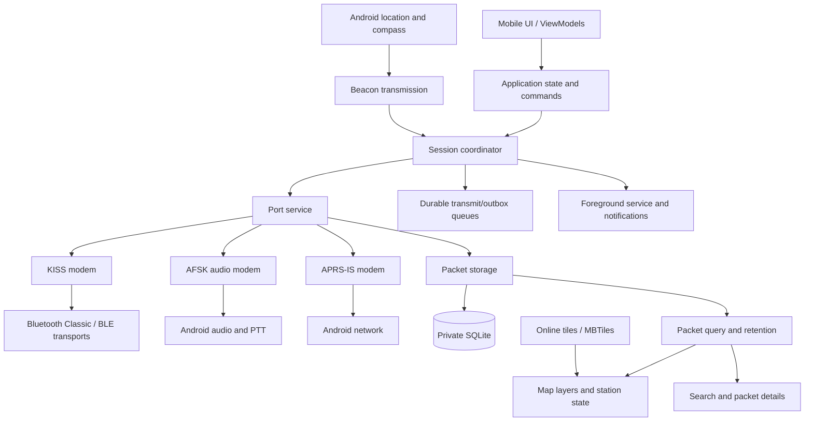

<!--
This file is part of AetherAprs
SPDX-FileCopyrightText: 2026 Rui Oliveira <ruimail24@gmail.com>
SPDX-License-Identifier: CC-BY-SA-4.0
-->

# AetherAprs production-grade design sheet

This is the product and engineering contract for taking AetherAprs from a working
Android APRS application to a general-availability field tool. It is deliberately
mobile-first. Desktop parity is outside the first release.

The first release serves operators who carry an Android phone into the field. It must
remain useful when Internet access is unavailable, connect to RF through Bluetooth
Classic, Bluetooth LE, or audio, and make position reporting and messaging dependable
enough for normal amateur-radio field work.

## Product outcome

An operator should be able to install the signed APK, configure a callsign and one
radio or APRS-IS port, download a map, and operate without reading a technical manual.
The app should show what is happening, recover from temporary failures, protect
credentials, and never transmit unexpectedly.

The product differentiators are:

- a fast field workflow for map, beacon, message, and station details;
- a complete offline mode with local maps, history, GPS, RF, and queued work;
- deep APRS controls for experienced operators without exposing unsafe defaults;
- transparent standards behavior, raw packet visibility, and data ownership;
- reliable Android lifecycle behavior while the screen is off or the app is backgrounded.

“Feature parity” means parity with the useful field workflows of APRSIS32, Xastir, and
APRSdroid. It does not mean copying their desktop layouts, every platform integration,
or every historical option. A feature is complete only when its behavior is documented,
tested against representative packets and hardware, observable in the UI, and safe
under reconnect, restart, and offline conditions.

## Decisions already made

| Area | Decision |
|---|---|
| First audience | Mobile field operators; emergency/public-service and power-user workflows are phase two |
| Android target | Android 13 and later |
| RF connections | Bluetooth Classic, Bluetooth LE, phone/Bluetooth audio APRS |
| Offline behavior | Full offline field mode |
| Identity | Local only; no mandatory account or cloud service |
| APRS-IS | Anonymous receive is allowed; a verified callsign passcode is required for transmit |
| History | 30 days by default, configurable |
| Maps | Documented online provider plus user-downloaded offline packages |
| Portability | No import/export or backup promise in GA |
| GA release | Signed APK distributed through GitHub Releases |
| GA blockers | Core position/messaging plus safe digipeating and gating |
| Product posture | Field UX, maximum power, offline operation, and interoperability all matter |
| Bluetooth Classic matrix | Generic paired Bluetooth SPP devices |
| Bluetooth LE matrix | LilyGO T-Echo Plus with compatible APRS firmware as the first named target |
| Audio matrix | Android audio routing only in phase one; handset and Bluetooth audio routes |
| Audio TX default | Enabled after setup; show route, level, and transmit state clearly |
| Beacon defaults | Sensible configurable defaults using the existing profile architecture |
| Stale beacon queue | Expire stale position beacons and show the expiry in history |
| APRS-IS servers | User-configured validated servers with sensible defaults |
| Online maps | OpenStreetMap-compatible provider with required attribution and policy compliance |
| Message retry | Three retries with a 15-minute default expiry |
| Local data clearing | Independent controls for packets, messages, and diagnostics |
| Background notification | Persistent “app is running” notification opens the app; message notifications are separate |
| GA field trial | Internal engineering/operator trial before public release |
| Audio route changes | Continue automatically after route changes, while showing the active route and level |
| APRS-IS security | Prefer TLS when supported; allow documented plaintext only for legacy servers |
| Beacon defaults | Walk: 5 minutes/100 m; Drive: 2 minutes/500 m; both remain configurable |
| First-class packet detail | Weather, telemetry, objects, and items |
| Hardware expansion | Prioritize generic compatible SPP/BLE protocol support |
| Operator profiles | One active callsign profile in GA |
| APRS-IS server setup | Ship a documented editable default server |
| Audio transmit control | VOX by default with manual override |
| App privacy | Rely on Android device protection; no additional app lock in GA |
| Remote telemetry | No remote crash or usage telemetry; use local redacted reports |
| Map downloads | Operator chooses network, charging, and storage safeguards |
| Emergency scope | General amateur-radio software; emergency/public-service workflows are phase two |
| Digipeating and gating | Included in GA, disabled by default, and deliberately enabled by the operator |

## Current baseline

The repository already contains useful production foundations:

- Android-first Avalonia UI 12 on .NET 10 with CommunityToolkit.Mvvm;
- APRS-IS and KISS/TCP support;
- Android Bluetooth Classic and BLE KISS adapters;
- AFSK modem, HDLC framing, audio input/output abstractions, and PTT abstraction;
- GPS location, compass, foreground service, notifications, and keep-alive abstractions;
- position beacon profiles, dynamic beaconing, messaging with ACK/retry/history, templates,
  bulletins, objects/items, packet history, search, packet details, station map layers,
  trails, offline MBTiles download, digipeating, and RF/APRS-IS gating;
- SQLite persistence behind `PacketStorageService` and `PacketQueryService`;
- English and Portuguese localization;
- unit tests across packet parsing, services, ViewModels, settings, and memory disposal.

The baseline is not yet evidence of GA readiness. Several platform services and modem
paths exist as abstractions, but field behavior still needs hardware validation,
reconnect testing, lifecycle testing, performance measurement, and release operations.
The current source also contains unfinished UI converters (`RssiFormatConverter`,
`PacketDisplayTimeRangeConverter`, `ThemeModeConverter`, `TypeNameToIsVisibleConverter`,
and `TileSourceTypeConverter`) that must be resolved before release.

The project currently declares Android API 33 as its minimum and requests location,
Bluetooth, foreground-service, wake-lock, notification, and audio permissions. Permission
requests must be justified in context and tested on clean installs, upgrades, denied
permissions, revoked permissions, and devices without the requested hardware.

The repository currently has no `.github` workflow or other visible release automation,
no explicit Android backup exclusion, and no documented encrypted secret store. Those
are release gaps, not optional polish. A private file path alone does not prove that
credentials are protected from device backup, inspection, or diagnostic collection.

## Capability matrix

| Capability | Current evidence | GA status |
|---|---|---|
| APRS-IS receive and filters | `AprsIsModem`, port configuration, filter builder | Validate reconnect, TLS/server policy, auth, and offline transition |
| APRS-IS transmit | `PortService`, packet factory, passcode helper | Blocker; enforce passcode policy and explicit TX state |
| KISS over TCP | `TcpKissStreamConnector`, `KissModem` | Validate long-running reconnect and malformed frames |
| Bluetooth Classic KISS | Android RFCOMM connector and device provider | Blocker; test device matrix, pairing, loss, and reconnect |
| Bluetooth LE KISS | Android GATT connector and scanner | Blocker; test characteristic profiles, MTU, write pacing, loss, and reconnect |
| Audio APRS | AFSK modem plus Android audio and PTT services | Blocker; test handset and Bluetooth routes, audio focus, VOX/PTT, and calibration |
| GPS and beaconing | location tracking and beacon transmission services | Blocker; validate background limits, stale fixes, battery, and duplicate prevention |
| Map and station display | Mapsui layers, clustering, trails, symbols | Blocker; measure large station sets and offline behavior |
| Offline maps | downloader and MBTiles source | Blocker; resumability, storage limits, attribution, and corruption handling |
| Messaging | conversations, ACK/REJ, retries, notifications | Blocker; queue offline, deduplicate, recover after restart, and show route/status |
| Packet storage | EF Core SQLite, migrations, raw frame/path storage | Blocker; retention, migration, corruption recovery, and bounded storage |
| Objects/items/bulletins | models, services, pages, packet factory | Objects/items are GA packet-detail/map requirements; bulletin authoring can remain phase two |
| Digipeating | configurable service and per-port allow flag | Blocker; duplicate cache, path safety, rate limits, and audit display |
| RF/APRS-IS gating | settings and service support | Blocker; loop prevention, allowlists, rate limits, and clear operator state |
| Telemetry/weather | packet models and persistence support exists | GA decoded detail and map visibility; historical graphing and alerts are phase two |
| Export/import/backup | no GA commitment | Phase two |
| Localization | English and Portuguese resources | GA; complete all new strings before feature acceptance |
| Crash and operational diagnostics | logging and global exception hooks exist | Blocker; add consented, actionable diagnostics and release monitoring |

## Reference feature coverage

The following matrix is the parity target. “Covered” means the workflow exists and
meets the acceptance criteria below, not merely that a class or screen exists.

| Field workflow | APRSIS32/Xastir/APRSdroid expectation | AetherAprs target |
|---|---|---|
| Setup | Callsign, symbol, comment, path, port, server, filter | Guided setup with safe defaults, validation, and a visible connection state |
| Live map | Stations, symbols, age, labels, trails, own position | Fast map with age/filter controls, clustering, trails, follow-me, and offline tiles |
| Receive | Raw and decoded packets, source path, port, timestamps | Searchable history with decoded detail and raw frame/path inspection |
| Transmit position | Manual and periodic beacons with profile controls | Walk/drive/custom profiles, GPS quality guard, queueing, preview, and TX history |
| Messaging | Compose, ACK/REJ, retries, conversations, notifications | Conversation UX with durable outbox, retry policy, duplicate suppression, and notifications |
| RF | TNC/audio connection and status | Bluetooth Classic/BLE/audio setup, calibration, reconnect, and diagnostics |
| Digipeater | Path handling, aliases, duplicate suppression | Explicit enablement, safe defaults, per-port policy, rate limits, and counters |
| Gateway | RF to IS and IS to RF with loop protection | Explicit direction switches, allowlists, rate limits, and audit entries |
| Offline | Local maps/history and intermittent connectivity | Full offline operation with durable queue and reconciliation |
| Expert controls | Filters, path, symbols, packet types, queries | Advanced screens behind clear explanations and validation |
| Operations | Long-running background behavior and recovery | Foreground service, notifications, wake policy, restart recovery, and diagnostics |

## Architecture target

Keep the existing boundaries and make background operation a first-class application
mode. The UI must observe state; it must not own radio loops, retention, retry logic,
or database access.

The session coordinator should own the application-wide lifecycle state:

- `Stopped`, `Starting`, `Running`, `Degraded`, `Stopping`, and `Faulted`;
- per-port state, last successful receive/transmit, retry schedule, and error reason;
- whether GPS is fresh enough for a position beacon;
- queued messages and beacons that are waiting for a usable route;
- whether digipeating or gating is enabled and currently healthy.

Every state transition should be observable in the UI, logged with structured fields,
and recoverable without force-closing the app. Use cancellation tokens and bounded
queues. A reconnect loop must use exponential backoff with jitter and stop on disposal.

The coordinator must not claim a port or foreground service is running merely because a
start request was issued. Platform start, notification publication, modem readiness, and
first successful I/O need separate states. This matters because Android can reject a
background foreground-service start while the current implementation catches the
exception and returns a completed task.

## Functional requirements

These are written in EARS form so they can become issues and tests.

### Setup and permissions

- When a new operator starts the app, the app shall guide them through callsign,
  SSID, symbol, comment, map source, and at least one connection option.
- When the operator configures identity, the app shall maintain one active callsign
  profile and shall make any future profile migration explicit.
- When the operator configures APRS-IS, the app shall provide a documented default
  server that remains editable with validated host, port, TLS, and filter settings.
- When a connection needs a permission, the app shall explain the purpose before asking
  and shall provide a recovery path when the permission is denied or later revoked.
- When a callsign or passcode is invalid, the app shall identify the invalid field and
  shall not start a transmitting session.
- Where an APRS-IS connection is receive-only, the app shall permit anonymous receive
  and shall disable transmit actions with an explanation.
- When a credential is stored, the app shall keep it in the private app data location
  using Android Keystore-backed encryption and shall never include it in logs,
  notifications, crash reports, backups, or exported text.
- When Android backup or device transfer is enabled, the app shall exclude credentials,
  message text, packet history, and diagnostic files unless the operator explicitly
  chooses a protected export in a future release.
- When an operator completes setup, the app shall explain that APRS transmissions are
  subject to the operator’s license, local regulations, and network etiquette.

### Connection and lifecycle

- When a configured port starts, the app shall show connecting, connected, degraded,
  and stopped states within one second of the state change.
- When a port loses its transport, the app shall preserve unsent work, notify the
  operator according to notification settings, and retry using bounded backoff.
- When Android backgrounds or recreates the activity, the app shall keep enabled
  background work alive through the foreground-service contract and restore state.
- When the operator stops a port, the app shall cancel reads, writes, timers, retries,
  audio, and location subscriptions before reporting the port stopped.
- When Android rejects or kills a foreground service, the app shall show the session as
  degraded or stopped, preserve queued work, and provide an operator action to resume.
- When a malformed frame or unsupported packet arrives, the app shall preserve the raw
  data where safe, record a reason, and continue processing later frames.
- When the device reboots or the app is upgraded, the app shall not silently resume
  transmission; the operator shall explicitly re-arm background operation.

### Position and maps

- When a fresh location is available and beaconing is enabled, the app shall construct
  the configured position format, symbol, comment, and path without blocking the UI.
- When a location is stale, unavailable, or below configured accuracy, the app shall
  explain why a beacon is delayed and shall not transmit a misleading position.
- When a beacon is queued offline, the app shall apply an explicit expiry policy and
  shall show whether the item was sent, expired, or discarded by the operator.
- When the map has many stations, the app shall cluster or otherwise bound rendered
  work while keeping the own station and selected station immediately visible.
- When an offline package is selected, the app shall use it without network access and
  shall report missing, corrupt, incomplete, or out-of-range tiles.
- When an operator downloads an offline map, the app shall apply the operator’s
  selected network, charging, and storage-quota safeguards and shall show estimated
  size before starting.

### Messaging

- When an operator sends a message, the app shall persist it before transmission and
  shall show queued, sending, acknowledged, rejected, expired, and failed states.
- When an ACK or REJ arrives on any active port, the app shall correlate it to the
  correct message and shall update the conversation exactly once.
- When the app restarts, it shall restore pending messages and continue only according
  to their expiry and retry policy.
- When the same message is received through multiple ports, the app shall deduplicate
  it while retaining enough route information for diagnostics.
- When a new message arrives in the background, the app shall post a notification that
  does not disclose message text unless the operator enabled previews.
- When the app runs in the background, the app shall continue eligible beaconing and
  ACK processing under the foreground-service contract and shall show a persistent
  “app is running” notification that opens the app.

### RF, digipeating, and gating

- When Bluetooth Classic or BLE is selected, the app shall show discovered and paired
  devices with transport-specific requirements before connecting.
- When BLE service, characteristic, MTU, notification, or write negotiation fails, the
  app shall identify the failed stage and offer retry without losing configuration.
- When audio APRS starts, the app shall show the selected input/output route, sample
  rate, audio level, PTT mode, and a receive/transmit test result. Audio transmit may
  be enabled after setup, but the current route and transmit state shall remain obvious.
- When audio is routed to a different Android device or profile, the app shall continue
  according to the selected policy but shall visibly update the route and level before
  the next transmission; the policy must be covered by an audio-route test.
- When audio APRS transmits without an external PTT device, the app shall use VOX by
  default and provide a clearly visible manual transmit override.
- When a transmit request is made, the app shall serialize access to the selected
  channel and shall not overlap audio/PTT operations.
- When digipeating is enabled, the app shall reject packets that fail path, duplicate,
  alias, rate, or loop-suppression rules and shall expose counters for each reason.
- When gating is enabled, the app shall enforce direction-specific allowlists, rate
  limits, duplicate suppression, and a clear audit trail before forwarding a packet.
- When the operator changes a safety-sensitive setting, the app shall show its effect,
  persist it atomically, and require the next session to use the new policy.
- When a beacon, message, digipeat, or gate is transmitted, the app shall show the
  selected route, port, and reason in local history without exposing credentials.
- Where digipeating or gating is available, the app shall keep both features disabled
  until the operator explicitly enables them and confirms the resulting network role.

### Storage and recovery

- When packet data exceeds the configured retention window, the app shall delete old
  records in bounded batches without blocking packet reception.
- When a migration or database open fails, the app shall preserve the original file,
  show a recovery action, and avoid silently creating an empty database.
- When storage is nearly full, the app shall warn the operator and reduce retention or
  queue growth according to an explicit policy.
- When the app receives an unknown packet family, it shall retain raw frame, source,
  path, port, and timestamp data where possible.
- When the operator clears data, the app shall independently clear packet history,
  message content, queued work, map packages, and diagnostics according to the
  selected action and shall report what was removed.

## Non-functional requirements

| Quality | GA target and evidence |
|---|---|
| Startup | Cold start to usable home screen in 3 seconds on a representative Android 13 device |
| UI responsiveness | No user-visible blocking on packet receive, map refresh, DB writes, or reconnect |
| Map performance | Maintain usable pan/zoom with 1,000 recent stations and bounded memory under a documented test dataset |
| Reliability | No unhandled exception in a 24-hour mixed receive/beacon session on each supported transport family |
| Recovery | Activity recreation, process restart, Bluetooth loss, network loss, audio route change, and permission revocation have tested recovery paths |
| Battery | Measure idle, receive-only, GPS beaconing, and audio receive modes; publish expected ranges before GA |
| Storage | Default 30-day retention has bounded growth under a documented packet-rate scenario |
| Security | Secrets stay private; logs are redacted; transport validation and input limits are tested |
| Secret storage | APRS-IS passcodes use Android Keystore-backed encryption; Android backup excludes secrets and operational data |
| Privacy | No analytics, crash uploads, or remote packet collection; privacy statement and data-flow inventory are published |
| Accessibility | Touch targets, contrast, dynamic text, screen reader labels, and landscape/portrait layouts are reviewed |
| Localization | English and Portuguese resources are complete; no user-facing key or fallback text remains |
| Protocol correctness | Golden vectors cover AX.25, KISS, APRS information fields, timestamps, paths, messages, ACK/REJ, and gating decisions |
| Observability | Every session and port failure has a local diagnostic event with timestamp, state, reason, and safe identifiers |
| Supportability | A redacted diagnostic report can be copied or shared by the operator without exporting packet/message history by default |
| Supply chain | Dependencies, licenses, vulnerability results, SBOM, and build provenance are recorded for each release |
| Release | Signed, reproducible-enough release build; upgrade tested from the previous public version; rollback instructions documented |

## Safety and failure policy

| Failure | User-visible behavior | System behavior |
|---|---|---|
| No location | “Beacon paused: location unavailable” | Do not send a stale position; retry when location becomes valid |
| No Internet | “Offline” with queued work count | Continue RF/local mode; queue eligible work with expiry |
| Bluetooth disconnected | Port degraded and reconnect action | Stop dependent modem cleanly; retry with backoff |
| Audio route changed | Show the new route and level | Follow the selected automatic-route policy and record the route used for TX |
| No TX credentials | Receive-only state | Disable transmit and gateway paths |
| Database unavailable | Recovery screen with diagnostic ID | Preserve source file; do not silently reset data |
| Queue full | Operator warning | Apply bounded discard/expiry policy and record it |
| Unsafe digipeat/gate config | Validation error before enable | Keep previous safe configuration active |
| Unsupported packet | Raw/unknown packet indicator | Continue pipeline and retain safe raw data |
| Permission revoked | Feature-specific blocked state | Stop affected service and offer Android settings path |

## Test and field evidence plan

Unit tests are necessary but insufficient. The release candidate must have evidence from
the following layers:

1. Protocol vectors: valid, malformed, boundary, escaped, duplicate, and unsupported
   packets for every supported packet family.
2. Service integration: packet receive/storage/query, message queue/retry, beacon
   scheduling, retention, digipeat/gate policy, and migration recovery.
3. Android hardware matrix: at least two Android 13+ phones, one Bluetooth Classic
   device, one BLE device, one phone audio route, and one Bluetooth audio route.
4. Lifecycle matrix: cold start, background, screen off, activity recreation, process
   death, airplane mode, network transition, Bluetooth loss, audio route change, and
   permission revocation.
5. Soak tests: 24-hour receive-only, beaconing, messaging, and mixed-port sessions,
   with memory, CPU, battery, queue, database, and reconnect measurements.
6. Field trials: real operators use the app on foot and in a vehicle with known-good
   radios, record failures, and attach raw diagnostics without exposing credentials.
7. UI and Android automation: exercise onboarding, permissions, background notification,
   map gestures, message composition, accessibility labels, dark/light themes, rotation,
   process death, and upgrade migration on representative API 33+ devices.
8. Security and release tests: inspect backup contents, verify Keystore recovery behavior,
   scan dependencies and APK contents, validate signing/upgrade identity, and test
   malformed input, log redaction, and notification privacy.

The test suite must make failures deterministic where possible by injecting clocks,
randomness, transports, location providers, audio routes, and storage. Avoid tests
that merely mirror implementation details.

## Acceptance criteria

These scenarios are the minimum release-gate examples. Each must become an automated
test where practical and a recorded device result where Android hardware is required.

| Given | When | Then |
|---|---|---|
| A clean Android 13+ install has no permissions and no configuration | The operator completes guided setup | The app explains each permission, validates identity, stores configuration, and reaches a usable home screen without transmitting |
| A receive-only APRS-IS port has no valid transmit passcode | The operator starts the port | Receive works, transmit and gateway actions are disabled, and the reason is visible |
| A transmitting APRS-IS port has a valid callsign/passcode | The operator enables beaconing | The app sends only after a fresh location and records the server, port, timestamp, and result |
| A Bluetooth port is connected and receiving | Android drops the Bluetooth link | The port becomes degraded, queued work is preserved, reconnect uses backoff, and recovery is visible |
| A message is composed while all routes are unavailable | The operator presses Send and later restarts the app | The message remains queued, expires after 15 minutes or reaches three retries, and has one terminal status |
| A message is received twice through different ports | Both copies are processed | One conversation entry is shown, while both route observations remain available diagnostically |
| A location is stale or below the configured accuracy | A beacon timer fires | No position is transmitted and the UI explains the pause |
| A map package is complete and the device is offline | The operator opens the map and selects a station | Tiles, station details, and local history work without network access |
| Android recreates the activity while ports and beaconing are active | The new activity is shown | The session coordinator retains correct state and the foreground notification opens the restored UI |
| Android rejects a foreground-service start | A background reconnect attempts to resume | The app does not claim that the session is running, preserves queues, and gives a resume action |
| Audio routing changes after setup | The next audio transmission occurs | The configured automatic-route policy is followed, the active route and level are visible, and the route is recorded |
| Digipeating or gating is enabled with a packet that violates policy | The packet reaches the forwarding policy engine | It is rejected with a reason, does not transmit, and increments the relevant counter |
| The app is upgraded with an existing database and credentials | The first launch completes | Migrations preserve valid data, credentials remain protected, and no transmission resumes without explicit re-arming |
| The operator requests a support report | The report is generated | It contains useful state and error context but excludes passcodes, message text, and packet history by default |
| The APK is installed from a clean signed release | Android verifies and upgrades it | The signature identity is valid, the version is shown correctly, and the release can be rolled back according to the documented policy |

## Repository-specific blocker register

These findings came from the current repository audit and should be converted into
tracked issues before implementation work is parallelized:

- [ ] Implement and test
  [`Converters/UI`](../../AetherAprs/Converters/UI) converters that currently throw
  `NotImplementedException`: RSSI, packet time range, theme mode, type visibility,
  and tile source type.
- [ ] Make
  [`AndroidForegroundService`](../../AetherAprs.Android/Services/Platform/AndroidForegroundService.cs)
  report actual platform start/readiness state instead of treating a rejected start as
  success.
- [ ] Replace the unconditional foreground-service wake lock with a measured,
  mode-specific policy and prove release on every stop/failure path.
- [ ] Add explicit Android backup rules and Keystore-backed secret storage; verify the
  generated APK and device-transfer behavior.
- [ ] Add CI and release automation. The repository currently has no visible `.github`
  workflow for build, test, licensing, dependency review, signing, or artifact checks.
- [ ] Replace critical startup `Debug.WriteLine` usage in the Android application path
  with structured logging and a user-facing recovery result.
- [ ] Add Android UI/instrumentation coverage; the existing suite is primarily core and
  ViewModel tests and cannot prove permissions, notifications, gestures, lifecycle, or
  real audio/Bluetooth behavior.
- [ ] Define and test the BLE profile contract for the LilyGO T-Echo Plus target rather
  than treating every BLE device as interchangeable.

## Delivery phases

### Phase 0 — product and release foundation

- Freeze the decisions in this document and turn each requirement into a tracked issue.
- Define supported hardware models, APRS-IS servers, map provider attribution, and
  representative Android test devices.
- Resolve unfinished converters and all placeholder UI behavior.
- Add a versioned diagnostics model, redaction rules, feature flags, and a release
  checklist.
- Define the secure-storage, Android-backup, privacy, licensing, RF-regulatory, and
  support policies; add a data-flow and permission inventory.
- Create CI for build, tests, REUSE, static analysis, dependency/license scanning, APK
  inspection, and release artifact checks.
- Establish golden packet vectors, transport fakes, a controllable clock, and a
  deterministic test database.

Exit: the app has no known placeholder behavior in supported flows, and every GA
blocker has an owner, test strategy, and measurable exit criterion.

### Phase 1 — dependable field session

- Implement the session coordinator and durable application state.
- Complete foreground-service behavior, notification actions, wake policy, and restart
  recovery for Android 13+.
- Replace unconditional wake-lock assumptions with measured, mode-specific power policy;
  define behavior after reboot, force-stop, app update, and battery optimization changes.
- Make port reconnect, cancellation, duplicate handling, and error reporting consistent.
- Add retention, storage pressure handling, migration backup/recovery, and queue bounds.
- Complete guided setup and safe transmit/receive state presentation.

Exit: a scripted 24-hour receive/beacon session survives lifecycle and transport faults
without data loss outside documented expiry policies.

### Phase 2 — RF and audio GA

- Validate Bluetooth Classic and BLE against the supported device matrix.
- Complete AFSK audio receive/transmit calibration, route selection, audio focus, PTT,
  VOX, and safety interlocks.
- Add an operator-facing RF diagnostics screen with packet counters and test controls.
- Add transport-specific documentation and a compatibility table.
- Validate the generic BLE profile contract and the LilyGO T-Echo Plus APRS firmware
  profile separately; “BLE compatible” must name required services and characteristics.

Exit: each supported transport family passes connection, receive, transmit, loss,
reconnect, background, and restart scenarios on real devices.

### Phase 3 — messaging, maps, and offline mode

- Make messages durable before send and recoverable after process death.
- Finish map clustering, selected-station details, trails, age filtering, follow-me,
  offline package validation, resumable downloads, storage limits, and attribution.
- Implement offline queue expiry and reconciliation for messages and eligible beacons.
- Validate packet history performance and 30-day retention under realistic load.
- Add independent data-clear actions and a redacted support report that excludes packet
  and message content unless explicitly selected.

Exit: a field operator can download a map, lose Internet, use RF/GPS/messages, restart
the app, and recover the expected local state.

### Phase 4 — digipeating, gating, and protocol hardening

- Review every path mutation against APRS conventions and test it with golden vectors.
- Add duplicate caches, alias rules, rate limits, loop prevention, allowlists, and audit
  counters for digipeating and both gating directions.
- Add an explicit safety review and a disabled-by-default migration path for existing
  configurations.
- Complete core position, messaging, queries, objects/items, status, weather, telemetry,
  third-party, and unknown packet handling to the agreed parity level.
- Review APRS-IS login/filter semantics, message-number persistence, timestamp formats,
  compressed and Mic-E positions, weather/telemetry decoding, and path mutation against
  a standards-reviewed interoperability corpus.

Exit: a field trial confirms forwarding behavior is predictable, bounded, observable,
and safe under duplicate and multi-port traffic.

### Phase 5 — GA hardening and release

- Complete accessibility, localization, privacy, permissions, and secure storage review.
- Run the full Android matrix, soak tests, migration tests, and release candidate field
  trial; fix all release-blocking defects.
- Run threat modeling, dependency/license review, APK backup inspection, signing-key
  verification, SBOM generation, and a clean-device upgrade/install test.
- Produce signed APK, checksums, release notes, known limitations, privacy statement,
  support instructions, and rollback instructions.
- Publish only after the GA checklist is signed by engineering and field-test owners.

Exit: the evidence package is complete and the signed GitHub release can be reproduced
and installed as an upgrade from the previous public version.

### Phase 6 — phase two

- Emergency/public-service workflows, tactical forms, team coordination, and audit
  exports.
- Telemetry/weather dashboards and alerting.
- Settings, packet, and database backup/import/export.
- Optional cloud sync with explicit privacy and security design.
- Google Play and F-Droid distribution after the release and policy work is planned.
- Additional Android versions, USB serial, richer PTT accessories, and new radio adapters.

## Architecture decisions

### ADR-001: Keep a mobile monolith with explicit domain boundaries

**Status:** Proposed for GA.

**Decision:** Keep the core application in the existing .NET/Avalonia solution. Isolate
protocols, domain services, storage, platform interfaces, and UI through the current
boundaries. Do not split the mobile app into network services.

**Reason:** The product is offline-first and hardware-connected. A local monolith
reduces operational dependencies and supports deterministic field recovery. Interfaces
keep platform implementations replaceable.

**Trade-off:** The codebase needs strict ownership, contract tests, and lifecycle
discipline as it grows.

### ADR-002: Use durable local queues for transmit work

**Status:** Proposed for GA.

**Decision:** Persist messages and other eligible transmit work before attempting a send.
Give every item an identity, route policy, expiry, retry count, and terminal outcome.

**Reason:** Process death, network loss, and RF loss are normal mobile conditions.
In-memory retries cannot provide field reliability.

**Trade-off:** Queue schema migrations and duplicate prevention become part of protocol
correctness.

### ADR-003: Treat RF forwarding as a policy engine

**Status:** Proposed for GA.

**Decision:** Digipeating and gating decisions pass through a pure, testable policy
engine before any transmission. The engine returns allow/deny plus a reason and
metadata for audit counters.

**Reason:** Forwarding errors can create loops, congestion, and accidental network
bridges. A policy result is easier to test and explain than scattered conditionals.

**Trade-off:** The policy model must stay aligned with APRS conventions and may require
expert review for unusual paths.

### ADR-004: Keep credentials local and logs redacted

**Status:** Accepted by product decision.

**Decision:** Store APRS-IS passcodes in private app storage and omit them from logs,
notifications, diagnostics, and future exports. No cloud account is required for GA.

**Reason:** The product is useful without a service account and the credential is
operator-sensitive.

**Trade-off:** Device migration and cloud backup are deferred to phase two.

## Design decisions to validate during implementation

The product questions are settled for planning. Implementation should still validate
the exact Android APIs, audio behavior, APRS-IS server compatibility, and generic BLE
profiles with tests and field hardware. A technical discovery can change an API choice
without changing the product decisions above; any change to product behavior belongs
in this sheet.

## Definition of done for GA

GA is complete only when all of the following are true:

- every GA capability in the matrix has a demonstrated workflow and documented limit;
- core position and messaging work through APRS-IS, Bluetooth KISS, and audio where
  applicable, including offline queueing and restart recovery;
- digipeating and gating are disabled by default, policy-tested, rate-limited, and
  observable when enabled;
- no known unfinished converter, placeholder action, unlocalized user-facing string,
  or silent error remains in a supported path;
- Android 13+ clean-install, upgrade, background, process-death, permission, storage,
  network, Bluetooth, and audio scenarios have evidence;
- 24-hour soak and field trials meet the stated reliability, performance, battery,
  storage, and recovery targets;
- credentials are protected, diagnostics are redacted, and privacy behavior is
  documented;
- signed APK, checksums, release notes, known limitations, support path, and rollback
  instructions are ready;
- engineering and field-test owners have signed the release checklist.

## Implementation checklist

- [ ] Convert the capability matrix into tracked issues with owners and milestones.
- [ ] Add the session coordinator and explicit lifecycle state model.
- [ ] Add durable transmit/outbox records, expiry, retry, and reconciliation.
- [ ] Finish Android foreground service and process-restart recovery.
- [ ] Complete Bluetooth Classic compatibility and reconnect tests.
- [ ] Complete BLE profile, MTU, notification, pacing, and reconnect tests.
- [ ] Complete audio route, calibration, AFSK, VOX/PTT, and audio-focus tests.
- [ ] Add packet/message/beacon/gateway diagnostics with redaction.
- [ ] Add Android Keystore-backed credential storage and explicit backup exclusions.
- [ ] Add independent data clearing and a redacted support diagnostic report.
- [ ] Add editable default APRS-IS server configuration and one-active-profile rules.
- [ ] Add database retention, storage pressure, migration backup, and recovery.
- [ ] Finish map performance, offline package validation, and attribution handling.
- [ ] Finish message notification and background action behavior.
- [ ] Implement and test digipeat/gate policy engine, duplicate cache, and rate limits.
- [ ] Resolve all unfinished converters and placeholder UI paths.
- [ ] Add golden protocol vectors and deterministic integration fixtures.
- [ ] Add UI/instrumentation tests for onboarding, permissions, notifications, navigation,
  accessibility, process death, and upgrade migration.
- [ ] Test English and Portuguese resources for every new user-facing string.
- [ ] Run accessibility review on supported Android sizes and orientations.
- [ ] Add CI, dependency/license scanning, APK inspection, SBOM, and signed artifact verification.
- [ ] Perform threat modeling and review RF regulatory, APRS network, OSM, and software licenses.
- [ ] Run the Android hardware matrix and 24-hour soak tests.
- [ ] Run field trials and document defects, mitigations, and known limitations.
- [ ] Produce signed GitHub APK, checksums, upgrade test, release notes, and rollback plan.
- [ ] Link the final evidence package from the release tag and this design sheet.
